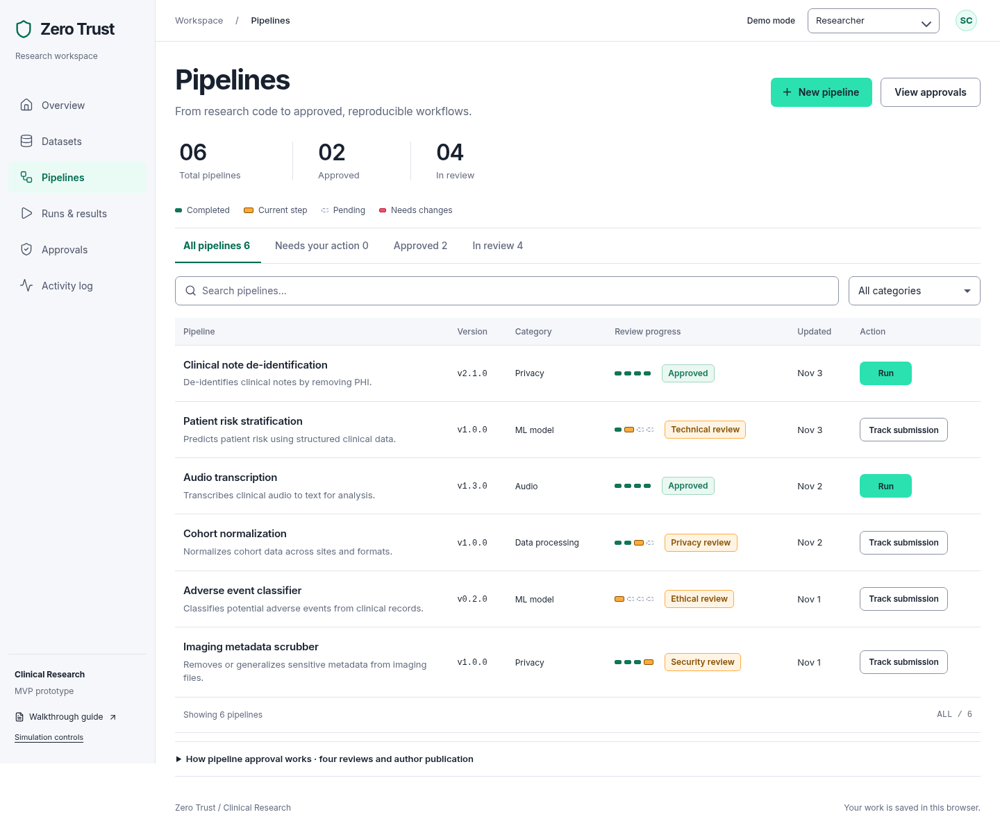
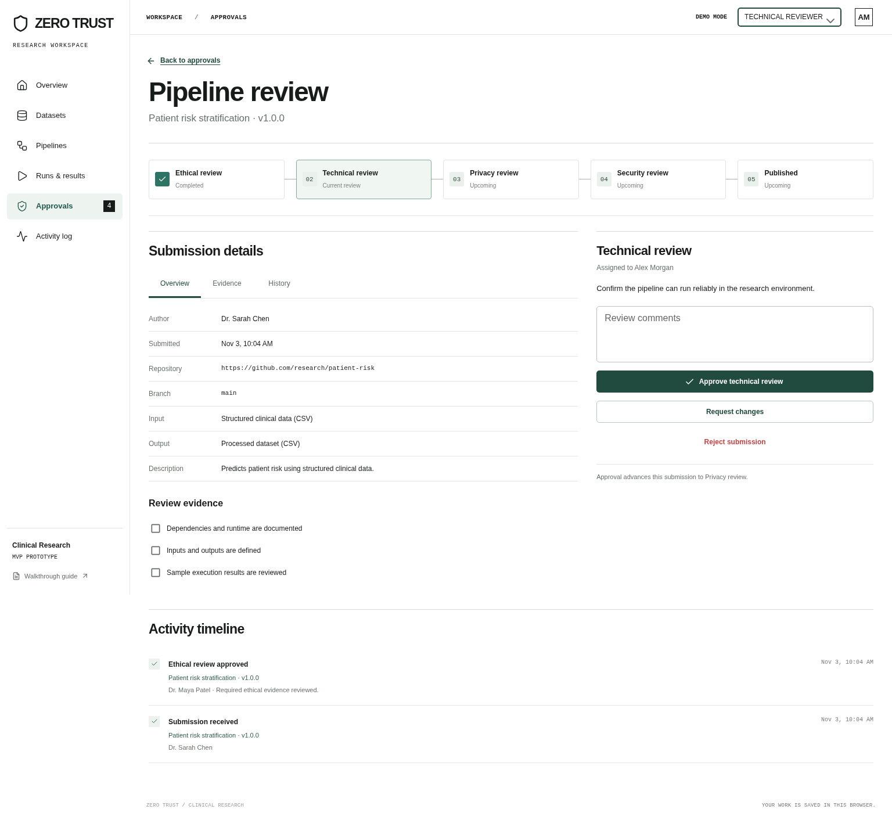

# Zero Trust — MVP prototype

An interactive research workspace for datasets, governed pipelines, mandatory multistage approval, simulated execution, and reviewed outputs. Built with React, TypeScript, MUI, and Lucide.

The current UI uses Stripe as a visual reference: self-hosted Inter, navy text, violet actions, light surfaces and restrained borders. This styling is always on. Phone/tablet layouts retain larger text and touch controls.

## Run locally

```sh
npm ci
npm run dev
```

Open **http://localhost:3000**. The MVP is the default view; `/?view=full` preserves the original full prototype.

## Try the workflow

1. Import a small CSV or choose the synthetic example.
2. Create a pipeline, define its inputs/outputs, and attach optional evidence.
3. Continue as each reviewer to complete **Ethical → Technical → Privacy → Security** reviews. The review workspace keeps evidence checks next to the decision. Try requesting changes or rejecting with a reason.
4. Switch back to Researcher and publish the approved submission.
5. Start a demo run, inspect its output, and switch to Privacy reviewer to validate it before downloading the sample CSV.

New versions and revisions repeat all four stages. Previous approved versions remain usable. The app also demonstrates drafts, support requests/resolution, cancellation/retry, evidence previews, log export, and activity-history export.

For a solo walkthrough, use the small **Simulation controls** link below the sidebar guide, or click **Demo mode** in the header. On phones, **Workspace options → Simulation controls** opens the same panel. Simulate one approval or all remaining reviews, publish as the author, finish waiting runs, or accept an output. Each required review is recorded separately; publication stays a distinct event. Run and artifact dialogs also expose the link. These shortcuts affect only the local prototype.

Reviewer queues default to **My tasks**. Authors see a submission receipt and next owner. Source settings, the full approval path and history expand on demand. Named drafts can be incomplete; revision drafts preserve the reviewed version until explicit resubmission. Output previews use synthetic fixtures for the declared contract, and downloads require either a deliberate Privacy reviewer decision or an explicitly simulated acceptance.

Phone and portrait-tablet layouts use **16px body/input text, 14px secondary labels, and 44px touch targets**. Lists and output samples become labelled cards, keeping their actions visible without sideways scrolling.

**Prototype boundary:** role switching and processing are local simulations. There is no production authentication, backend execution, PHI detection, or external support integration. Use synthetic data. Dataset file contents are not uploaded; metadata and column names, attached text evidence, and workflow decisions are saved in browser storage. Import sample rows are discarded when the dialog closes. Run setup checks format compatibility only; it does not verify field mappings.

## Saving and recovery

Tabs synchronize saved actions using the browser's Web Locks API. Independent changes are combined against the latest saved workspace. If another tab changes the pipeline you are editing, saving keeps your form open and explains the conflict. Copy your edits before reopening the latest version. Browsers without Web Locks use session-only changes, with a storage warning.

Unreadable saved data is never replaced automatically. The recovery screen pauses editing, lets you download the original bytes, and offers an explicit reset that first stores a browser recovery copy. If a save fails, changes remain in memory; a later successful save retains them. A concurrent save from another tab pauses editing and offers a download of your local copy before loading the saved workspace. Keep the download if browser storage is full or unavailable.

Closing an edited pipeline form offers **Save draft**, **Keep editing**, and **Discard changes**. The browser also warns before leaving a page with an unsaved form or unsaved workspace changes.

The original `/?view=full` workspace reads shared workflow records for reference; its dataset, pipeline, run and output interactions are local to the tab. The checked-in Firestore rules deny all client mutations of those collections, even for administrators. A trusted backend must implement authenticated ownership, stage-specific reviewer permissions, mandatory approval transitions and artifact validation before shared workflow writes can be enabled. The demo role selector is not an authorization source. Profile roles cannot be added, removed or changed by browser clients.

These rule changes are local source changes until deployed. Rule validation uses the Firebase grammar and structural write-denial checks; it does not replace emulator or deployed-environment authorization tests.

## Preview





## Validate

```sh
npm run lint
npm run build
npm run test:mvp
```

Browser tests use local Chromium. Set `CHROMIUM_PATH` if it is installed somewhere other than `/usr/bin/chromium`. Test output is kept outside the repository under `/tmp/zero-trust-mvp-test-results`.

## Documentation

- [High-level customer journey with screenshots](docs/mvp/customer-journey.md) · [Interactive journey](https://zero-trust-git-mvp-t-dotnets-projects.vercel.app/mvp-customer-journey.html) · [PDF](https://zero-trust-git-mvp-t-dotnets-projects.vercel.app/mvp-customer-journey.pdf)

- [MVP screen-by-screen flows and attached user stories](docs/mvp/screen-flows.md)
- [Clickable MVP wireframe atlas](https://zero-trust-git-mvp-t-dotnets-projects.vercel.app/mvp-flows.html) — connected screens, action destinations, conditions and recovery paths.

- [MVP walkthrough and implementation boundaries](docs/mvp/README.md)
- [MVP scope and rationale](docs/mvp-scope.md)
- [Post MVP product roadmap](docs/post-mvp-roadmap.md) · [Interactive roadmap](https://zero-trust-git-mvp-t-dotnets-projects.vercel.app/post-mvp-roadmap.html)
- [Personas, objectives, pains, and gains](docs/personas.md)
- [Full prototype features, settings, and diagrams](docs/README.md)

## Vercel deployment

The repository includes `vercel.json` for a static Vite deployment: install with `npm ci`, build with `npm run build`, and serve `dist` from the repository root. The `mvp` branch can be deployed as a preview without changing an existing project's production branch. The MVP opens at `/`; `/?view=full` opens the original workspace. The MVP needs no backend or API credentials. The local Express server and its `/api/health` endpoint are used for development and automated tests, not the hosted UI.
