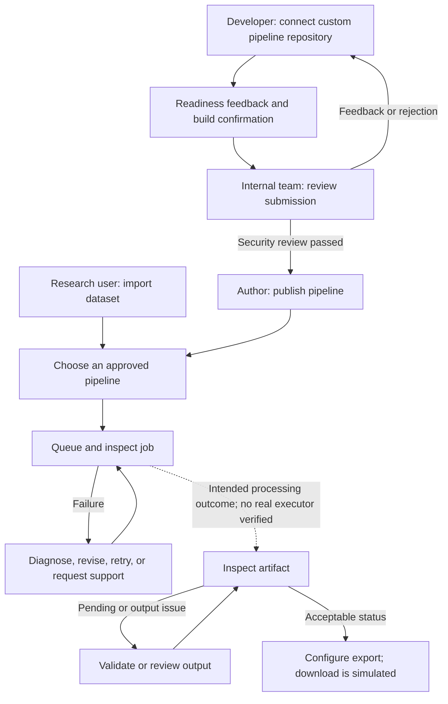

# Zero_trust: product and user-flow documentation

Reviewed against repository commit `b6be833`; documentation completed 2026-11-03. This is a source-code review, not an end-to-end production validation.

The product is a **research-data pipeline management prototype**. It connects datasets, processing pipelines, review decisions, jobs, and generated artifacts. Its intended value is to help research teams move from sensitive source data and custom algorithms to reviewed, usable outputs with clearer handoffs.

The repository calls the application **Ready Validator v5b** in [metadata.json](../metadata.json). The name `Zero_trust` alone does not establish a complete Zero Trust security implementation.

## Interactive MVP checkpoint

The [high-level customer journey](mvp/customer-journey.md) adds real screenshots and customer goals to the detailed screen atlas. [Open the screenshot walkthrough](https://zero-trust-git-mvp-t-dotnets-projects.vercel.app/mvp-customer-journey.html) or [download its PDF](https://zero-trust-git-mvp-t-dotnets-projects.vercel.app/mvp-customer-journey.pdf).

Use the current [MVP screen-by-screen reference](mvp/screen-flows.md) and [clickable wireframe atlas](https://zero-trust-git-mvp-t-dotnets-projects.vercel.app/mvp-flows.html) for the `mvp` checkpoint. Each screen has an attached user story, acceptance criteria and explicit click-to-next-screen connections.

The `mvp` branch now opens the [MVP prototype](mvp/README.md) by default. Start it with `npm run dev` on port 3000; `/?view=full` preserves the original full prototype. The original persona/feature/flow documentation below describes the full prototype at its reviewed source commit.

## Read these documents

| Document | What it answers |
| --- | --- |
| [Feature list — all features enabled](feature-list.md) | All 59 seeded features and the canonical E1 selection |
| [Personas, objectives, pains, and gains](personas.md) | Who uses the product, what they need, and which benefits are hypotheses |
| [MVP scope and rationale](mvp-scope.md) | Recommended launch scope, including mandatory multistage approval and acceptance requirements |
| [Post MVP product roadmap](post-mvp-roadmap.md) | Pilot release gates, prioritized enhancements, release sequencing, owners and success measures |
| [Settings and feature toggles](settings-and-feature-toggles.md) | Exact control names, initial values, feature IDs, dependencies, presets, and known exceptions |
| [User flows and diagrams](user-flows.md) | Step-by-step journeys with all capabilities ON, actor view selections, and feature associations |
| [Diagram sources and SVG exports](diagrams/README.md) | Ten editable diagrams, portable SVG copies, and regeneration instructions |

## Canonical scenario: all features enabled

All documented flows use [E1](feature-list.md#e1--canonical-all-features-enabled-configuration): every exposed capability switch is ON, including Quality Gates. Core features without a switch remain available. Actor modes still change between author and internal steps. This is a documentation assumption, not a change to code defaults or saved settings. Current implementation limits, including the strict wizard gate, remain visible.

## Evidence and interpretation

The [validation survey](../jj_user_validation_survey.md) explicitly names researchers, data scientists, and clinical data managers in a J&J user group. It establishes the intended validation audience; it does not demonstrate adoption, completed interviews, or customer results.

The documents use these distinctions:

| Term | Meaning |
| --- | --- |
| **Implemented UI** | A control, view, or state transition exists in the inspected code |
| **Simulated** | A mock response, timer, random outcome, or local state represents an operation |
| **Intended benefit** | An inferred pain or gain supported by product design, not validated user research |
| **Selected configuration** | The explicit setting values chosen to describe a journey; not a new saved preset or a claim about the current running session |
| **Initial value** | The React state initializer; authenticated settings or loaded configurations may replace it |

## Product workflow

[Open rendered SVG](diagrams/product-workflow.svg).

Text equivalent: researchers use approved pipelines; developers introduce new ones through readiness and review. After security review, the author publishes. Jobs and artifacts have separate inspection and recovery workflows. The dotted job-to-artifact connection is intended product behavior, not a verified backend execution path. Exact toggle selections appear in [each detailed flow](user-flows.md).

## Important boundaries

- **Personas are workflow roles, not verified permission groups.** Footer **Internal View** changes UI visibility. A separate `isReviewerView` changes navigation. Neither should be described as proof of role-based authorization.
- **Settings and Features usually share state.** A feature's Active switch generally writes the same boolean as Settings. Some mappings are incomplete; see the [toggle exceptions](settings-and-feature-toggles.md#exceptions-and-behavior-to-check).
- **Several operations are demonstrations.** Repository analysis, dry runs, build initiation, Jira interactions, and some job progression use mock data or local state. Artifact download confirmation displays a toast.
- **Persistence is mixed.** Firebase listeners and selected writes exist, but many handlers only update React state. Do not assume every review, rename, job retry, or support decision survives a reload.
- **Privacy and security indicators are not assurance.** A PHI warning, vulnerability count, readiness score, or “Secure Vault” label does not establish actual scanning, isolation, or regulatory compliance.

## Source map

| Source | What was used |
| --- | --- |
| [src/App.tsx](../src/App.tsx) | Actual labels, state initializers, settings handlers, feature mappings, flow handlers, navigation, persistence |
| [ReadinessResolutionSystem.tsx](../src/components/ReadinessResolutionSystem.tsx) | Readiness decisions, actions, acknowledgment, score, build-button conditions, preview chat |
| [USER_STORIES.md](../USER_STORIES.md) | Intended personas and acceptance criteria; older labels and lifecycle descriptions are checked against code |
| [FEATURE_LIST.md](../FEATURE_LIST.md) | Feature intent; not treated as proof that backend operations exist |
| [INTERNAL_VS_EXTERNAL_USERS.md](../INTERNAL_VS_EXTERNAL_USERS.md) | Intended internal/external distinction; current footer label is **Internal View** |
| [jj_user_validation_survey.md](../jj_user_validation_survey.md) | Intended research audience and questions awaiting validation |
| [firestore.rules](../firestore.rules), [security_spec.md](../security_spec.md) | Declared data-access rules and security intent; not a security certification |
| [server.ts](../server.ts) | Health route and app serving; does not implement a pipeline execution service |

## Maintaining these documents

When behavior changes, update the persona-to-flow mapping, the selected configurations, and the diagrams together. Check the actual Settings handlers and Features Active handler rather than copying feature titles alone. Mermaid diagrams are embedded in Markdown for compatible repository viewers; each has a prose equivalent for readers without diagram rendering.
