# Zero Trust MVP · High-level customer journey

From a research method and synthetic source data to a reviewed, accepted sample output.

[Screenshot journey](https://zero-trust-git-mvp-t-dotnets-projects.vercel.app/mvp-customer-journey.html) · [PDF](https://zero-trust-git-mvp-t-dotnets-projects.vercel.app/mvp-customer-journey.pdf) · [Detailed screen atlas](https://zero-trust-git-mvp-t-dotnets-projects.vercel.app/mvp-flows.html)

**Primary customer:** Researcher / method author.

**Customer objective:** Use a reviewed research method on an appropriate source, understand each handoff, and obtain an accepted result with traceable context.

**Trigger:** A researcher has a method to introduce and a dataset to process.

**Successful end state:** The method is published after four reviews; a completed demo run has a separately accepted output and its synthetic sample can be downloaded.

This is a source-backed journey of the implemented MVP, illustrated with fresh UI screenshots. Customer questions, pains and gains are hypotheses inferred from the workflow, not findings from interviews or measured customer outcomes.

Screenshots captured 2026-11-04 from source [`13ae9e5`](https://github.com/T-dotnet/Zero_trust/tree/13ae9e53dda4c8a2e7de6887540403cced27bc51); the last app change is [`b04e8a6`](https://github.com/T-dotnet/Zero_trust/tree/b04e8a6601d2867794b2611494caaef640a3f972/src/mvp). 16 unedited browser screenshots; the primary journey uses normal review/publication controls, not approval shortcuts.

## Journey at a glance

**Already have an approved method?** Select or import a dataset, then start at Configure & run (J05) with an existing Approved pipeline. Its existing version does not repeat pipeline review for each run; the newly generated output still needs the separate Privacy decision. A new or revised method/version requires the full review path.

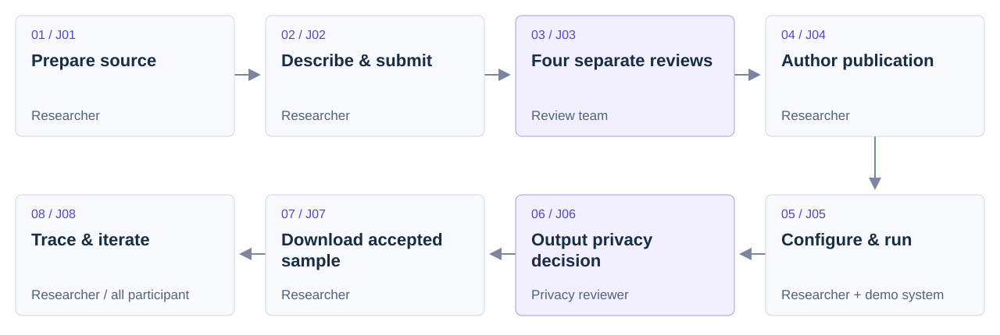

The top row reads left to right, then the bottom row reads right to left. The reviewer stages are separate team touchpoints; the researcher follows progress and responds when feedback is requested. Pipeline Privacy review and output Privacy validation are distinct decisions.

| Stage | Primary owner | Customer goal | Success signal |
| --- | --- | --- | --- |
| [J01 · Prepare the source data](#j01) | Researcher | Start with an identifiable, inspectable source. | The synthetic cohort appears in Datasets after import. |
| [J02 · Describe and submit the method](#j02) | Researcher | Give reviewers enough purpose, source and contract context. | The receipt says Submitted for review and identifies the Ethical reviewer as next owner. |
| [J03 · Complete organizational review](#j03) | Review team | Resolve all required organizational decisions. | After Security approval the status is Ready to publish; the method is still not published. |
| [J04 · Publish the reviewed version](#j04) | Researcher | Decide when the reviewed method becomes available to run. | Pipeline details say Ready for research and offer Configure run and Submit new version. |
| [J05 · Run the approved method](#j05) | Researcher + demo system | Pair the published version with a compatible source and follow execution. | Run status is Completed and Inspect output opens an artifact awaiting privacy validation. |
| [J06 · Validate the generated output](#j06) | Privacy reviewer | Assess this particular output before it becomes downloadable. | Acceptance changes the artifact to Validated; a rejection keeps download blocked. |
| [J07 · Retrieve the accepted sample](#j07) | Researcher | Obtain the accepted demonstration result. | The Download sample CSV action is enabled and the browser emits a CSV download. |
| [J08 · Trace decisions and improve the method](#j08) | Researcher / all participants | Understand the recorded decisions and choose the next iteration. | Filtered history exports as JSON; related entities reopen their current state. Iteration is available from the approved version. |

## Selected scenario and enabled features

| Setting / selection | Value |
| --- | --- |
| Feature selection | All included MVP capabilities are always on. There is no MVP feature-toggle setup. |
| Roles selected | Researcher → Ethical reviewer → Technical reviewer → Privacy reviewer → Security reviewer → Researcher → Privacy reviewer for output → Researcher. |
| Review policy | Every submitted pipeline/version requires all four separate reviews, followed by a separate Researcher publication. |
| Scenario | New Customer journey outcome classifier v1.0.0, synthetic CSV cohort, and one optional synthetic text-evidence attachment. |
| Simulation controls | Available for solo demos; not used for the captured main journey. Reviewer decisions and publication were exercised through their normal UI controls. |
| Capture viewports | 1440 × 1100 desktop; 390 × 844 mobile accepted-output example. |

## Journey with screenshots

<a id="j01"></a>

### J01 · Prepare the source data

**Owner:** Researcher. **Goal:** Start with an identifiable, inspectable source.

**Customer question (hypothesis):** “Can I explore this without uploading real research data?”

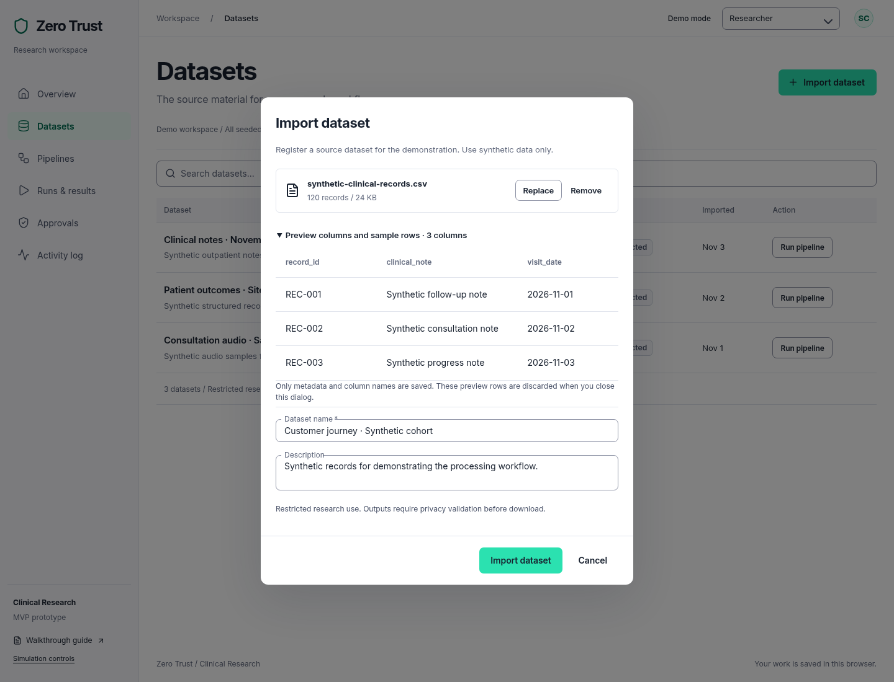

The import dialog shows the synthetic CSV, preview rows, dataset name and Import dataset action. The starting pipeline catalog is included as supporting context.

| Journey element | Description |
| --- | --- |
| Customer action | Open Datasets, choose Import dataset, use the synthetic example, inspect columns and sample rows, then import. |
| Team / system action | The browser validates the CSV shape and registers metadata and column names locally. |
| Handoff | Researcher retains ownership; the registered source can be selected later in Configure run. |
| Success signal | The synthetic cohort appears in Datasets after import. |
| Potential pain (hypothesis) | Unclear source identity or format could lead to choosing the wrong data. |
| Intended gain (hypothesis) | Preview and explicit metadata make the chosen source easier to recognize. |

**Prototype limit:** CSV shape validation is demonstrated; no dataset upload or enforced permission check occurs.

**Related story:** [US-S06](screen-flows.md#us-s06). **Screens:** [S04](screen-flows.md#s04), [S05](screen-flows.md#s05), [S06](screen-flows.md#s06), [S07](screen-flows.md#s07). [Follow the detailed flow](https://zero-trust-git-mvp-t-dotnets-projects.vercel.app/mvp-flows.html#screen=S04&journey=F02).

**Planned post MVP improvements:** [Guided pipeline and dataset setup (R2)](https://zero-trust-git-mvp-t-dotnets-projects.vercel.app/post-mvp-roadmap.html#feature-3) · [Institutional identity and a first data connector (R3 candidate; move blockers to G0)](https://zero-trust-git-mvp-t-dotnets-projects.vercel.app/post-mvp-roadmap.html#feature-6). These are proposed capabilities, not behavior shown in the screenshots.

<details>
<summary>Supporting screens and handoff evidence</summary>

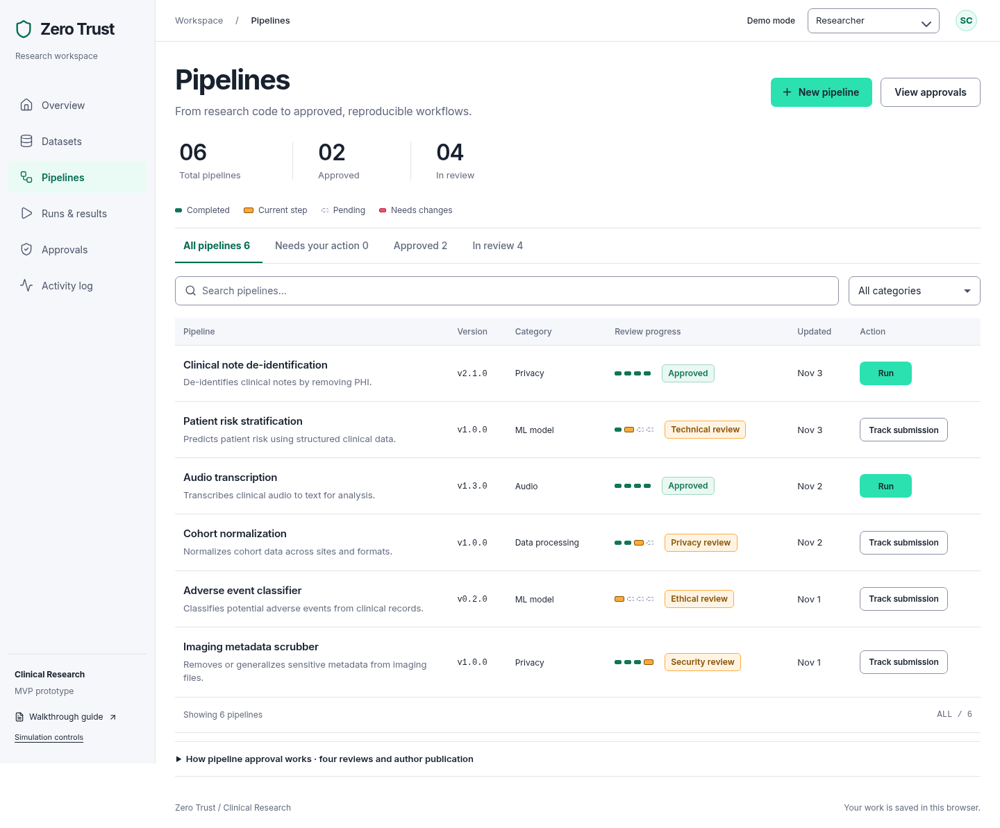

Initial pipeline catalog.

</details>

<a id="j02"></a>

### J02 · Describe and submit the method

**Owner:** Researcher. **Goal:** Give reviewers enough purpose, source and contract context.

**Customer question (hypothesis):** “What do reviewers need, and who owns the next step?”

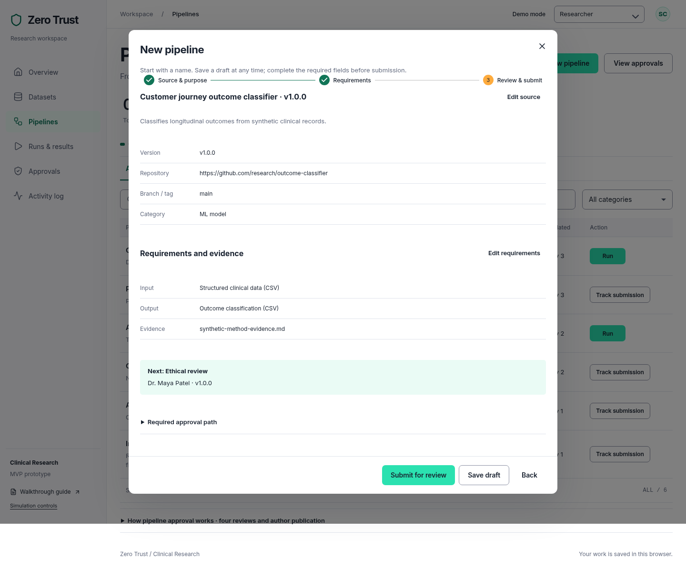

The final wizard summary exposes the research purpose, source, version, contracts and attached evidence before submission. The receipt shows the subsequent reviewer handoff.

| Journey element | Description |
| --- | --- |
| Customer action | Complete the three-step pipeline wizard, attach optional synthetic evidence, inspect the final summary and submit for review. Save a named draft when not ready. |
| Team / system action | Submission records the method/version and starts Ethical review. The author receives a status receipt and next owner. |
| Handoff | Researcher → Ethical reviewer. The author cannot approve the pending stage. |
| Success signal | The receipt says Submitted for review and identifies the Ethical reviewer as next owner. |
| Potential pain (hypothesis) | Scattered requirements and unclear handoffs could cause repeated follow-up. |
| Intended gain (hypothesis) | A structured submission and clear receipt provide a shared starting point. |

**Prototype limit:** The repository URL is descriptive metadata; the prototype does not fetch research code.

**Related story:** [US-S10](screen-flows.md#us-s10). **Screens:** [S08](screen-flows.md#s08), [S09](screen-flows.md#s09), [S10](screen-flows.md#s10), [S11](screen-flows.md#s11), [S13](screen-flows.md#s13). [Follow the detailed flow](https://zero-trust-git-mvp-t-dotnets-projects.vercel.app/mvp-flows.html#screen=S08&journey=F03).

**Planned post MVP improvements:** [Structured feedback and revision comparison (R1)](https://zero-trust-git-mvp-t-dotnets-projects.vercel.app/post-mvp-roadmap.html#feature-2) · [Guided pipeline and dataset setup (R2)](https://zero-trust-git-mvp-t-dotnets-projects.vercel.app/post-mvp-roadmap.html#feature-3) · [Readiness automation and AI assistance (Later; validate demand first)](https://zero-trust-git-mvp-t-dotnets-projects.vercel.app/post-mvp-roadmap.html#feature-10). These are proposed capabilities, not behavior shown in the screenshots.

<details>
<summary>Supporting screens and handoff evidence</summary>

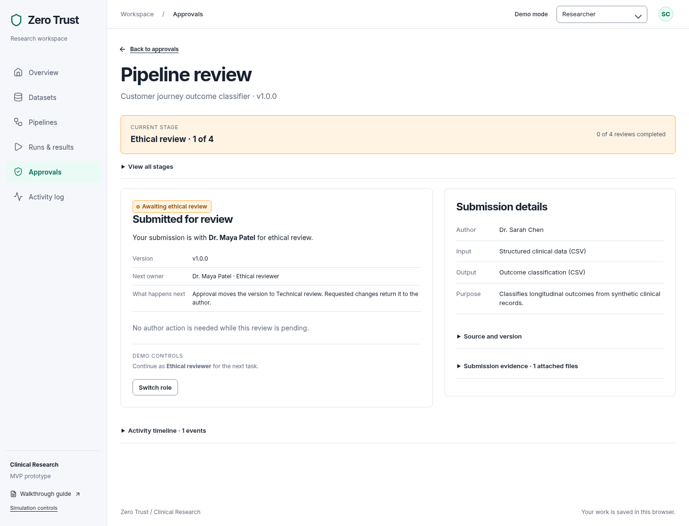

Submission receipt and next reviewer.

</details>

<a id="j03"></a>

### J03 · Complete organizational review

**Owner:** Review team. **Goal:** Resolve all required organizational decisions.

**Customer question (hypothesis):** “Which review is pending, and what would unblock it?”

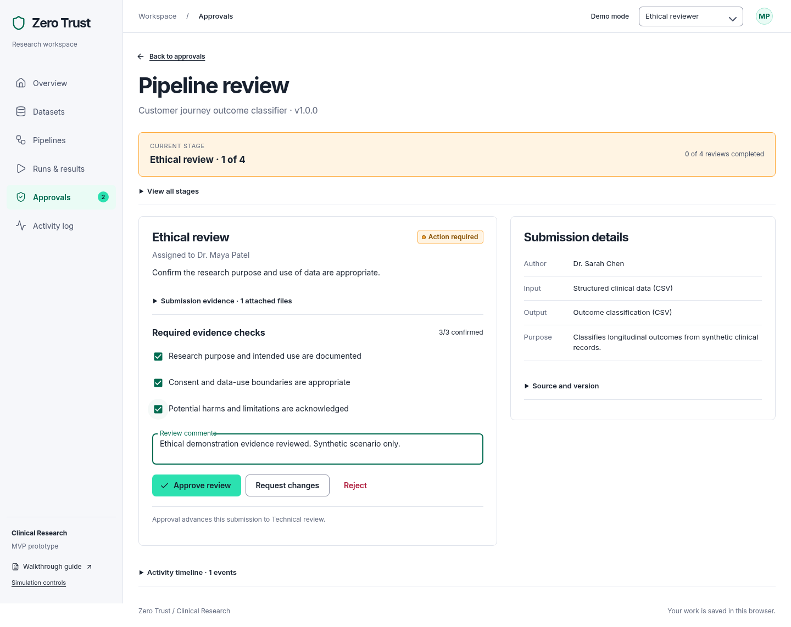

Four distinct reviewer screens show their stage-specific checklists. The captured run checked each criterion and used the normal approval action; it did not simulate approval.

| Journey element | Description |
| --- | --- |
| Customer action | Track the submission and next owner. If a reviewer requests changes or rejects it, read the reason, revise and resubmit. |
| Team / system action | Ethical, Technical, Privacy and Security reviewers each inspect their own evidence, confirm three criteria and make a distinct decision, in that order. |
| Handoff | Ethical → Technical → Privacy → Security → Researcher. In the demo, switch roles to act as each participant. |
| Success signal | After Security approval the status is Ready to publish; the method is still not published. |
| Potential pain (hypothesis) | An opaque queue or one generic approval could hide accountability and missing review stages. |
| Intended gain (hypothesis) | Separate stage criteria, named owners and decision history make each handoff explicit. |

**Prototype limit:** Reviewers confirm illustrative evidence. No automated ethics, runtime, privacy or security assessment is claimed.

**Related story:** [US-S14](screen-flows.md#us-s14) · [US-S15](screen-flows.md#us-s15) · [US-S16](screen-flows.md#us-s16) · [US-S17](screen-flows.md#us-s17). **Screens:** [S12](screen-flows.md#s12), [S13](screen-flows.md#s13), [S14](screen-flows.md#s14), [S15](screen-flows.md#s15), [S16](screen-flows.md#s16), [S17](screen-flows.md#s17), [S18](screen-flows.md#s18), [S19](screen-flows.md#s19), [S20](screen-flows.md#s20), [S21](screen-flows.md#s21). [Follow the detailed flow](https://zero-trust-git-mvp-t-dotnets-projects.vercel.app/mvp-flows.html#screen=S12&journey=F04).

**Planned post MVP improvements:** [Assigned work and notifications (R1)](https://zero-trust-git-mvp-t-dotnets-projects.vercel.app/post-mvp-roadmap.html#feature-1) · [Structured feedback and revision comparison (R1)](https://zero-trust-git-mvp-t-dotnets-projects.vercel.app/post-mvp-roadmap.html#feature-2). These are proposed capabilities, not behavior shown in the screenshots.

<details>
<summary>Supporting screens and handoff evidence</summary>

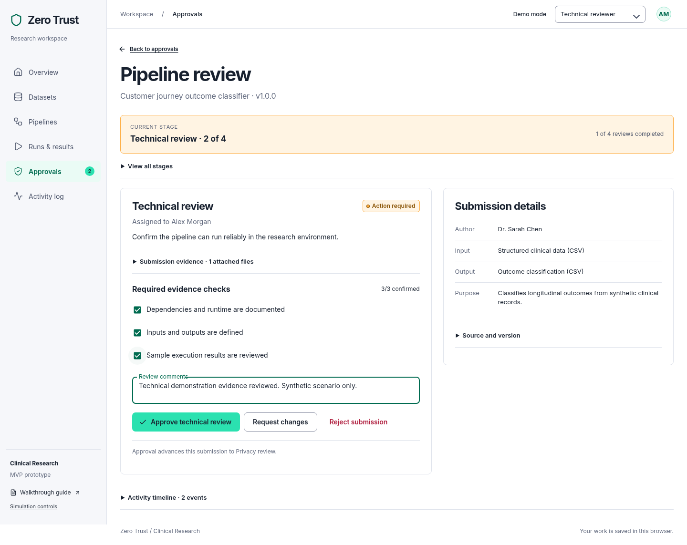

Technical reviewer confirms stage-specific criteria.


Privacy reviewer confirms stage-specific criteria.


Security reviewer confirms stage-specific criteria.

</details>

<a id="j04"></a>

### J04 · Publish the reviewed version

**Owner:** Researcher. **Goal:** Decide when the reviewed method becomes available to run.

**Customer question (hypothesis):** “Are all reviews complete, and is this the version I want to release?”

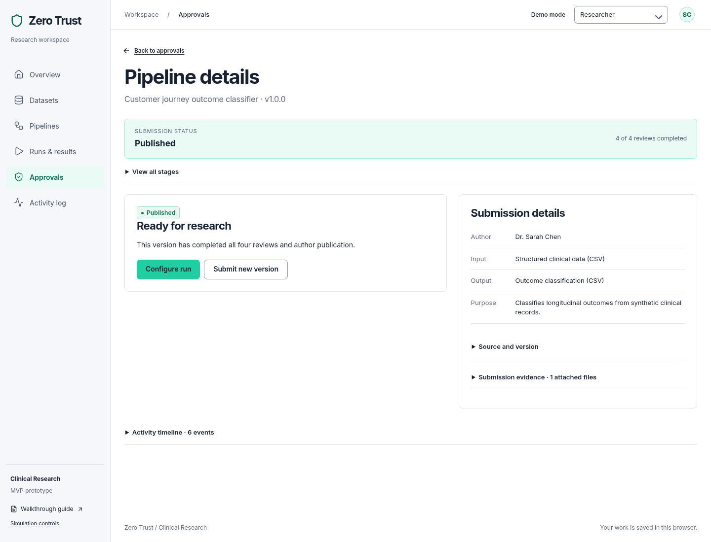

The published pipeline is ready for research. The supporting screen shows the previous Ready to publish state with a distinct Publish pipeline action.

| Journey element | Description |
| --- | --- |
| Customer action | Return to Researcher and choose Publish pipeline after all four reviews are complete. |
| Team / system action | Publication records its own event and changes the pipeline to Approved. |
| Handoff | Review team → Researcher; publication is a separate author decision. |
| Success signal | Pipeline details say Ready for research and offer Configure run and Submit new version. |
| Potential pain (hypothesis) | Review completion could be mistaken for release, making availability unclear. |
| Intended gain (hypothesis) | Explicit author publication separates assessment from making a version runnable. |

**Prototype limit:** Publication changes local prototype state; it does not deploy research code.

**Related story:** [US-S21](screen-flows.md#us-s21). **Screens:** [S21](screen-flows.md#s21), [S22](screen-flows.md#s22). [Follow the detailed flow](https://zero-trust-git-mvp-t-dotnets-projects.vercel.app/mvp-flows.html#screen=S21&journey=F04).

**Planned post MVP improvements:** [Structured feedback and revision comparison (R1)](https://zero-trust-git-mvp-t-dotnets-projects.vercel.app/post-mvp-roadmap.html#feature-2) · [Reproducible runs and lineage (R2)](https://zero-trust-git-mvp-t-dotnets-projects.vercel.app/post-mvp-roadmap.html#feature-4). These are proposed capabilities, not behavior shown in the screenshots.

<details>
<summary>Supporting screens and handoff evidence</summary>

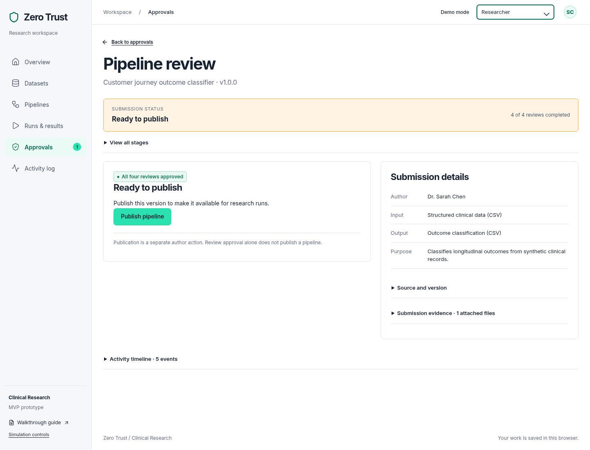

Four reviews complete; author publication still required.

</details>

<a id="j05"></a>

### J05 · Run the approved method

**Owner:** Researcher + demo system. **Goal:** Pair the published version with a compatible source and follow execution.

**Customer question (hypothesis):** “Does the source fit this method, and has the run actually finished?”

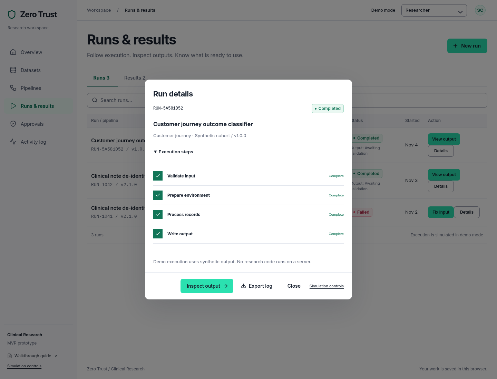

Completed run details retain method, dataset and version context and link to the output. The supporting Configure run screen shows the chosen pipeline, dataset and columns.

| Journey element | Description |
| --- | --- |
| Customer action | Configure a run with the approved pipeline and imported cohort. Inspect the declared input and dataset columns, start the demo, then open run details. |
| Team / system action | A local timer advances four labelled execution steps and produces a synthetic artifact marked Pending review. |
| Handoff | Researcher → simulated execution → Privacy reviewer for the output decision. |
| Success signal | Run status is Completed and Inspect output opens an artifact awaiting privacy validation. |
| Potential pain (hypothesis) | A format mismatch or an unexplained run state could make recovery difficult. |
| Intended gain (hypothesis) | Visible contracts and separate run/output statuses clarify what is complete and what remains. |

**Prototype limit:** The prototype checks format only, not schema mapping. No research code runs on a backend.

**Related story:** [US-S23](screen-flows.md#us-s23). **Screens:** [S23](screen-flows.md#s23), [S24](screen-flows.md#s24), [S25](screen-flows.md#s25), [S26](screen-flows.md#s26). [Follow the detailed flow](https://zero-trust-git-mvp-t-dotnets-projects.vercel.app/mvp-flows.html#screen=S23&journey=F07).

**Planned post MVP improvements:** [Guided pipeline and dataset setup (R2)](https://zero-trust-git-mvp-t-dotnets-projects.vercel.app/post-mvp-roadmap.html#feature-3) · [Reproducible runs and lineage (R2)](https://zero-trust-git-mvp-t-dotnets-projects.vercel.app/post-mvp-roadmap.html#feature-4) · [Operational and resource controls (R3 candidate)](https://zero-trust-git-mvp-t-dotnets-projects.vercel.app/post-mvp-roadmap.html#feature-5) · [Scheduled and batch processing (Later)](https://zero-trust-git-mvp-t-dotnets-projects.vercel.app/post-mvp-roadmap.html#feature-9). These are proposed capabilities, not behavior shown in the screenshots.

<details>
<summary>Supporting screens and handoff evidence</summary>

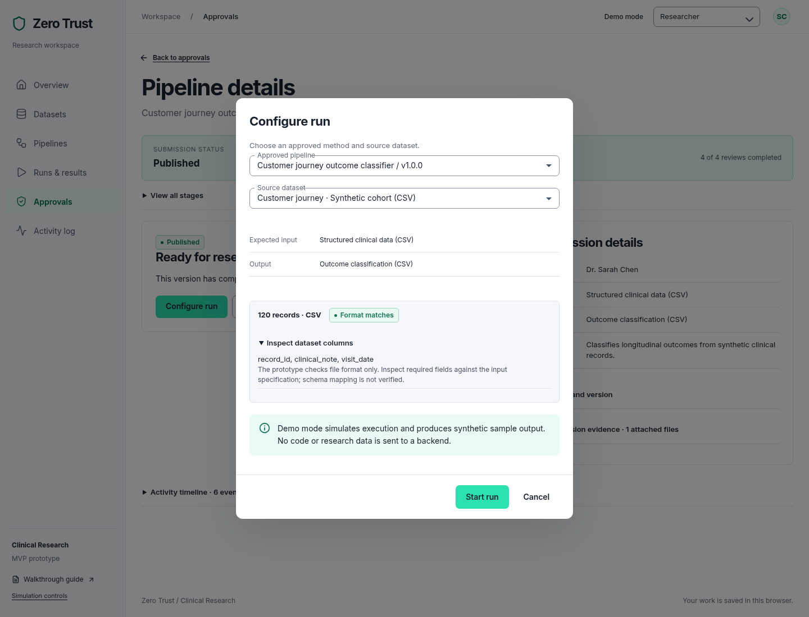

Pair published method with the imported source.

</details>

<a id="j06"></a>

### J06 · Validate the generated output

**Owner:** Privacy reviewer. **Goal:** Assess this particular output before it becomes downloadable.

**Customer question (hypothesis):** “Does approving the method also mean its output is acceptable?”

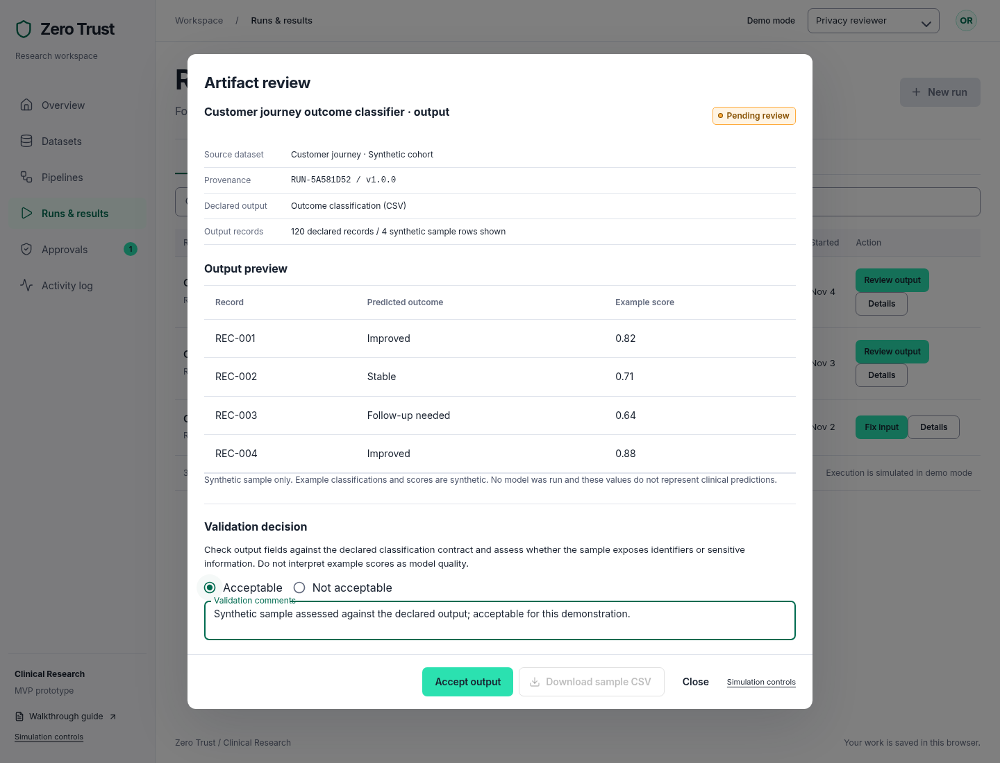

The output review shows synthetic rows, provenance, a deliberately selected Acceptable option, validation comments and Accept output. The capture also verified download was blocked before acceptance.

| Journey element | Description |
| --- | --- |
| Customer action | Inspect the synthetic output preview and provenance. In the demo, use Continue as Privacy reviewer to perform the output handoff. |
| Team / system action | The Privacy reviewer deliberately chooses Acceptable or Not acceptable and submits the decision. Rejection requires an explanation. |
| Handoff | Researcher → Privacy reviewer → Researcher after acceptance. This is separate from the pipeline Privacy review. |
| Success signal | Acceptance changes the artifact to Validated; a rejection keeps download blocked. |
| Potential pain (hypothesis) | A generated output could be mistaken for an already validated one. |
| Intended gain (hypothesis) | A distinct output decision and receipt make download eligibility understandable. |

**Prototype limit:** The output preview is a fixture for demonstration, not a PHI scan or a computation over imported source records.

**Related story:** [US-S34](screen-flows.md#us-s34). **Screens:** [S32](screen-flows.md#s32), [S33](screen-flows.md#s33), [S34](screen-flows.md#s34), [S35](screen-flows.md#s35), [S36](screen-flows.md#s36). [Follow the detailed flow](https://zero-trust-git-mvp-t-dotnets-projects.vercel.app/mvp-flows.html#screen=S32&journey=F09).

**Planned post MVP improvements:** [Output quality and disclosure review tools (R3 candidate)](https://zero-trust-git-mvp-t-dotnets-projects.vercel.app/post-mvp-roadmap.html#feature-7). These are proposed capabilities, not behavior shown in the screenshots.

<a id="j07"></a>

### J07 · Retrieve the accepted sample

**Owner:** Researcher. **Goal:** Obtain the accepted demonstration result.

**Customer question (hypothesis):** “What am I downloading, and why is it available now?”

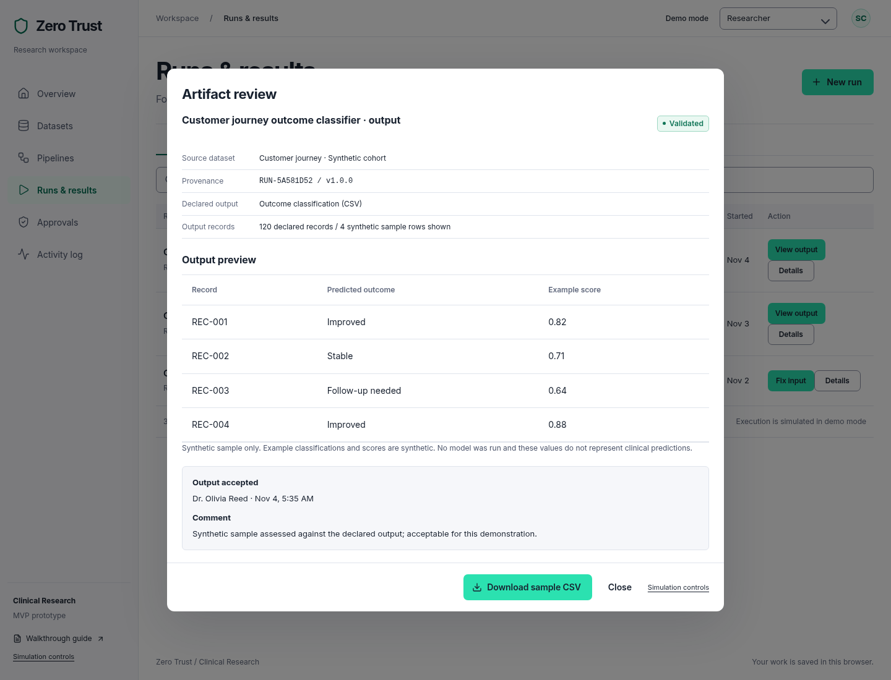

The researcher sees Output accepted and the enabled sample-download action. A supporting phone capture shows the same accepted artifact with full-width mobile CTAs. The capture run exercised and checked the CSV download.

| Journey element | Description |
| --- | --- |
| Customer action | Return to Researcher, reopen the accepted output, read the validation receipt and choose Download sample CSV. |
| Team / system action | The browser downloads the small synthetic preview fixture; the artifact remains Validated. |
| Handoff | The researcher obtains a local file and keeps the run/version/decision context in the prototype. |
| Success signal | The Download sample CSV action is enabled and the browser emits a CSV download. |
| Potential pain (hypothesis) | Unclear output labels could imply a full processed result when only a sample exists. |
| Intended gain (hypothesis) | The sample label and acceptance receipt set the right expectation for this prototype. |

**Prototype limit:** The downloaded file is a synthetic sample, not the declared full-record-count output.

**Related story:** [US-S35](screen-flows.md#us-s35). **Screens:** [S35](screen-flows.md#s35). [Follow the detailed flow](https://zero-trust-git-mvp-t-dotnets-projects.vercel.app/mvp-flows.html#screen=S35&journey=F09).

**Planned post MVP improvements:** [Reproducible runs and lineage (R2)](https://zero-trust-git-mvp-t-dotnets-projects.vercel.app/post-mvp-roadmap.html#feature-4) · [Output quality and disclosure review tools (R3 candidate)](https://zero-trust-git-mvp-t-dotnets-projects.vercel.app/post-mvp-roadmap.html#feature-7). These are proposed capabilities, not behavior shown in the screenshots.

<details>
<summary>Supporting screens and handoff evidence</summary>

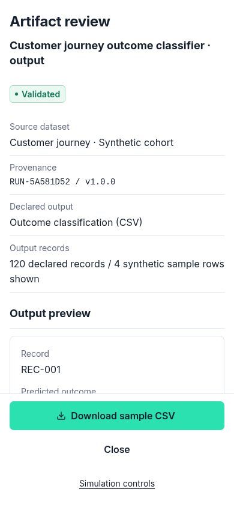

Accepted output on mobile with full-width primary action.

</details>

<a id="j08"></a>

### J08 · Trace decisions and improve the method

**Owner:** Researcher / all participants. **Goal:** Understand the recorded decisions and choose the next iteration.

**Customer question (hypothesis):** “Which version and decisions led to this output, and how do I continue?”

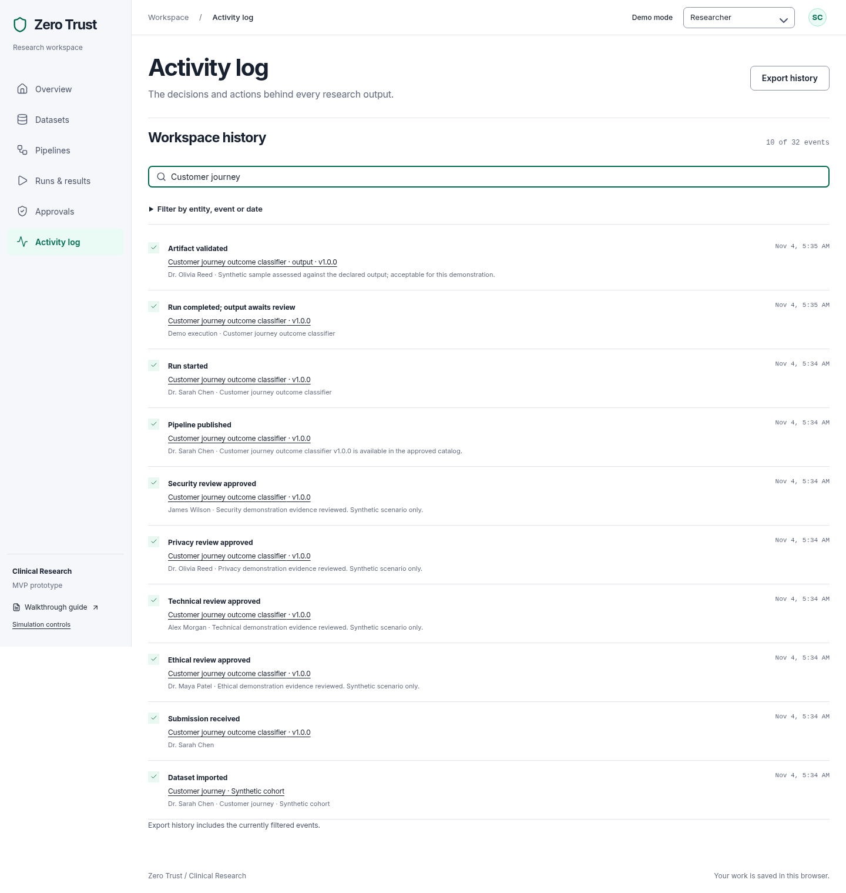

The activity history is filtered to the captured customer-journey scenario and shows its decision trail. The capture run verified a filtered JSON export. New-version creation is documented in the linked F06 flow, not separately executed in this screenshot run.

| Journey element | Description |
| --- | --- |
| Customer action | Open Activity log, search/filter the relevant work, export its history or reopen an entity. To improve the method, open the published pipeline and choose Submit new version. |
| Team / system action | History shows recorded actors, versions, review decisions, publication and execution/output events. A new version starts all four reviews again while the earlier approved version stays runnable. |
| Handoff | Any participant can inspect history. A new-version journey returns ownership to the researcher and then the review team. |
| Success signal | Filtered history exports as JSON; related entities reopen their current state. Iteration is available from the approved version. |
| Potential pain (hypothesis) | Context scattered across versions and handoffs could make it hard to explain how an output was reached. |
| Intended gain (hypothesis) | Linked lifecycle history and explicit versioning provide a readable record and a route to the next cycle. |

**Prototype limit:** Local history is not immutable or shared audit infrastructure. Downloading the sample does not add an activity event.

**Related story:** [US-S37](screen-flows.md#us-s37). **Screens:** [S37](screen-flows.md#s37), [S22](screen-flows.md#s22), [S08](screen-flows.md#s08). [Follow the detailed flow](https://zero-trust-git-mvp-t-dotnets-projects.vercel.app/mvp-flows.html#screen=S37&journey=F10).

[Submit a new version · F06](https://zero-trust-git-mvp-t-dotnets-projects.vercel.app/mvp-flows.html#screen=S22&journey=F06)

**Planned post MVP improvements:** [Structured feedback and revision comparison (R1)](https://zero-trust-git-mvp-t-dotnets-projects.vercel.app/post-mvp-roadmap.html#feature-2) · [Reproducible runs and lineage (R2)](https://zero-trust-git-mvp-t-dotnets-projects.vercel.app/post-mvp-roadmap.html#feature-4) · [Catalog discovery and personal views (R2 stretch or R3; do not displace ranks 3–4)](https://zero-trust-git-mvp-t-dotnets-projects.vercel.app/post-mvp-roadmap.html#feature-8). These are proposed capabilities, not behavior shown in the screenshots.

## When the journey stalls

These are alternative paths supported by the existing MVP. They were not all exercised in the screenshot capture; use the detailed flow reference for their full steps.

| Situation | Customer recovery | Detailed flow |
| --- | --- | --- |
| **Not ready to submit:** Source, contracts or evidence still need work. | Save a named draft, then reopen Edit & submit draft. Incomplete drafts are allowed; submission still requires all required fields. | [F03](https://zero-trust-git-mvp-t-dotnets-projects.vercel.app/mvp-flows.html#screen=S08&journey=F03) |
| **Reviewer asks for changes or rejects:** A stage cannot approve the current submission. | Researcher reads the required reason and revises. Saving a revision draft preserves the reviewed state; explicit resubmission creates the next patch version and restarts all four stages. | [F05](https://zero-trust-git-mvp-t-dotnets-projects.vercel.app/mvp-flows.html#screen=S19&journey=F05) |
| **Run fails or is cancelled:** Use the seeded Failed run, or cancel an active demo run. | Open Run details, retry with the example mapping or restart. A local support request can be resolved by the Technical reviewer. Resolving support alone does not complete the run. | [F08](https://zero-trust-git-mvp-t-dotnets-projects.vercel.app/mvp-flows.html#screen=S27&journey=F08) |
| **Output is not acceptable:** Privacy reviewer rejects a specific artifact. | Download stays blocked. Read the reason, investigate and start a new run to produce a fresh output for review; there is no direct decision-overturn action. | [F09](https://zero-trust-git-mvp-t-dotnets-projects.vercel.app/mvp-flows.html#screen=S36&journey=F09) |
| **The solo walkthrough is waiting:** A review, publication, timer or output decision prevents continuing alone. | Use the quiet Simulation controls link. Simulate one/all reviews, separately simulate author publication, finish running demos or accept a pending output. Draft/revision submission rules still apply. | [F11](https://zero-trust-git-mvp-t-dotnets-projects.vercel.app/mvp-flows.html#screen=S38&journey=F11) |

## What the screenshot run verified

- Fresh workspace → synthetic dataset import → method submission with local evidence → normal Ethical, Technical, Privacy and Security decisions → separate author publication.
- Compatible demo run → Completed → distinct Privacy output decision → Researcher sample CSV download (4 synthetic sample rows; not the full declared output).
- Filtered activity export (10 matching events) and the accepted-output mobile layout.
- No page/runtime or console errors were recorded during this capture.

## Prototype boundaries

- The prototype uses local browser state and demo role switching. It does not provide real authentication, enforced access control or organizational approval routing.
- Dataset imports save metadata and column names. File contents are not uploaded; temporary import preview rows are discarded when the import dialog closes. Attached text evidence is retained locally.
- The repository URL is recorded without fetching or analyzing code. Review checklists are human demonstration confirmations, not scanner findings.
- Execution is simulated and output rows are synthetic fixtures. Format matching does not verify schema mapping. The CSV download contains the small synthetic sample, not a full processed dataset.
- Activity and support records are local demonstrations, not an immutable audit service or external help desk. CSV downloads themselves are not recorded as activity events.

## Maintain the journey

Content: `docs/mvp/customer-journey.json`. Screenshot evidence and checks: [`public/mvp-customer-journey/capture.json`](../../public/mvp-customer-journey/capture.json). The screenshot files are the direct browser captures; they are not mockups or image-generated UI.

```sh
npm run dev                        # leave running in another terminal
npm run docs:mvp:journey:capture    # recapture fresh synthetic scenario
npm run docs:mvp                    # build atlas + customer journey
npm run docs:mvp:journey:pdf        # export printable journey
```

Capture uses the installed Chromium (`CHROMIUM_PATH` can override its path) and Playwright. `MVP_CAPTURE_URL` can point at a local test host. The generator validates screenshot presence/dimensions, screen/story/flow links and capture checks. The PDF is a generated delivery artifact, not a separate content source.

## Post MVP roadmap

Proposed improvements are grouped by priority, dependencies and release criteria. They are not implemented screens or committed delivery dates. All four pipeline reviews and separate author publication remain required.

[Read the full product roadmap](../post-mvp-roadmap.md) · [Open the published roadmap](https://zero-trust-git-mvp-t-dotnets-projects.vercel.app/post-mvp-roadmap.html)

| Release group | Outcome |
| --- | --- |
| G0 Pilot readiness | An authorized user completes one real, traceable workflow |
| R1 Review coordination | Authors and reviewers know who acts next and what needs to change |
| R2 Reproducible self-service | Researchers configure compatible inputs and repeat work without engineering help |
| R3 Institutional adoption | Teams can operate the product within their institution's access, support and resource policies |
| Later | Broader workloads become economical to support |

| Current journey | Planned improvements |
| --- | --- |
| J01 · Prepare the source data | 3. Guided pipeline and dataset setup (R2); 6. Institutional identity and a first data connector (R3 candidate; move blockers to G0) |
| J02 · Describe and submit the method | 2. Structured feedback and revision comparison (R1); 3. Guided pipeline and dataset setup (R2); 10. Readiness automation and AI assistance (Later; validate demand first) |
| J03 · Complete organizational review | 1. Assigned work and notifications (R1); 2. Structured feedback and revision comparison (R1) |
| J04 · Publish the reviewed version | 2. Structured feedback and revision comparison (R1); 4. Reproducible runs and lineage (R2) |
| J05 · Run the approved method | 3. Guided pipeline and dataset setup (R2); 4. Reproducible runs and lineage (R2); 5. Operational and resource controls (R3 candidate); 9. Scheduled and batch processing (Later) |
| J06 · Validate the generated output | 7. Output quality and disclosure review tools (R3 candidate) |
| J07 · Retrieve the accepted sample | 4. Reproducible runs and lineage (R2); 7. Output quality and disclosure review tools (R3 candidate) |
| J08 · Trace decisions and improve the method | 2. Structured feedback and revision comparison (R1); 4. Reproducible runs and lineage (R2); 8. Catalog discovery and personal views (R2 stretch or R3; do not displace ranks 3–4) |

Mappings: [roadmap links](roadmap-links.json). Scope and release gates: [canonical roadmap](../post-mvp-roadmap.md).
