# Zero Trust MVP · Screen & flow atlas

Reviewed 2026-11-04 against MVP source [`b453c2b`](https://github.com/T-dotnet/Zero_trust/tree/b453c2b391ad42854113f4146276275b22ee37d2/src/mvp).

[Open the clickable wireframes](https://zero-trust-git-mvp-t-dotnets-projects.vercel.app/mvp-flows.html) · [Download / open local HTML](../../public/mvp-flows.html) · [Canonical flow model](user-flows.json)

43 screen states · 13 connected journeys · 223 action/transition entries · 43 attached user stories.

Current mvp checkpoint only. All included MVP capabilities are always on. The archived /?view=full workspace is outside this atlas.

High-level companion: [Customer journey with real screenshots](customer-journey.md).

## How to read the wires

A box is a page, dialog, step or meaningful state of an existing screen. Click a box in the interactive document to see its wireframe, actions and story. Wireframe action buttons navigate the documentation, not the live app. Diagrams show curated journey paths; the action tables below are the complete transition inventory. A wire may combine approval and a labelled role handoff; the intermediate waiting state is explicitly documented. “Same screen” covers filtering, validation, download, disclosure and simulation events. “Originating page” depends on where a dialog was opened.

Wireframes are schematic representations of the implemented controls, not pixel-exact screenshots or proposed new screens. Story acceptance criteria describe current prototype behavior; they do not claim production security guarantees.

## Personas

Personas, pains and gains are inferred from the implemented workflow; they are not validated interview findings.

| Persona | Objective | Pain | Gain |
| --- | --- | --- | --- |
| Researcher | Register data and describe, revise, publish and run a reviewed research method. | Unclear submission requirements, handoffs and usable output status. | A visible path from a named draft to a traceable, accepted output. |
| Ethical reviewer | Assess intended use, consent boundaries, harms and limitations. | Research context and evidence are scattered. | Purpose and evidence appear beside an explicit stage decision. |
| Technical reviewer | Assess runtime and input/output evidence; resolve local run-support requests. | Incomplete contracts and failures with little context. | A dedicated checklist, run log and recorded support resolution. |
| Privacy reviewer | Assess handling and disclosure risks, then separately accept or reject generated output. | Pipeline approval can be confused with output validation. | A distinct output decision gates sample download. |
| Security reviewer | Assess dependency, secrets, network and permission evidence. | Security can become an implicit or skipped handoff. | A mandatory final review before a separate author publication. |

## Always-on feature and interaction contract

- Initial entry is Pipelines as Researcher; valid saved workspace data is restored. Navigation and demo role are not persisted.
- The six navigation destinations are Overview, Datasets, Pipelines, Runs & results, Approvals and Activity log. Mobile uses a closeable navigation drawer. Navigating closes the drawer and resets selected detail context.
- Header role selector offers Researcher, Ethical reviewer, Technical reviewer, Privacy reviewer and Security reviewer. Changing role keeps the current page; controls and task eligibility update. It does not advance an approval.
- Every submitted pipeline, revision and new version requires Ethical → Technical → Privacy → Security, followed by Researcher publication. A pipeline is runnable only when Approved.
- At widths up to 900px all labelled CTA controls use full container width and their own row; the primary action comes first in visual and keyboard order. Utility icons remain compact touch targets. Task dialogs become fullscreen on phones/short mobile viewports.
- Search, filters, disclosures, evidence preview, field errors and neutral decision selection are in-place states unless a transition below says otherwise. No extra screen is implied.
- Browser refresh restores valid stored records and decisions, then returns to initial Pipelines / Researcher; running demos resume their timer. With unavailable storage the current session works and a warning says changes may not survive refresh.
- Close, Cancel, Escape or backdrop dismiss a dismissible dialog to its underlying page. Unsaved wizard edits are discarded unless Save draft was used. Import preview rows are discarded. Reset requires its own confirmation.
- Edited pipeline forms require an explicit save, keep-editing or discard choice when closing. Browser navigation warns about unsaved forms.
- Workspace saves are serialized across tabs. Unreadable data is preserved for download and explicit recovery; unsupported atomic storage uses session-only changes.

## Prototype boundaries

- Role switching demonstrates five interfaces; it is not authentication or backend authorization.
- All decisions, dataset metadata, column names and attached text evidence are local browser state. Import preview rows are discarded when the import dialog closes.
- Execution, repository evidence, output samples, approval shortcuts and support requests are demonstrations. No repository analysis, research code execution, PHI scanning, security enforcement or external support delivery occurs.
- Screen IDs describe UI states, including dialogs and inline panels. They are documentation anchors, not routes in the live single-page app.
- Wireframe clicks navigate this document; they never change the live prototype. Return means the actual originating page, not a fixed destination.

## Journey index

| Journey | Goal |
| --- | --- |
| [F01 · Find your way](#f01) | Navigate the workspace and choose a starting task. |
| [F02 · Import & inspect a dataset](#f02) | Register a source before configuring a run. |
| [F03 · Create, save & submit](#f03) | Work through the three-step wizard, including incomplete drafts. |
| [F04 · Four reviews & author publication](#f04) | Complete each required organizational stage before publishing. |
| [F05 · Feedback, rejection & revision](#f05) | Recover a paused review without losing its evidence or history. |
| [F06 · Submit a new version](#f06) | Keep a published source available while reviewing an update. |
| [F07 · Run & inspect output](#f07) | Configure a compatible run and inspect the synthetic result. |
| [F08 · Failure, cancellation & support](#f08) | Recover a seeded failure or a cancelled run. |
| [F09 · Validate, reject or download output](#f09) | Make a deliberate Privacy decision before sample download. |
| [F10 · Trace, export & reopen](#f10) | Inspect local history and open the related current record. |
| [F11 · Solo demo shortcuts & reset](#f11) | Continue across external-person and timer dependencies. |
| [F12 · Attach & inspect review evidence](#f12) | Carry local text evidence from a submission into each reviewer’s assessment. |
| [F13 · Protect edits and recover saved work](#f13) | Keep form edits and saved work recoverable when closing, saving in multiple tabs or encountering damaged storage. |

## Connected journeys

<a id="f01"></a>

### F01 · Find your way

Navigate the workspace and choose a starting task.

**Entry:** Initial Pipelines; shell is shared by every page.

**Completion:** A destination is selected; role remains the same unless a guide shortcut sets Researcher.

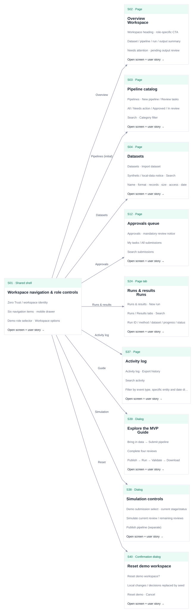

[Editable Graphviz source](../../public/mvp-flow-docs/flows/F01.dot) · [SVG](../../public/mvp-flow-docs/flows/F01.svg)

| From | Click / event | Next |
| --- | --- | --- |
| [S01 · Workspace navigation & role controls](#s01) | Overview | [S02 · Overview · Workspace](#s02) |
| [S01 · Workspace navigation & role controls](#s01) | Pipelines (initial) | [S03 · Pipeline catalog](#s03) |
| [S01 · Workspace navigation & role controls](#s01) | Datasets | [S04 · Datasets](#s04) |
| [S01 · Workspace navigation & role controls](#s01) | Approvals | [S12 · Approvals queue](#s12) |
| [S01 · Workspace navigation & role controls](#s01) | Runs & results | [S24 · Runs & results · Runs](#s24) |
| [S01 · Workspace navigation & role controls](#s01) | Activity log | [S37 · Activity log](#s37) |
| [S01 · Workspace navigation & role controls](#s01) | Guide | [S39 · Explore the MVP · Guide](#s39) |
| [S01 · Workspace navigation & role controls](#s01) | Simulation | [S38 · Simulation controls](#s38) |
| [S01 · Workspace navigation & role controls](#s01) | Reset | [S40 · Reset demo workspace](#s40) |

<a id="f02"></a>

### F02 · Import & inspect a dataset

Register a source before configuring a run.

**Entry:** Researcher; Datasets or guide Import data.

**Completion:** Dataset metadata exists locally; source is preselected for a run.

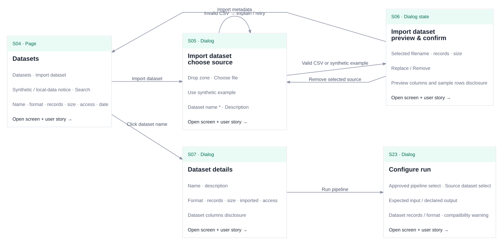

[Editable Graphviz source](../../public/mvp-flow-docs/flows/F02.dot) · [SVG](../../public/mvp-flow-docs/flows/F02.svg)

| From | Click / event | Next |
| --- | --- | --- |
| [S04 · Datasets](#s04) | Import dataset | [S05 · Import dataset · choose source](#s05) |
| [S05 · Import dataset · choose source](#s05) | Valid CSV or synthetic example | [S06 · Import dataset · preview & confirm](#s06) |
| [S05 · Import dataset · choose source](#s05) | Invalid CSV → explain / retry | [S05 · Import dataset · choose source](#s05) |
| [S06 · Import dataset · preview & confirm](#s06) | Remove selected source | [S05 · Import dataset · choose source](#s05) |
| [S06 · Import dataset · preview & confirm](#s06) | Import metadata | [S04 · Datasets](#s04) |
| [S04 · Datasets](#s04) | Click dataset name | [S07 · Dataset details](#s07) |
| [S07 · Dataset details](#s07) | Run pipeline | [S23 · Configure run](#s23) |

<a id="f03"></a>

### F03 · Create, save & submit

Work through the three-step wizard, including incomplete drafts.

**Entry:** Researcher; new name or a saved draft.

**Completion:** Author sees submission receipt; Ethical review is pending.

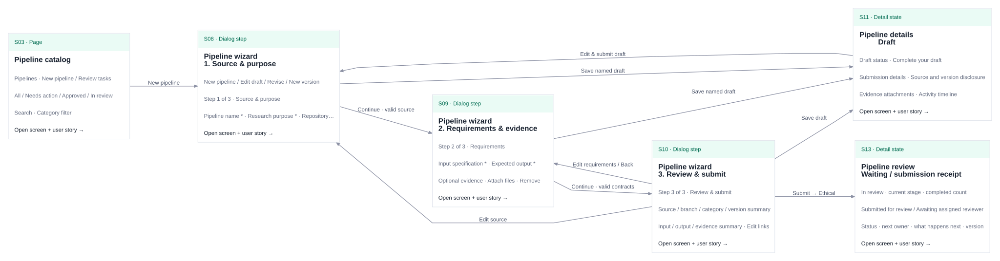

[Editable Graphviz source](../../public/mvp-flow-docs/flows/F03.dot) · [SVG](../../public/mvp-flow-docs/flows/F03.svg)

| From | Click / event | Next |
| --- | --- | --- |
| [S03 · Pipeline catalog](#s03) | New pipeline | [S08 · Pipeline wizard · 1. Source & purpose](#s08) |
| [S08 · Pipeline wizard · 1. Source & purpose](#s08) | Continue · valid source | [S09 · Pipeline wizard · 2. Requirements & evidence](#s09) |
| [S09 · Pipeline wizard · 2. Requirements & evidence](#s09) | Continue · valid contracts | [S10 · Pipeline wizard · 3. Review & submit](#s10) |
| [S10 · Pipeline wizard · 3. Review & submit](#s10) | Edit source | [S08 · Pipeline wizard · 1. Source & purpose](#s08) |
| [S10 · Pipeline wizard · 3. Review & submit](#s10) | Edit requirements / Back | [S09 · Pipeline wizard · 2. Requirements & evidence](#s09) |
| [S08 · Pipeline wizard · 1. Source & purpose](#s08) | Save named draft | [S11 · Pipeline details · Draft](#s11) |
| [S09 · Pipeline wizard · 2. Requirements & evidence](#s09) | Save named draft | [S11 · Pipeline details · Draft](#s11) |
| [S10 · Pipeline wizard · 3. Review & submit](#s10) | Save draft | [S11 · Pipeline details · Draft](#s11) |
| [S11 · Pipeline details · Draft](#s11) | Edit & submit draft | [S08 · Pipeline wizard · 1. Source & purpose](#s08) |
| [S10 · Pipeline wizard · 3. Review & submit](#s10) | Submit → Ethical | [S13 · Pipeline review · Waiting / submission receipt](#s13) |
| [S08 · Pipeline wizard · 1. Source & purpose](#s08) | Close edited form | [S42 · Save your changes?](#s42) |
| [S42 · Save your changes?](#s42) | Keep editing | [S08 · Pipeline wizard · 1. Source & purpose](#s08) |
| [S42 · Save your changes?](#s42) | Save draft | [S11 · Pipeline details · Draft](#s11) |
| [S42 · Save your changes?](#s42) | Discard changes | [S03 · Pipeline catalog](#s03) |

<a id="f04"></a>

### F04 · Four reviews & author publication

Complete each required organizational stage before publishing.

**Entry:** Submitted pipeline; role selector or Continue as actions supply each handoff.

**Completion:** Pipeline Approved after a separate Researcher publish event. Edge labels that combine approval + role switch represent two actions; after approval the UI first shows S13 waiting for the next reviewer.

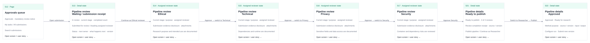

[Editable Graphviz source](../../public/mvp-flow-docs/flows/F04.dot) · [SVG](../../public/mvp-flow-docs/flows/F04.svg)

| From | Click / event | Next |
| --- | --- | --- |
| [S12 · Approvals queue](#s12) | Open submission | [S13 · Pipeline review · Waiting / submission receipt](#s13) |
| [S13 · Pipeline review · Waiting / submission receipt](#s13) | Continue as Ethical reviewer | [S14 · Pipeline review · Ethical](#s14) |
| [S14 · Pipeline review · Ethical](#s14) | Approve → switch to Technical | [S15 · Pipeline review · Technical](#s15) |
| [S15 · Pipeline review · Technical](#s15) | Approve → switch to Privacy | [S16 · Pipeline review · Privacy](#s16) |
| [S16 · Pipeline review · Privacy](#s16) | Approve → switch to Security | [S17 · Pipeline review · Security](#s17) |
| [S17 · Pipeline review · Security](#s17) | Approve Security | [S21 · Pipeline details · Ready to publish](#s21) |
| [S21 · Pipeline details · Ready to publish](#s21) | Switch to Researcher → Publish | [S22 · Pipeline details · Approved](#s22) |

<a id="f05"></a>

### F05 · Feedback, rejection & revision

Recover a paused review without losing its evidence or history.

**Entry:** Any assigned stage can request changes/reject; Ethical is shown as the example.

**Completion:** Revised version starts all four reviews again. For a rejected record, Save revision draft returns to S20, not S19.

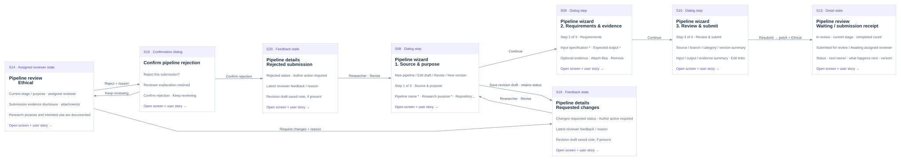

[Editable Graphviz source](../../public/mvp-flow-docs/flows/F05.dot) · [SVG](../../public/mvp-flow-docs/flows/F05.svg)

| From | Click / event | Next |
| --- | --- | --- |
| [S14 · Pipeline review · Ethical](#s14) | Request changes + reason | [S19 · Pipeline details · Requested changes](#s19) |
| [S14 · Pipeline review · Ethical](#s14) | Reject + reason | [S18 · Confirm pipeline rejection](#s18) |
| [S18 · Confirm pipeline rejection](#s18) | Keep reviewing | [S14 · Pipeline review · Ethical](#s14) |
| [S18 · Confirm pipeline rejection](#s18) | Confirm rejection | [S20 · Pipeline details · Rejected submission](#s20) |
| [S19 · Pipeline details · Requested changes](#s19) | Researcher · Revise | [S08 · Pipeline wizard · 1. Source & purpose](#s08) |
| [S20 · Pipeline details · Rejected submission](#s20) | Researcher · Revise | [S08 · Pipeline wizard · 1. Source & purpose](#s08) |
| [S08 · Pipeline wizard · 1. Source & purpose](#s08) | Save revision draft · retains status | [S19 · Pipeline details · Requested changes](#s19) |
| [S08 · Pipeline wizard · 1. Source & purpose](#s08) | Continue | [S09 · Pipeline wizard · 2. Requirements & evidence](#s09) |
| [S09 · Pipeline wizard · 2. Requirements & evidence](#s09) | Continue | [S10 · Pipeline wizard · 3. Review & submit](#s10) |
| [S10 · Pipeline wizard · 3. Review & submit](#s10) | Resubmit → patch + Ethical | [S13 · Pipeline review · Waiting / submission receipt](#s13) |

<a id="f06"></a>

### F06 · Submit a new version

Keep a published source available while reviewing an update.

**Entry:** Researcher on an Approved pipeline.

**Completion:** A separate basedOn record enters full review; the earlier approved version remains runnable.

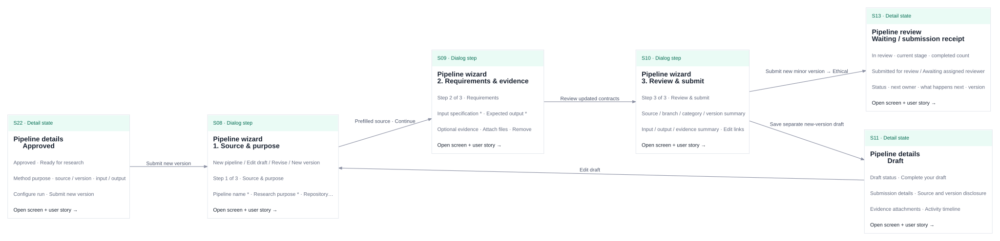

[Editable Graphviz source](../../public/mvp-flow-docs/flows/F06.dot) · [SVG](../../public/mvp-flow-docs/flows/F06.svg)

| From | Click / event | Next |
| --- | --- | --- |
| [S22 · Pipeline details · Approved](#s22) | Submit new version | [S08 · Pipeline wizard · 1. Source & purpose](#s08) |
| [S08 · Pipeline wizard · 1. Source & purpose](#s08) | Prefilled source · Continue | [S09 · Pipeline wizard · 2. Requirements & evidence](#s09) |
| [S09 · Pipeline wizard · 2. Requirements & evidence](#s09) | Review updated contracts | [S10 · Pipeline wizard · 3. Review & submit](#s10) |
| [S10 · Pipeline wizard · 3. Review & submit](#s10) | Save separate new-version draft | [S11 · Pipeline details · Draft](#s11) |
| [S11 · Pipeline details · Draft](#s11) | Edit draft | [S08 · Pipeline wizard · 1. Source & purpose](#s08) |
| [S10 · Pipeline wizard · 3. Review & submit](#s10) | Submit new minor version → Ethical | [S13 · Pipeline review · Waiting / submission receipt](#s13) |

<a id="f07"></a>

### F07 · Run & inspect output

Configure a compatible run and inspect the synthetic result.

**Entry:** Researcher; Approved method and registered format-compatible dataset.

**Completion:** Completed run has a distinct Pending review artifact; no download yet.

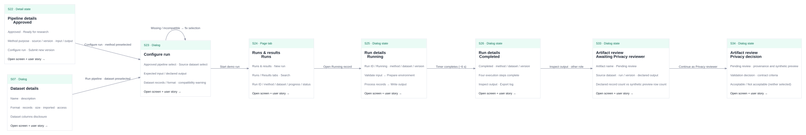

[Editable Graphviz source](../../public/mvp-flow-docs/flows/F07.dot) · [SVG](../../public/mvp-flow-docs/flows/F07.svg)

| From | Click / event | Next |
| --- | --- | --- |
| [S22 · Pipeline details · Approved](#s22) | Configure run · method preselected | [S23 · Configure run](#s23) |
| [S07 · Dataset details](#s07) | Run pipeline · dataset preselected | [S23 · Configure run](#s23) |
| [S23 · Configure run](#s23) | Missing / incompatible → fix selection | [S23 · Configure run](#s23) |
| [S23 · Configure run](#s23) | Start demo run | [S24 · Runs & results · Runs](#s24) |
| [S24 · Runs & results · Runs](#s24) | Open Running record | [S25 · Run details · Running](#s25) |
| [S25 · Run details · Running](#s25) | Timer completes (~6 s) | [S26 · Run details · Completed](#s26) |
| [S26 · Run details · Completed](#s26) | Inspect output · other role | [S33 · Artifact review · Awaiting Privacy reviewer](#s33) |
| [S33 · Artifact review · Awaiting Privacy reviewer](#s33) | Continue as Privacy reviewer | [S34 · Artifact review · Privacy decision](#s34) |

<a id="f08"></a>

### F08 · Failure, cancellation & support

Recover a seeded failure or a cancelled run.

**Entry:** Seeded Failed run or an active Running run.

**Completion:** Recovery creates a new pending output on completion; resolving support alone does not change run status.

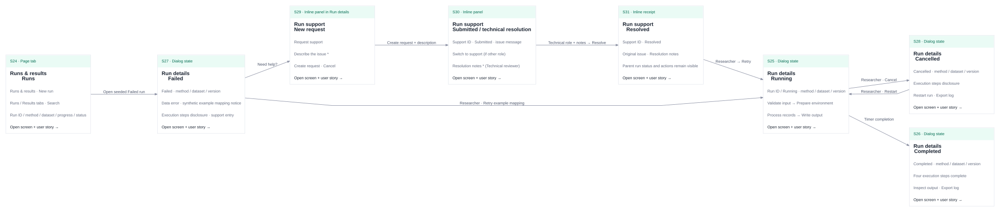

[Editable Graphviz source](../../public/mvp-flow-docs/flows/F08.dot) · [SVG](../../public/mvp-flow-docs/flows/F08.svg)

| From | Click / event | Next |
| --- | --- | --- |
| [S24 · Runs & results · Runs](#s24) | Open seeded Failed run | [S27 · Run details · Failed](#s27) |
| [S27 · Run details · Failed](#s27) | Researcher · Retry example mapping | [S25 · Run details · Running](#s25) |
| [S27 · Run details · Failed](#s27) | Need help? | [S29 · Run support · New request](#s29) |
| [S29 · Run support · New request](#s29) | Create request + description | [S30 · Run support · Submitted / technical resolution](#s30) |
| [S30 · Run support · Submitted / technical resolution](#s30) | Technical role + notes → Resolve | [S31 · Run support · Resolved](#s31) |
| [S31 · Run support · Resolved](#s31) | Researcher → Retry | [S25 · Run details · Running](#s25) |
| [S25 · Run details · Running](#s25) | Researcher · Cancel | [S28 · Run details · Cancelled](#s28) |
| [S28 · Run details · Cancelled](#s28) | Researcher · Restart | [S25 · Run details · Running](#s25) |
| [S25 · Run details · Running](#s25) | Timer completion | [S26 · Run details · Completed](#s26) |

<a id="f09"></a>

### F09 · Validate, reject or download output

Make a deliberate Privacy decision before sample download.

**Entry:** Completed artifact Pending review; neither radio option is selected initially.

**Completion:** Accepted output enables sample download; rejected output requires a fresh run for a new decision. The rejected-to-configure wire is a recovery sequence through the underlying Runs/Results page, not a CTA inside the rejected dialog.

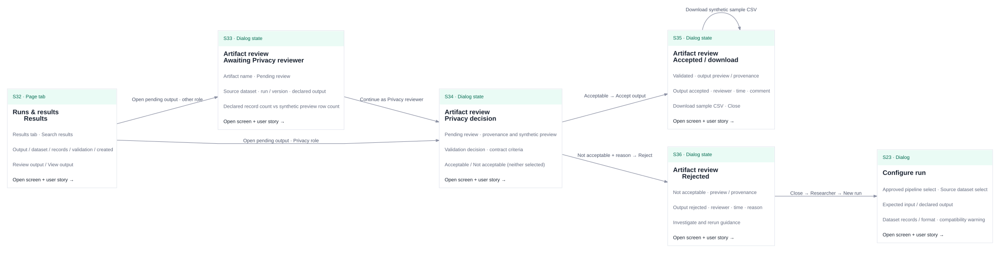

[Editable Graphviz source](../../public/mvp-flow-docs/flows/F09.dot) · [SVG](../../public/mvp-flow-docs/flows/F09.svg)

| From | Click / event | Next |
| --- | --- | --- |
| [S32 · Runs & results · Results](#s32) | Open pending output · other role | [S33 · Artifact review · Awaiting Privacy reviewer](#s33) |
| [S33 · Artifact review · Awaiting Privacy reviewer](#s33) | Continue as Privacy reviewer | [S34 · Artifact review · Privacy decision](#s34) |
| [S32 · Runs & results · Results](#s32) | Open pending output · Privacy role | [S34 · Artifact review · Privacy decision](#s34) |
| [S34 · Artifact review · Privacy decision](#s34) | Acceptable → Accept output | [S35 · Artifact review · Accepted / download](#s35) |
| [S34 · Artifact review · Privacy decision](#s34) | Not acceptable + reason → Reject | [S36 · Artifact review · Rejected](#s36) |
| [S35 · Artifact review · Accepted / download](#s35) | Download synthetic sample CSV | [S35 · Artifact review · Accepted / download](#s35) |
| [S36 · Artifact review · Rejected](#s36) | Close → Researcher → New run | [S23 · Configure run](#s23) |

<a id="f10"></a>

### F10 · Trace, export & reopen

Inspect local history and open the related current record.

**Entry:** Any role; Activity log.

**Completion:** Filtered history downloads as JSON, or the current related entity opens. Link destinations vary with current record status; this is not a historical replay.

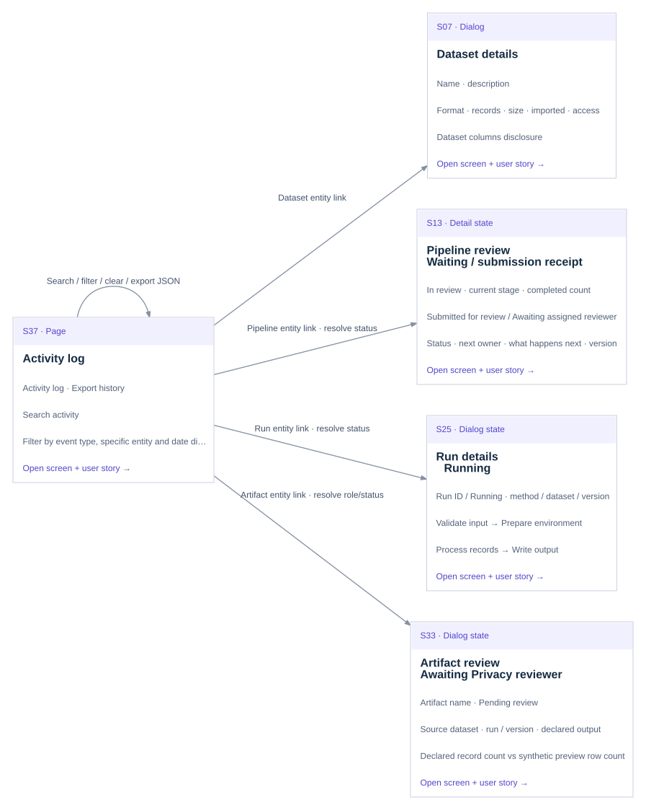

[Editable Graphviz source](../../public/mvp-flow-docs/flows/F10.dot) · [SVG](../../public/mvp-flow-docs/flows/F10.svg)

| From | Click / event | Next |
| --- | --- | --- |
| [S37 · Activity log](#s37) | Search / filter / clear / export JSON | [S37 · Activity log](#s37) |
| [S37 · Activity log](#s37) | Dataset entity link | [S07 · Dataset details](#s07) |
| [S37 · Activity log](#s37) | Pipeline entity link · resolve status | [S13 · Pipeline review · Waiting / submission receipt](#s13) |
| [S37 · Activity log](#s37) | Run entity link · resolve status | [S25 · Run details · Running](#s25) |
| [S37 · Activity log](#s37) | Artifact entity link · resolve role/status | [S33 · Artifact review · Awaiting Privacy reviewer](#s33) |

<a id="f11"></a>

### F11 · Solo demo shortcuts & reset

Continue across external-person and timer dependencies.

**Entry:** Any role; sidebar, Demo mode, workspace menu or run/artifact dialog shortcut.

**Completion:** Simulator actions happen inside S38; wires show outcomes after returning/reopening the applicable record. The underlying page is preserved. Reset is a separate confirmed action.

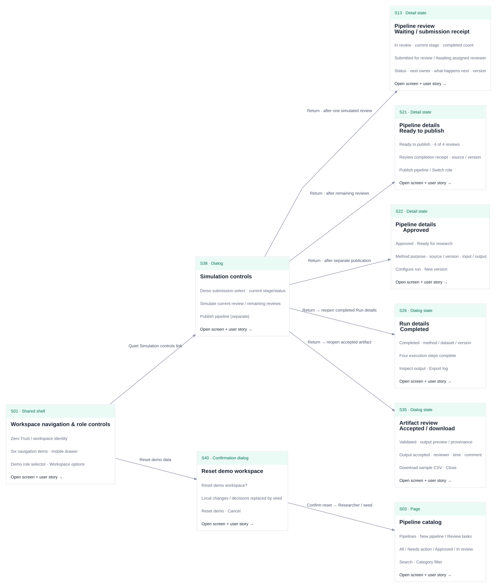

[Editable Graphviz source](../../public/mvp-flow-docs/flows/F11.dot) · [SVG](../../public/mvp-flow-docs/flows/F11.svg)

| From | Click / event | Next |
| --- | --- | --- |
| [S01 · Workspace navigation & role controls](#s01) | Quiet Simulation controls link | [S38 · Simulation controls](#s38) |
| [S38 · Simulation controls](#s38) | Return · after one simulated review | [S13 · Pipeline review · Waiting / submission receipt](#s13) |
| [S38 · Simulation controls](#s38) | Return · after remaining reviews | [S21 · Pipeline details · Ready to publish](#s21) |
| [S38 · Simulation controls](#s38) | Return · after separate publication | [S22 · Pipeline details · Approved](#s22) |
| [S38 · Simulation controls](#s38) | Return → reopen completed Run details | [S26 · Run details · Completed](#s26) |
| [S38 · Simulation controls](#s38) | Return → reopen accepted artifact | [S35 · Artifact review · Accepted / download](#s35) |
| [S01 · Workspace navigation & role controls](#s01) | Reset demo data | [S40 · Reset demo workspace](#s40) |
| [S40 · Reset demo workspace](#s40) | Confirm reset → Researcher / seed | [S03 · Pipeline catalog](#s03) |

<a id="f12"></a>

### F12 · Attach & inspect review evidence

Carry local text evidence from a submission into each reviewer’s assessment.

**Entry:** Researcher in the submission wizard; optional supported text files.

**Completion:** A reviewer reads the exact locally attached text and returns to the same assessment. Any pipeline detail may open this preview; Ethical is shown as an example.

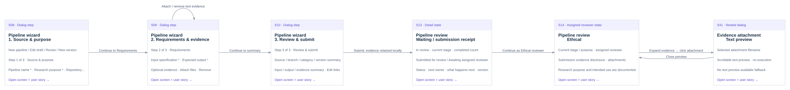

[Editable Graphviz source](../../public/mvp-flow-docs/flows/F12.dot) · [SVG](../../public/mvp-flow-docs/flows/F12.svg)

| From | Click / event | Next |
| --- | --- | --- |
| [S08 · Pipeline wizard · 1. Source & purpose](#s08) | Continue to Requirements | [S09 · Pipeline wizard · 2. Requirements & evidence](#s09) |
| [S09 · Pipeline wizard · 2. Requirements & evidence](#s09) | Attach / remove text evidence | [S09 · Pipeline wizard · 2. Requirements & evidence](#s09) |
| [S09 · Pipeline wizard · 2. Requirements & evidence](#s09) | Continue to summary | [S10 · Pipeline wizard · 3. Review & submit](#s10) |
| [S10 · Pipeline wizard · 3. Review & submit](#s10) | Submit; evidence retained locally | [S13 · Pipeline review · Waiting / submission receipt](#s13) |
| [S13 · Pipeline review · Waiting / submission receipt](#s13) | Continue as Ethical reviewer | [S14 · Pipeline review · Ethical](#s14) |
| [S14 · Pipeline review · Ethical](#s14) | Expand evidence → click attachment | [S41 · Evidence attachment · Text preview](#s41) |
| [S41 · Evidence attachment · Text preview](#s41) | Close preview | [S14 · Pipeline review · Ethical](#s14) |

<a id="f13"></a>

### F13 · Protect edits and recover saved work

Keep form edits and saved work recoverable when closing, saving in multiple tabs or encountering damaged storage.

**Entry:** Close an edited wizard, or encounter protected workspace recovery.

**Completion:** A draft is saved, edits are explicitly discarded, or a protected copy is downloaded/backed up before recovery.

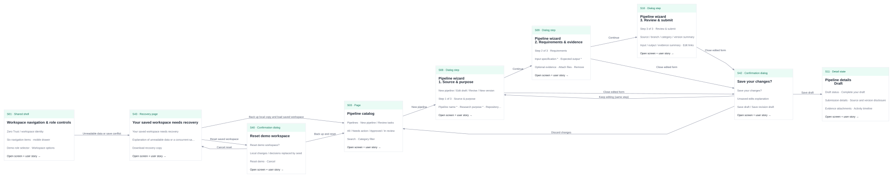

[Editable Graphviz source](../../public/mvp-flow-docs/flows/F13.dot) · [SVG](../../public/mvp-flow-docs/flows/F13.svg)

| From | Click / event | Next |
| --- | --- | --- |
| [S03 · Pipeline catalog](#s03) | New pipeline | [S08 · Pipeline wizard · 1. Source & purpose](#s08) |
| [S08 · Pipeline wizard · 1. Source & purpose](#s08) | Continue | [S09 · Pipeline wizard · 2. Requirements & evidence](#s09) |
| [S09 · Pipeline wizard · 2. Requirements & evidence](#s09) | Continue | [S10 · Pipeline wizard · 3. Review & submit](#s10) |
| [S08 · Pipeline wizard · 1. Source & purpose](#s08) | Close edited form | [S42 · Save your changes?](#s42) |
| [S09 · Pipeline wizard · 2. Requirements & evidence](#s09) | Close edited form | [S42 · Save your changes?](#s42) |
| [S10 · Pipeline wizard · 3. Review & submit](#s10) | Close edited form | [S42 · Save your changes?](#s42) |
| [S42 · Save your changes?](#s42) | Keep editing (same step) | [S08 · Pipeline wizard · 1. Source & purpose](#s08) |
| [S42 · Save your changes?](#s42) | Save draft | [S11 · Pipeline details · Draft](#s11) |
| [S42 · Save your changes?](#s42) | Discard changes | [S03 · Pipeline catalog](#s03) |
| [S01 · Workspace navigation & role controls](#s01) | Unreadable data or save conflict | [S43 · Your saved workspace needs recovery](#s43) |
| [S43 · Your saved workspace needs recovery](#s43) | Reset saved workspace | [S40 · Reset demo workspace](#s40) |
| [S40 · Reset demo workspace](#s40) | Cancel reset | [S43 · Your saved workspace needs recovery](#s43) |
| [S40 · Reset demo workspace](#s40) | Back up and reset | [S03 · Pipeline catalog](#s03) |
| [S43 · Your saved workspace needs recovery](#s43) | Back up local copy and load saved workspace | [S03 · Pipeline catalog](#s03) |

## Screen index

| Screen | Surface | Roles | Story |
| --- | --- | --- | --- |
| [S01 · Workspace navigation & role controls](#s01) | Shared shell | All roles | [US-S01](#us-s01) |
| [S02 · Overview · Workspace](#s02) | Page | All roles | [US-S02](#us-s02) |
| [S03 · Pipeline catalog](#s03) | Page | All roles | [US-S03](#us-s03) |
| [S04 · Datasets](#s04) | Page | All roles; import/run: Researcher | [US-S04](#us-s04) |
| [S05 · Import dataset · choose source](#s05) | Dialog | Researcher | [US-S05](#us-s05) |
| [S06 · Import dataset · preview & confirm](#s06) | Dialog state | Researcher | [US-S06](#us-s06) |
| [S07 · Dataset details](#s07) | Dialog | All roles; run: Researcher | [US-S07](#us-s07) |
| [S08 · Pipeline wizard · 1. Source & purpose](#s08) | Dialog step | Researcher | [US-S08](#us-s08) |
| [S09 · Pipeline wizard · 2. Requirements & evidence](#s09) | Dialog step | Researcher | [US-S09](#us-s09) |
| [S10 · Pipeline wizard · 3. Review & submit](#s10) | Dialog step | Researcher | [US-S10](#us-s10) |
| [S11 · Pipeline details · Draft](#s11) | Detail state | Researcher; others can switch role | [US-S11](#us-s11) |
| [S12 · Approvals queue](#s12) | Page | All roles | [US-S12](#us-s12) |
| [S13 · Pipeline review · Waiting / submission receipt](#s13) | Detail state | Researcher or non-assigned reviewer | [US-S13](#us-s13) |
| [S14 · Pipeline review · Ethical](#s14) | Assigned reviewer state | Ethical reviewer | [US-S14](#us-s14) |
| [S15 · Pipeline review · Technical](#s15) | Assigned reviewer state | Technical reviewer | [US-S15](#us-s15) |
| [S16 · Pipeline review · Privacy](#s16) | Assigned reviewer state | Privacy reviewer | [US-S16](#us-s16) |
| [S17 · Pipeline review · Security](#s17) | Assigned reviewer state | Security reviewer | [US-S17](#us-s17) |
| [S18 · Confirm pipeline rejection](#s18) | Confirmation dialog | Assigned reviewer | [US-S18](#us-s18) |
| [S19 · Pipeline details · Requested changes](#s19) | Feedback state | Researcher; others can switch role | [US-S19](#us-s19) |
| [S20 · Pipeline details · Rejected submission](#s20) | Feedback state | Researcher; others can switch role | [US-S20](#us-s20) |
| [S21 · Pipeline details · Ready to publish](#s21) | Detail state | Researcher; reviewers can hand off | [US-S21](#us-s21) |
| [S22 · Pipeline details · Approved](#s22) | Detail state | All roles; run/version: Researcher | [US-S22](#us-s22) |
| [S23 · Configure run](#s23) | Dialog | Researcher | [US-S23](#us-s23) |
| [S24 · Runs & results · Runs](#s24) | Page tab | All roles; new run: Researcher | [US-S24](#us-s24) |
| [S25 · Run details · Running](#s25) | Dialog state | All roles; cancel: Researcher | [US-S25](#us-s25) |
| [S26 · Run details · Completed](#s26) | Dialog state | All roles | [US-S26](#us-s26) |
| [S27 · Run details · Failed](#s27) | Dialog state | All roles; retry: Researcher | [US-S27](#us-s27) |
| [S28 · Run details · Cancelled](#s28) | Dialog state | All roles; restart: Researcher | [US-S28](#us-s28) |
| [S29 · Run support · New request](#s29) | Inline panel in Run details | Any active demo role | [US-S29](#us-s29) |
| [S30 · Run support · Submitted / technical resolution](#s30) | Inline panel | All roles; resolve: Technical reviewer | [US-S30](#us-s30) |
| [S31 · Run support · Resolved](#s31) | Inline receipt | All roles | [US-S31](#us-s31) |
| [S32 · Runs & results · Results](#s32) | Page tab | All roles | [US-S32](#us-s32) |
| [S33 · Artifact review · Awaiting Privacy reviewer](#s33) | Dialog state | Researcher and non-Privacy reviewers | [US-S33](#us-s33) |
| [S34 · Artifact review · Privacy decision](#s34) | Dialog state | Privacy reviewer | [US-S34](#us-s34) |
| [S35 · Artifact review · Accepted / download](#s35) | Dialog state | All roles | [US-S35](#us-s35) |
| [S36 · Artifact review · Rejected](#s36) | Dialog state | All roles | [US-S36](#us-s36) |
| [S37 · Activity log](#s37) | Page | All roles | [US-S37](#us-s37) |
| [S38 · Simulation controls](#s38) | Dialog | All roles | [US-S38](#us-s38) |
| [S39 · Explore the MVP · Guide](#s39) | Dialog | All roles | [US-S39](#us-s39) |
| [S40 · Reset demo workspace](#s40) | Confirmation dialog | All roles | [US-S40](#us-s40) |
| [S41 · Evidence attachment · Text preview](#s41) | Nested dialog | All roles viewing pipeline details | [US-S41](#us-s41) |
| [S42 · Save your changes?](#s42) | Confirmation dialog | Researcher | [US-S42](#us-s42) |
| [S43 · Your saved workspace needs recovery](#s43) | Recovery page | All roles | [US-S43](#us-s43) |

## Screen-by-screen reference

<a id="s01"></a>

### S01 · Workspace navigation & role controls

**Surface:** Shared shell. **Roles:** All roles.

Reach a workspace area and continue as the next demo participant.

**Wireframe content, top to bottom**

1. Zero Trust / workspace identity
2. Six navigation items · mobile drawer
3. Demo role selector · Workspace options
4. Walkthrough guide · Simulation controls

#### US-S01

As a participant, I want a consistent navigation and role switch so that I can follow a multi-person workflow alone.

Acceptance criteria:

- All six destinations are reachable by keyboard and on mobile.
- Changing role keeps the current page and updates available actions.
- Workspace options expose guide, simulation, archived workspace and reset.

Behavior and limits:

- This shell surrounds each page; it is not a separate landing page.
- All features are on. Role and simulation controls are not feature toggles.

| ID | Click / event | Required condition | Next screen / state | Result |
| --- | --- | --- | --- | --- |
| T001 | Overview (navigate) | — | [S02 · Overview · Workspace](#s02) | — |
| T002 | Datasets (navigate) | — | [S04 · Datasets](#s04) | — |
| T003 | Pipelines (navigate) | — | [S03 · Pipeline catalog](#s03) | — |
| T004 | Runs & results (navigate) | — | [S24 · Runs & results · Runs](#s24) | — |
| T005 | Approvals (navigate) | — | [S12 · Approvals queue](#s12) | — |
| T006 | Activity log (navigate) | — | [S37 · Activity log](#s37) | — |
| T007 | Walkthrough guide (navigate) | — | [S39 · Explore the MVP · Guide](#s39) | — |
| T008 | Simulation controls (navigate) | — | [S38 · Simulation controls](#s38) | — |
| T009 | Reset demo data (navigate) | — | [S40 · Reset demo workspace](#s40) | — |
| T010 | Select demo role (role) | — | Same screen | Same page, role-sensitive controls update; no review decision is made. |
| T011 | Open / Close navigation (disclosure) | — | Same screen | Mobile drawer opens or closes; no page transition. |
| T012 | Open original workspace (external) | — | Archived workspace (`/?view=full`) | Opens /?view=full in a new tab, outside MVP scope. |
| T217 | Saved workspace needs recovery (error) | Unreadable saved data or another tab saved while this tab had unsaved work | [S43 · Your saved workspace needs recovery](#s43) | Pause edits and preserve the protected copy. |

**Source:** [Shell.tsx:Shell](https://github.com/T-dotnet/Zero_trust/blob/b453c2b391ad42854113f4146276275b22ee37d2/src/mvp/Shell.tsx) · [MvpApp.tsx:MvpApp](https://github.com/T-dotnet/Zero_trust/blob/b453c2b391ad42854113f4146276275b22ee37d2/src/mvp/MvpApp.tsx)

<a id="s02"></a>

### S02 · Overview · Workspace

**Surface:** Page. **Roles:** All roles.

See attention items, workspace counts and approved methods.

**Wireframe content, top to bottom**

1. Workspace heading · role-specific CTA
2. Dataset / pipeline / run / output summary
3. Needs attention · pending output review
4. Approved pipeline list

#### US-S02

As a participant, I want an overview of actionable work so that I know where to continue.

Acceptance criteria:

- Attention items reflect the active role.
- Researcher can start a pipeline or run an approved method.
- Pending outputs lead to Results; reviewers reach the review queue.

| ID | Click / event | Required condition | Next screen / state | Result |
| --- | --- | --- | --- | --- |
| T013 | New pipeline (navigate) | Researcher | [S08 · Pipeline wizard · 1. Source & purpose](#s08) | — |
| T014 | View my tasks / View approvals (navigate) | Reviewer / any role | [S12 · Approvals queue](#s12) | — |
| T015 | Open attention submission (navigate) | Resolve selected record by status/role to S11/S13–S17/S19–S22. | [S13 · Pipeline review · Waiting / submission receipt](#s13) | Resolve by selected record status (see S03). |
| T016 | Review pending outputs (navigate) | — | [S32 · Runs & results · Results](#s32) | — |
| T017 | Run approved pipeline (navigate) | Researcher | [S23 · Configure run](#s23) | Pipeline preselected. |
| T018 | View approved pipeline (navigate) | Reviewer | [S22 · Pipeline details · Approved](#s22) | — |

**Source:** [PipelineViews.tsx:Overview](https://github.com/T-dotnet/Zero_trust/blob/b453c2b391ad42854113f4146276275b22ee37d2/src/mvp/PipelineViews.tsx)

<a id="s03"></a>

### S03 · Pipeline catalog

**Surface:** Page. **Roles:** All roles.

Find a pipeline, see its next owner and choose the next action.

**Wireframe content, top to bottom**

1. Pipelines · New pipeline / Review tasks
2. All / Needs action / Approved / In review
3. Search · Category filter
4. Pipeline name · version · status · next action
5. How pipeline approval works disclosure · Explore the review process

#### US-S03

As a researcher or reviewer, I want searchable pipelines with clear status and actions so that I can resume the right work.

Acceptance criteria:

- Status and category filters combine with search; clear restores results.
- Phone status select replaces the desktop tab row.
- Pipeline-name click opens details in Approvals; an approved Researcher row CTA opens Configure run.

Behavior and limits:

- The selected record chooses a detail state; no intermediate selector screen exists.
- No matches is an in-place empty state with Clear filters.

| ID | Click / event | Required condition | Next screen / state | Result |
| --- | --- | --- | --- | --- |
| T019 | New pipeline (navigate) | Researcher | [S08 · Pipeline wizard · 1. Source & purpose](#s08) | — |
| T020 | Review tasks / Approvals (navigate) | — | [S12 · Approvals queue](#s12) | — |
| T021 | Open draft (navigate) | Draft | [S11 · Pipeline details · Draft](#s11) | — |
| T022 | Open waiting submission (navigate) | In review, not assigned reviewer | [S13 · Pipeline review · Waiting / submission receipt](#s13) | — |
| T023 | Open Ethical task (navigate) | In review at Ethical, active Ethical reviewer | [S14 · Pipeline review · Ethical](#s14) | — |
| T024 | Open Technical task (navigate) | In review at Technical, active Technical reviewer | [S15 · Pipeline review · Technical](#s15) | — |
| T025 | Open Privacy task (navigate) | In review at Privacy, active Privacy reviewer | [S16 · Pipeline review · Privacy](#s16) | — |
| T026 | Open Security task (navigate) | In review at Security, active Security reviewer | [S17 · Pipeline review · Security](#s17) | — |
| T027 | Open feedback (navigate) | Changes requested | [S19 · Pipeline details · Requested changes](#s19) | — |
| T028 | Open rejection (navigate) | Rejected | [S20 · Pipeline details · Rejected submission](#s20) | — |
| T029 | Open publication-ready submission (navigate) | Ready to publish | [S21 · Pipeline details · Ready to publish](#s21) | — |
| T030 | Open approved pipeline name (navigate) | Approved | [S22 · Pipeline details · Approved](#s22) | — |
| T031 | Run pipeline (navigate) | Approved and Researcher | [S23 · Configure run](#s23) | — |
| T032 | Search / filter / clear (in-place) | — | Same screen | Visible rows and count update; no match shows an empty state. |
| T213 | Explore the review process (navigate) | Expand How pipeline approval works | [S12 · Approvals queue](#s12) | Open Approvals queue. |

**Source:** [PipelineViews.tsx:PipelineCatalog](https://github.com/T-dotnet/Zero_trust/blob/b453c2b391ad42854113f4146276275b22ee37d2/src/mvp/PipelineViews.tsx) · [model.ts:pipelineActionLabel](https://github.com/T-dotnet/Zero_trust/blob/b453c2b391ad42854113f4146276275b22ee37d2/src/mvp/model.ts) · [ui.tsx:ReviewGuide](https://github.com/T-dotnet/Zero_trust/blob/b453c2b391ad42854113f4146276275b22ee37d2/src/mvp/ui.tsx)

<a id="s04"></a>

### S04 · Datasets

**Surface:** Page. **Roles:** All roles; import/run: Researcher.

Find locally registered source data.

**Wireframe content, top to bottom**

1. Datasets · Import dataset
2. Synthetic / local-data notice · Search
3. Name · format · records · size · access · date
4. Dataset name opens details · Run pipeline

#### US-S04

As a researcher, I want a dataset catalog so that I can inspect and select data before running a method.

Acceptance criteria:

- Import and run actions are disabled for other roles.
- Search filters name and description; no matches stays on this page.
- Restricted is a demo label, not enforced access control.

| ID | Click / event | Required condition | Next screen / state | Result |
| --- | --- | --- | --- | --- |
| T033 | Import dataset (navigate) | Researcher | [S05 · Import dataset · choose source](#s05) | — |
| T034 | Open dataset name (navigate) | — | [S07 · Dataset details](#s07) | — |
| T035 | Run pipeline (navigate) | Researcher | [S23 · Configure run](#s23) | Dataset preselected. |
| T036 | Search datasets (in-place) | — | Same screen | — |

**Source:** [DataAndRuns.tsx:Datasets](https://github.com/T-dotnet/Zero_trust/blob/b453c2b391ad42854113f4146276275b22ee37d2/src/mvp/DataAndRuns.tsx)

<a id="s05"></a>

### S05 · Import dataset · choose source

**Surface:** Dialog. **Roles:** Researcher.

Select a valid CSV or a synthetic example.

**Wireframe content, top to bottom**

1. Drop zone · Choose file
2. Use synthetic example
3. Dataset name * · Description
4. Inline validation / reading state

#### US-S05

As a researcher, I want a safe sample or CSV import so that I can demonstrate a run without uploading research data.

Acceptance criteria:

- Accepted CSV has a header and at least one row, unique nonempty header names, valid quoting and equal-width rows.
- File must end in .csv and be at most 5 MiB; the UI copy says “up to 5 MB”.
- Import stays disabled until file is valid, name is nonblank and reading has finished.

Behavior and limits:

- Invalid file/read error stays here, explains the problem and allows choosing another file or sample.
- No server upload occurs.

| ID | Click / event | Required condition | Next screen / state | Result |
| --- | --- | --- | --- | --- |
| T037 | Choose file / Drop valid CSV (navigate) | Valid CSV, <= 5 MiB | [S06 · Import dataset · preview & confirm](#s06) | Read metadata, column names and up to 3 preview rows. |
| T038 | Use synthetic example (navigate) | — | [S06 · Import dataset · preview & confirm](#s06) | Prefills a 120-record synthetic cohort. |
| T039 | Invalid CSV / unreadable file (error) | — | Same screen | Show validation error; Import remains disabled. |
| T040 | Cancel / Close (return) | — | Originating page / parent state | — |

**Source:** [Dialogs.tsx:ImportDialog](https://github.com/T-dotnet/Zero_trust/blob/b453c2b391ad42854113f4146276275b22ee37d2/src/mvp/Dialogs.tsx) · [csv.ts:parseDatasetCsv](https://github.com/T-dotnet/Zero_trust/blob/b453c2b391ad42854113f4146276275b22ee37d2/src/mvp/csv.ts)

<a id="s06"></a>

### S06 · Import dataset · preview & confirm

**Surface:** Dialog state. **Roles:** Researcher.

Inspect the selected source and register its metadata.

**Wireframe content, top to bottom**

1. Selected filename · records · size
2. Replace / Remove
3. Preview columns and sample rows disclosure
4. Dataset name * · Description

#### US-S06

As a researcher, I want to preview columns and sample rows so that I can catch an incorrect source before registration.

Acceptance criteria:

- Import requires a nonblank name and validated file.
- Only metadata and column names are retained; preview rows are discarded on close.
- Successful import closes the dialog and opens Datasets with a success message.

| ID | Click / event | Required condition | Next screen / state | Result |
| --- | --- | --- | --- | --- |
| T041 | Import dataset (navigate) | Valid source + nonblank name | [S04 · Datasets](#s04) | Add local record and activity event. |
| T042 | Replace (navigate) | Choose another file | [S06 · Import dataset · preview & confirm](#s06) | A valid replacement stays in preview; invalid/unreadable replacement clears the file and shows choose/error state S05. |
| T043 | Remove (navigate) | — | [S05 · Import dataset · choose source](#s05) | Clear selected file and its error; entered name may remain. |
| T044 | Preview columns and sample rows (disclosure) | — | Same screen | — |
| T045 | Cancel / Close (return) | — | Originating page / parent state | — |

**Source:** [Dialogs.tsx:ImportDialog](https://github.com/T-dotnet/Zero_trust/blob/b453c2b391ad42854113f4146276275b22ee37d2/src/mvp/Dialogs.tsx)

<a id="s07"></a>

### S07 · Dataset details

**Surface:** Dialog. **Roles:** All roles; run: Researcher.

Inspect metadata and optional column names.

**Wireframe content, top to bottom**

1. Name · description
2. Format · records · size · imported · access
3. Dataset columns disclosure
4. Local metadata / no access enforcement notice

#### US-S07

As a researcher, I want dataset details beside a run action so that I can choose an appropriate source.

Acceptance criteria:

- Column metadata expands when available.
- Run opens Configure run with this dataset selected.

| ID | Click / event | Required condition | Next screen / state | Result |
| --- | --- | --- | --- | --- |
| T046 | Run pipeline (navigate) | Researcher | [S23 · Configure run](#s23) | Close details and preselect dataset. |
| T047 | Dataset columns (disclosure) | — | Same screen | — |
| T048 | Close (return) | — | Originating page / parent state | — |

**Source:** [DataAndRuns.tsx:Datasets](https://github.com/T-dotnet/Zero_trust/blob/b453c2b391ad42854113f4146276275b22ee37d2/src/mvp/DataAndRuns.tsx)

<a id="s08"></a>

### S08 · Pipeline wizard · 1. Source & purpose

**Surface:** Dialog step. **Roles:** Researcher.

Describe the method and its repository source.

**Wireframe content, top to bottom**

1. New pipeline / Edit draft / Revise / New version
2. Step 1 of 3 · Source & purpose
3. Pipeline name * · Research purpose * · Repository URL *
4. Use example (new only) · Source settings disclosure
5. Branch/tag * · Category in disclosure

#### US-S08

As a researcher, I want to describe the purpose and source in a short first step so that I can submit a reviewable method or save early work.

Acceptance criteria:

- Continue requires a unique new name, research purpose, HTTP(S) repository URL and nonempty branch.
- Save draft requires a name; incomplete fields are allowed.
- Validation focuses the first invalid field and expands Source settings for a missing branch.

Behavior and limits:

- Modes reuse the same three steps. New: v1.0.0. Saved draft: keeps version. Rejected/changes revision: next available patch at resubmission. Approved source: separate new record with next available minor version.
- Draft/revision/new-version modes prefill fields. Identity is retained when editing an existing pipeline. No repository is fetched.
- A stale save keeps the form open with its edits and a conflict message. Copy changes before reopening the latest version; it never silently overwrites another tab.

| ID | Click / event | Required condition | Next screen / state | Result |
| --- | --- | --- | --- | --- |
| T049 | Continue (navigate) | Valid name, purpose, HTTP(S) URL and branch | [S09 · Pipeline wizard · 2. Requirements & evidence](#s09) | — |
| T050 | Save draft (navigate) | Named new or existing Draft | [S11 · Pipeline details · Draft](#s11) | Save local draft and close wizard. |
| T051 | Save revision draft (navigate) | Revision of Changes requested; Rejected returns S20. | [S19 · Pipeline details · Requested changes](#s19) | Keep reviewed version/status and save revision fields separately. |
| T052 | Use example / Source settings (in-place) | — | Same screen | Prefill synthetic example (new only) or expand branch/category. |
| T053 | Validation error (error) | — | Same screen | Show error and focus invalid field. |
| T054 | Cancel / Close (return) | No unsaved form changes | Originating page / parent state | Close the unchanged form without a confirmation. |
| T214 | Close edited form / Escape / backdrop (navigate) | Unsaved fields or evidence | [S42 · Save your changes?](#s42) | Offer Save draft, Keep editing and Discard changes. |

**Source:** [Dialogs.tsx:PipelineForm](https://github.com/T-dotnet/Zero_trust/blob/b453c2b391ad42854113f4146276275b22ee37d2/src/mvp/Dialogs.tsx)

<a id="s09"></a>

### S09 · Pipeline wizard · 2. Requirements & evidence

**Surface:** Dialog step. **Roles:** Researcher.

Define input/output expectations and optional evidence.

**Wireframe content, top to bottom**

1. Step 2 of 3 · Requirements
2. Input specification * · Expected output *
3. Optional evidence · Attach files · Remove
4. Attached filenames / sizes · Remove · validation feedback

#### US-S09

As a researcher, I want explicit input/output contracts and supporting evidence so that each reviewer can assess the method.

Acceptance criteria:

- Continue requires both input and output descriptions.
- Up to four .txt/.md/.json/.csv/.yaml/.yml files, each <= 50,000 bytes.
- Reading evidence disables progression and saving; rejected/unreadable files show an error.
- Evidence text is retained locally and available to demo reviewers.

Behavior and limits:

- A stale save keeps the form open with its edits and a conflict message. Copy changes before reopening the latest version; it never silently overwrites another tab.

| ID | Click / event | Required condition | Next screen / state | Result |
| --- | --- | --- | --- | --- |
| T055 | Continue (navigate) | Input and output nonblank, evidence reading complete | [S10 · Pipeline wizard · 3. Review & submit](#s10) | — |
| T056 | Back (navigate) | — | [S08 · Pipeline wizard · 1. Source & purpose](#s08) | Retain in-dialog edits. |
| T057 | Save draft (navigate) | Named Draft; revision returns feedback state S19/S20. | [S11 · Pipeline details · Draft](#s11) | Save current working fields, close wizard. |
| T058 | Attach / remove evidence (in-place) | — | Same screen | Update local evidence; invalid file shows inline error. |
| T059 | Cancel / Close (return) | No unsaved form changes | Originating page / parent state | Close the unchanged form without a confirmation. |
| T215 | Close edited form / Escape / backdrop (navigate) | Unsaved fields or evidence | [S42 · Save your changes?](#s42) | Offer Save draft, Keep editing and Discard changes. |

**Source:** [Dialogs.tsx:PipelineForm](https://github.com/T-dotnet/Zero_trust/blob/b453c2b391ad42854113f4146276275b22ee37d2/src/mvp/Dialogs.tsx) · [Evidence.tsx:AttachmentPicker](https://github.com/T-dotnet/Zero_trust/blob/b453c2b391ad42854113f4146276275b22ee37d2/src/mvp/Evidence.tsx)

<a id="s10"></a>

### S10 · Pipeline wizard · 3. Review & submit

**Surface:** Dialog step. **Roles:** Researcher.

Check the complete submission and start the approval path.

**Wireframe content, top to bottom**

1. Step 3 of 3 · Review & submit
2. Source / branch / category / version summary
3. Input / output / evidence summary · Edit links
4. Required approval path disclosure

#### US-S10

As a researcher, I want a final review with edit links so that I deliberately submit the intended version.

Acceptance criteria:

- Final submit revalidates source and both contract fields.
- Success closes wizard, opens submission detail and starts Ethical review.
- No stage is bypassed for revised or new versions.

Behavior and limits:

- A stale save keeps the form open with its edits and a conflict message. Copy changes before reopening the latest version; it never silently overwrites another tab.

| ID | Click / event | Required condition | Next screen / state | Result |
| --- | --- | --- | --- | --- |
| T060 | Submit for review / Resubmit for review (navigate) | All required fields valid | [S13 · Pipeline review · Waiting / submission receipt](#s13) | New record or revised record enters In review / Ethical; author sees receipt. |
| T061 | Edit source / Back to source (navigate) | — | [S08 · Pipeline wizard · 1. Source & purpose](#s08) | Preserve values. |
| T062 | Edit requirements / Back (navigate) | — | [S09 · Pipeline wizard · 2. Requirements & evidence](#s09) | Preserve values. |
| T063 | Save draft (navigate) | Named Draft; revision returns S19/S20. | [S11 · Pipeline details · Draft](#s11) | No review begins. |
| T064 | Required approval path (disclosure) | — | Same screen | — |
| T065 | Close (return) | No unsaved form changes | Originating page / parent state | Close the unchanged form without a confirmation. |
| T216 | Close edited form / Escape / backdrop (navigate) | Unsaved fields or evidence | [S42 · Save your changes?](#s42) | Offer Save draft, Keep editing and Discard changes. |

**Source:** [Dialogs.tsx:PipelineForm](https://github.com/T-dotnet/Zero_trust/blob/b453c2b391ad42854113f4146276275b22ee37d2/src/mvp/Dialogs.tsx) · [model.ts:workspaceReducer](https://github.com/T-dotnet/Zero_trust/blob/b453c2b391ad42854113f4146276275b22ee37d2/src/mvp/model.ts)

<a id="s11"></a>

### S11 · Pipeline details · Draft

**Surface:** Detail state. **Roles:** Researcher; others can switch role.

Resume a saved, possibly incomplete submission.

**Wireframe content, top to bottom**

1. Draft status · Complete your draft
2. Submission details · Source and version disclosure
3. Evidence attachments · Activity timeline
4. Edit & submit draft

#### US-S11

As a researcher, I want a named draft receipt so that I can return later without losing incomplete work.

Acceptance criteria:

- Drafts cannot run or enter review until explicitly submitted.
- Editing starts the same three-step wizard with saved fields.

| ID | Click / event | Required condition | Next screen / state | Result |
| --- | --- | --- | --- | --- |
| T066 | Edit & submit draft (navigate) | Researcher | [S08 · Pipeline wizard · 1. Source & purpose](#s08) | Edit mode keeps existing draft identity and version. |
| T067 | Continue as Researcher (role) | Other role | Same screen | Switch role only. |
| T068 | Back to approvals (navigate) | — | [S12 · Approvals queue](#s12) | — |
| T069 | Source / evidence / history disclosures (disclosure) | — | Same screen | — |
| T202 | Open attached evidence (navigate) | At least one attached file; expand evidence section if needed | [S41 · Evidence attachment · Text preview](#s41) | Open text preview over the same pipeline. |

**Source:** [ReviewView.tsx:ReviewView](https://github.com/T-dotnet/Zero_trust/blob/b453c2b391ad42854113f4146276275b22ee37d2/src/mvp/ReviewView.tsx)

<a id="s12"></a>

### S12 · Approvals queue

**Surface:** Page. **Roles:** All roles.

Find role-specific tasks or inspect all non-published submissions.

**Wireframe content, top to bottom**

1. Approvals · mandatory review notice
2. My tasks / All submissions
3. Search submissions
4. Submission · version · progress · next actor · action

#### US-S12

As a reviewer, I want my task queue separated from all submissions so that I can focus on work I can act on.

Acceptance criteria:

- Reviewers initially see My tasks; Researcher initially sees All submissions.
- Approved records are absent from this queue.
- Empty task view offers viewing all submissions or clearing search.

| ID | Click / event | Required condition | Next screen / state | Result |
| --- | --- | --- | --- | --- |
| T070 | Open waiting submission (navigate) | In review, other role | [S13 · Pipeline review · Waiting / submission receipt](#s13) | — |
| T071 | Review Ethical (navigate) | Assigned Ethical reviewer | [S14 · Pipeline review · Ethical](#s14) | — |
| T072 | Review Technical (navigate) | Assigned Technical reviewer | [S15 · Pipeline review · Technical](#s15) | — |
| T073 | Review Privacy (navigate) | Assigned Privacy reviewer | [S16 · Pipeline review · Privacy](#s16) | — |
| T074 | Review Security (navigate) | Assigned Security reviewer | [S17 · Pipeline review · Security](#s17) | — |
| T075 | Open draft (navigate) | Draft | [S11 · Pipeline details · Draft](#s11) | — |
| T076 | Open requested changes (navigate) | Changes requested | [S19 · Pipeline details · Requested changes](#s19) | — |
| T077 | Open rejected submission (navigate) | Rejected | [S20 · Pipeline details · Rejected submission](#s20) | — |
| T078 | Open ready-to-publish submission (navigate) | Ready to publish | [S21 · Pipeline details · Ready to publish](#s21) | — |
| T079 | My tasks / All submissions / Search / Clear (in-place) | — | Same screen | — |

**Source:** [PipelineViews.tsx:Approvals](https://github.com/T-dotnet/Zero_trust/blob/b453c2b391ad42854113f4146276275b22ee37d2/src/mvp/PipelineViews.tsx)

<a id="s13"></a>

### S13 · Pipeline review · Waiting / submission receipt

**Surface:** Detail state. **Roles:** Researcher or non-assigned reviewer.

Know the current stage, next owner and how the demo can continue.

**Wireframe content, top to bottom**

1. In review · current stage · completed count
2. Submitted for review / Awaiting assigned reviewer
3. Status · next owner · what happens next · version
4. Submission details · evidence · history
5. Continue as assigned reviewer (demo)

#### US-S13

As an author or observer, I want a clear review receipt and next owner so that I understand why I cannot approve this stage.

Acceptance criteria:

- Only the assigned stage reviewer receives decision controls.
- Demo handoff changes role on the same submission; no external user is required.
- Approving one stage brings the previous role back to this waiting variant for the next stage.

| ID | Click / event | Required condition | Next screen / state | Result |
| --- | --- | --- | --- | --- |
| T080 | Continue as Ethical reviewer (role) | Current stage is Ethical | [S14 · Pipeline review · Ethical](#s14) | Role switch only; stage still needs decision. |
| T081 | Continue as Technical reviewer (role) | Current stage is Technical | [S15 · Pipeline review · Technical](#s15) | Role switch only; stage still needs decision. |
| T082 | Continue as Privacy reviewer (role) | Current stage is Privacy | [S16 · Pipeline review · Privacy](#s16) | Role switch only; stage still needs decision. |
| T083 | Continue as Security reviewer (role) | Current stage is Security | [S17 · Pipeline review · Security](#s17) | Role switch only; stage still needs decision. |
| T084 | Back to approvals (navigate) | — | [S12 · Approvals queue](#s12) | — |
| T085 | View all stages / details / evidence / history (disclosure) | — | Same screen | — |
| T203 | Open attached evidence (navigate) | At least one attached file; expand evidence section if needed | [S41 · Evidence attachment · Text preview](#s41) | Open text preview over the same pipeline. |

**Source:** [ReviewView.tsx:ReviewView](https://github.com/T-dotnet/Zero_trust/blob/b453c2b391ad42854113f4146276275b22ee37d2/src/mvp/ReviewView.tsx)

<a id="s14"></a>

### S14 · Pipeline review · Ethical

**Surface:** Assigned reviewer state. **Roles:** Ethical reviewer.

Make the mandatory ethical decision.

**Wireframe content, top to bottom**

1. Current stage / purpose · assigned reviewer
2. Submission evidence disclosure · attachments
3. Research purpose and intended use are documented
4. Consent and data-use boundaries are appropriate
5. Potential harms and limitations are acknowledged
6. Review comments · decision actions

#### US-S14

As a ethical reviewer, I want stage-specific criteria and evidence beside a deliberate decision so that the assessment is traceable.

Acceptance criteria:

- All three unchecked criteria must be confirmed before Approve enables.
- Approval comment is optional; requesting changes or rejection requires a nonblank explanation.
- Wrong role cannot act; rejection opens a separate confirmation.
- Decision and actor are recorded in pipeline and workspace history.

Behavior and limits:

- Checklist confirms illustrative evidence; no scanner verifies the criteria.
- Next stage requires switching to its reviewer role; Security approval does not publish.

| ID | Click / event | Required condition | Next screen / state | Result |
| --- | --- | --- | --- | --- |
| T086 | Approve Ethical (navigate) | All 3 criteria checked | [S13 · Pipeline review · Waiting / submission receipt](#s13) | Advance to next review stage; Security enters Ready to publish. |
| T087 | Request changes (navigate) | Nonblank review comment | [S19 · Pipeline details · Requested changes](#s19) | Pause review and return ownership to Researcher. |
| T088 | Reject submission (navigate) | Nonblank review comment | [S18 · Confirm pipeline rejection](#s18) | Open confirmation; no decision until confirmed. |
| T089 | Check criteria / comments / disclosures (in-place) | — | Same screen | Update local review form; missing reason shows inline error. |
| T090 | Back to approvals (navigate) | — | [S12 · Approvals queue](#s12) | — |
| T204 | Open attached evidence (navigate) | At least one attached file; expand evidence section if needed | [S41 · Evidence attachment · Text preview](#s41) | Open text preview over the same pipeline. |

**Source:** [ReviewView.tsx:CHECKS](https://github.com/T-dotnet/Zero_trust/blob/b453c2b391ad42854113f4146276275b22ee37d2/src/mvp/ReviewView.tsx) · [ReviewView.tsx:ReviewView](https://github.com/T-dotnet/Zero_trust/blob/b453c2b391ad42854113f4146276275b22ee37d2/src/mvp/ReviewView.tsx) · [model.ts:workspaceReducer](https://github.com/T-dotnet/Zero_trust/blob/b453c2b391ad42854113f4146276275b22ee37d2/src/mvp/model.ts)

<a id="s15"></a>

### S15 · Pipeline review · Technical

**Surface:** Assigned reviewer state. **Roles:** Technical reviewer.

Make the mandatory technical decision.

**Wireframe content, top to bottom**

1. Current stage / purpose · assigned reviewer
2. Submission evidence disclosure · attachments
3. Dependencies and runtime are documented
4. Inputs and outputs are defined
5. Sample execution results are reviewed
6. Review comments · decision actions

#### US-S15

As a technical reviewer, I want stage-specific criteria and evidence beside a deliberate decision so that the assessment is traceable.

Acceptance criteria:

- All three unchecked criteria must be confirmed before Approve enables.
- Approval comment is optional; requesting changes or rejection requires a nonblank explanation.
- Wrong role cannot act; rejection opens a separate confirmation.
- Decision and actor are recorded in pipeline and workspace history.

Behavior and limits:

- Checklist confirms illustrative evidence; no scanner verifies the criteria.
- Next stage requires switching to its reviewer role; Security approval does not publish.

| ID | Click / event | Required condition | Next screen / state | Result |
| --- | --- | --- | --- | --- |
| T091 | Approve Technical (navigate) | All 3 criteria checked | [S13 · Pipeline review · Waiting / submission receipt](#s13) | Advance to next review stage; Security enters Ready to publish. |
| T092 | Request changes (navigate) | Nonblank review comment | [S19 · Pipeline details · Requested changes](#s19) | Pause review and return ownership to Researcher. |
| T093 | Reject submission (navigate) | Nonblank review comment | [S18 · Confirm pipeline rejection](#s18) | Open confirmation; no decision until confirmed. |
| T094 | Check criteria / comments / disclosures (in-place) | — | Same screen | Update local review form; missing reason shows inline error. |
| T095 | Back to approvals (navigate) | — | [S12 · Approvals queue](#s12) | — |
| T205 | Open attached evidence (navigate) | At least one attached file; expand evidence section if needed | [S41 · Evidence attachment · Text preview](#s41) | Open text preview over the same pipeline. |

**Source:** [ReviewView.tsx:CHECKS](https://github.com/T-dotnet/Zero_trust/blob/b453c2b391ad42854113f4146276275b22ee37d2/src/mvp/ReviewView.tsx) · [ReviewView.tsx:ReviewView](https://github.com/T-dotnet/Zero_trust/blob/b453c2b391ad42854113f4146276275b22ee37d2/src/mvp/ReviewView.tsx) · [model.ts:workspaceReducer](https://github.com/T-dotnet/Zero_trust/blob/b453c2b391ad42854113f4146276275b22ee37d2/src/mvp/model.ts)

<a id="s16"></a>

### S16 · Pipeline review · Privacy

**Surface:** Assigned reviewer state. **Roles:** Privacy reviewer.

Make the mandatory privacy decision.

**Wireframe content, top to bottom**

1. Current stage / purpose · assigned reviewer
2. Submission evidence disclosure · attachments
3. Sensitive fields and data access are documented
4. Redaction and minimization approach is appropriate
5. Output disclosure risks are reviewed
6. Review comments · decision actions

#### US-S16

As a privacy reviewer, I want stage-specific criteria and evidence beside a deliberate decision so that the assessment is traceable.

Acceptance criteria:

- All three unchecked criteria must be confirmed before Approve enables.
- Approval comment is optional; requesting changes or rejection requires a nonblank explanation.
- Wrong role cannot act; rejection opens a separate confirmation.
- Decision and actor are recorded in pipeline and workspace history.

Behavior and limits:

- Checklist confirms illustrative evidence; no scanner verifies the criteria.
- Next stage requires switching to its reviewer role; Security approval does not publish.

| ID | Click / event | Required condition | Next screen / state | Result |
| --- | --- | --- | --- | --- |
| T096 | Approve Privacy (navigate) | All 3 criteria checked | [S13 · Pipeline review · Waiting / submission receipt](#s13) | Advance to next review stage; Security enters Ready to publish. |
| T097 | Request changes (navigate) | Nonblank review comment | [S19 · Pipeline details · Requested changes](#s19) | Pause review and return ownership to Researcher. |
| T098 | Reject submission (navigate) | Nonblank review comment | [S18 · Confirm pipeline rejection](#s18) | Open confirmation; no decision until confirmed. |
| T099 | Check criteria / comments / disclosures (in-place) | — | Same screen | Update local review form; missing reason shows inline error. |
| T100 | Back to approvals (navigate) | — | [S12 · Approvals queue](#s12) | — |
| T206 | Open attached evidence (navigate) | At least one attached file; expand evidence section if needed | [S41 · Evidence attachment · Text preview](#s41) | Open text preview over the same pipeline. |

**Source:** [ReviewView.tsx:CHECKS](https://github.com/T-dotnet/Zero_trust/blob/b453c2b391ad42854113f4146276275b22ee37d2/src/mvp/ReviewView.tsx) · [ReviewView.tsx:ReviewView](https://github.com/T-dotnet/Zero_trust/blob/b453c2b391ad42854113f4146276275b22ee37d2/src/mvp/ReviewView.tsx) · [model.ts:workspaceReducer](https://github.com/T-dotnet/Zero_trust/blob/b453c2b391ad42854113f4146276275b22ee37d2/src/mvp/model.ts)

<a id="s17"></a>

### S17 · Pipeline review · Security

**Surface:** Assigned reviewer state. **Roles:** Security reviewer.

Make the mandatory security decision.

**Wireframe content, top to bottom**

1. Current stage / purpose · assigned reviewer
2. Submission evidence disclosure · attachments
3. Container and dependency risks are reviewed
4. Secrets and network access are documented
5. Execution permissions follow least privilege
6. Review comments · decision actions

#### US-S17

As a security reviewer, I want stage-specific criteria and evidence beside a deliberate decision so that the assessment is traceable.

Acceptance criteria:

- All three unchecked criteria must be confirmed before Approve enables.
- Approval comment is optional; requesting changes or rejection requires a nonblank explanation.
- Wrong role cannot act; rejection opens a separate confirmation.
- Decision and actor are recorded in pipeline and workspace history.

Behavior and limits:

- Checklist confirms illustrative evidence; no scanner verifies the criteria.
- Next stage requires switching to its reviewer role; Security approval does not publish.

| ID | Click / event | Required condition | Next screen / state | Result |
| --- | --- | --- | --- | --- |
| T101 | Approve Security (navigate) | All 3 criteria checked | [S21 · Pipeline details · Ready to publish](#s21) | Advance to next review stage; Security enters Ready to publish. |
| T102 | Request changes (navigate) | Nonblank review comment | [S19 · Pipeline details · Requested changes](#s19) | Pause review and return ownership to Researcher. |
| T103 | Reject submission (navigate) | Nonblank review comment | [S18 · Confirm pipeline rejection](#s18) | Open confirmation; no decision until confirmed. |
| T104 | Check criteria / comments / disclosures (in-place) | — | Same screen | Update local review form; missing reason shows inline error. |
| T105 | Back to approvals (navigate) | — | [S12 · Approvals queue](#s12) | — |
| T207 | Open attached evidence (navigate) | At least one attached file; expand evidence section if needed | [S41 · Evidence attachment · Text preview](#s41) | Open text preview over the same pipeline. |

**Source:** [ReviewView.tsx:CHECKS](https://github.com/T-dotnet/Zero_trust/blob/b453c2b391ad42854113f4146276275b22ee37d2/src/mvp/ReviewView.tsx) · [ReviewView.tsx:ReviewView](https://github.com/T-dotnet/Zero_trust/blob/b453c2b391ad42854113f4146276275b22ee37d2/src/mvp/ReviewView.tsx) · [model.ts:workspaceReducer](https://github.com/T-dotnet/Zero_trust/blob/b453c2b391ad42854113f4146276275b22ee37d2/src/mvp/model.ts)

<a id="s18"></a>

### S18 · Confirm pipeline rejection

**Surface:** Confirmation dialog. **Roles:** Assigned reviewer.

Confirm a consequential review decision.

**Wireframe content, top to bottom**

1. Reject this submission?
2. Reviewer explanation retained
3. Confirm rejection · Keep reviewing

#### US-S18

As a reviewer, I want a confirmation before rejecting so that an accidental click does not end the current review.

Acceptance criteria:

- Confirm rejection records Rejected and the explanation.
- Keep reviewing dismisses confirmation with review fields retained.

| ID | Click / event | Required condition | Next screen / state | Result |
| --- | --- | --- | --- | --- |
| T106 | Confirm rejection (navigate) | Assigned reviewer and comment | [S20 · Pipeline details · Rejected submission](#s20) | Record rejection; author can revise. |
| T107 | Keep reviewing / dismiss (return) | — | Originating page / parent state | Return to the originating stage S14–S17. |

**Source:** [ReviewView.tsx:ReviewView](https://github.com/T-dotnet/Zero_trust/blob/b453c2b391ad42854113f4146276275b22ee37d2/src/mvp/ReviewView.tsx)

<a id="s19"></a>

### S19 · Pipeline details · Requested changes

**Surface:** Feedback state. **Roles:** Researcher; others can switch role.

Read feedback and prepare a revised submission.

**Wireframe content, top to bottom**

1. Changes requested status · Author action required
2. Latest reviewer feedback / reason
3. Revision draft saved note, if present
4. Source / evidence / timeline · Revise & resubmit

#### US-S19

As a researcher, I want actionable reviewer feedback and a saved revision so that I can correct issues without losing the reviewed record.

Acceptance criteria:

- Saving revision fields preserves current reviewed fields/version/status until resubmission.
- Resubmission allocates the next available patch version and restarts Ethical review.
- History remains attached; rejection is recoverable by revision in this prototype.

| ID | Click / event | Required condition | Next screen / state | Result |
| --- | --- | --- | --- | --- |
| T108 | Revise & resubmit (navigate) | Researcher | [S08 · Pipeline wizard · 1. Source & purpose](#s08) | Prefill revision draft if saved, otherwise reviewed fields. |
| T109 | Continue as Researcher (role) | Other role | Same screen | Switch role, no state change. |
| T110 | Back to approvals (navigate) | — | [S12 · Approvals queue](#s12) | — |
| T111 | Source / evidence / timeline (disclosure) | — | Same screen | — |
| T208 | Open attached evidence (navigate) | At least one attached file; expand evidence section if needed | [S41 · Evidence attachment · Text preview](#s41) | Open text preview over the same pipeline. |

**Source:** [ReviewView.tsx:ReviewView](https://github.com/T-dotnet/Zero_trust/blob/b453c2b391ad42854113f4146276275b22ee37d2/src/mvp/ReviewView.tsx) · [model.ts:SAVE_DRAFT / REVISE](https://github.com/T-dotnet/Zero_trust/blob/b453c2b391ad42854113f4146276275b22ee37d2/src/mvp/model.ts)

<a id="s20"></a>

### S20 · Pipeline details · Rejected submission

**Surface:** Feedback state. **Roles:** Researcher; others can switch role.

Read feedback and prepare a revised submission.

**Wireframe content, top to bottom**

1. Rejected status · Author action required
2. Latest reviewer feedback / reason
3. Revision draft saved note, if present
4. Source / evidence / timeline · Revise & resubmit

#### US-S20

As a researcher, I want actionable reviewer feedback and a saved revision so that I can correct issues without losing the reviewed record.

Acceptance criteria:

- Saving revision fields preserves current reviewed fields/version/status until resubmission.
- Resubmission allocates the next available patch version and restarts Ethical review.
- History remains attached; rejection is recoverable by revision in this prototype.

| ID | Click / event | Required condition | Next screen / state | Result |
| --- | --- | --- | --- | --- |
| T112 | Revise & resubmit (navigate) | Researcher | [S08 · Pipeline wizard · 1. Source & purpose](#s08) | Prefill revision draft if saved, otherwise reviewed fields. |
| T113 | Continue as Researcher (role) | Other role | Same screen | Switch role, no state change. |
| T114 | Back to approvals (navigate) | — | [S12 · Approvals queue](#s12) | — |
| T115 | Source / evidence / timeline (disclosure) | — | Same screen | — |
| T209 | Open attached evidence (navigate) | At least one attached file; expand evidence section if needed | [S41 · Evidence attachment · Text preview](#s41) | Open text preview over the same pipeline. |

**Source:** [ReviewView.tsx:ReviewView](https://github.com/T-dotnet/Zero_trust/blob/b453c2b391ad42854113f4146276275b22ee37d2/src/mvp/ReviewView.tsx) · [model.ts:SAVE_DRAFT / REVISE](https://github.com/T-dotnet/Zero_trust/blob/b453c2b391ad42854113f4146276275b22ee37d2/src/mvp/model.ts)

<a id="s21"></a>

### S21 · Pipeline details · Ready to publish

**Surface:** Detail state. **Roles:** Researcher; reviewers can hand off.

Publish only after all four approvals.

**Wireframe content, top to bottom**

1. Ready to publish · 4 of 4 reviews
2. Review completion receipt · source / version
3. Publish pipeline / Continue as Researcher
4. Retained evidence and approval timeline

#### US-S21

As a researcher, I want publication separate from review completion so that I control when an approved method becomes runnable.

Acceptance criteria:

- Security approval stops here.
- Researcher publication changes status to Approved and records a separate event.

| ID | Click / event | Required condition | Next screen / state | Result |
| --- | --- | --- | --- | --- |
| T116 | Publish pipeline (navigate) | Researcher and all four stages approved | [S22 · Pipeline details · Approved](#s22) | Status Approved; method becomes selectable for runs. |
| T117 | Continue as Researcher (role) | Reviewer | Same screen | — |
| T118 | Back to approvals (navigate) | — | [S12 · Approvals queue](#s12) | — |
| T119 | View stages / source / history (disclosure) | — | Same screen | — |
| T210 | Open attached evidence (navigate) | At least one attached file; expand evidence section if needed | [S41 · Evidence attachment · Text preview](#s41) | Open text preview over the same pipeline. |

**Source:** [ReviewView.tsx:ReviewView](https://github.com/T-dotnet/Zero_trust/blob/b453c2b391ad42854113f4146276275b22ee37d2/src/mvp/ReviewView.tsx) · [model.ts:PUBLISH](https://github.com/T-dotnet/Zero_trust/blob/b453c2b391ad42854113f4146276275b22ee37d2/src/mvp/model.ts)

<a id="s22"></a>

### S22 · Pipeline details · Approved

**Surface:** Detail state. **Roles:** All roles; run/version: Researcher.

Use a published method or start an independently reviewed version.

**Wireframe content, top to bottom**

1. Approved · Ready for research
2. Method purpose · source / version · input / output
3. Configure run · Submit new version
4. Evidence and retained decision timeline

#### US-S22

As a researcher, I want an approved version to remain usable while I submit an update so that review does not interrupt the published method.

Acceptance criteria:

- Configure run preselects this approved pipeline.
- New version uses a separate ID, basedOn link and next available minor version.
- Existing approved source remains runnable while the new version completes all four reviews.

| ID | Click / event | Required condition | Next screen / state | Result |
| --- | --- | --- | --- | --- |
| T120 | Configure run (navigate) | Researcher | [S23 · Configure run](#s23) | Preselect this pipeline. |
| T121 | Submit new version (navigate) | Researcher | [S08 · Pipeline wizard · 1. Source & purpose](#s08) | Prefill approved source in new-version mode; save/submit creates separate record. |
| T122 | Continue as Researcher (role) | Reviewer | Same screen | — |
| T123 | Back to approvals (navigate) | — | [S12 · Approvals queue](#s12) | — |
| T124 | Source / evidence / timeline (disclosure) | — | Same screen | — |
| T211 | Open attached evidence (navigate) | At least one attached file; expand evidence section if needed | [S41 · Evidence attachment · Text preview](#s41) | Open text preview over the same pipeline. |

**Source:** [ReviewView.tsx:ReviewView](https://github.com/T-dotnet/Zero_trust/blob/b453c2b391ad42854113f4146276275b22ee37d2/src/mvp/ReviewView.tsx) · [Dialogs.tsx:PipelineForm](https://github.com/T-dotnet/Zero_trust/blob/b453c2b391ad42854113f4146276275b22ee37d2/src/mvp/Dialogs.tsx) · [model.ts:nextAvailableVersion](https://github.com/T-dotnet/Zero_trust/blob/b453c2b391ad42854113f4146276275b22ee37d2/src/mvp/model.ts)

<a id="s23"></a>

### S23 · Configure run

**Surface:** Dialog. **Roles:** Researcher.

Pair an approved method with a format-compatible dataset.

**Wireframe content, top to bottom**

1. Approved pipeline select · Source dataset select
2. Expected input / declared output
3. Dataset records / format · compatibility warning
4. Inspect dataset columns disclosure · demo notice

#### US-S23

As a researcher, I want a visible input contract and compatibility check so that I can avoid starting an obviously incompatible demo run.

Acceptance criteria:

- Only Approved pipelines are offered.
- Start requires both selections and a matching file format.
- Matching format does not verify schema mapping; the disclosure states this limit.
- Success opens Runs & results; the new run is Running.

| ID | Click / event | Required condition | Next screen / state | Result |
| --- | --- | --- | --- | --- |
| T125 | Start demo run (navigate) | Approved pipeline + dataset + supported format | [S24 · Runs & results · Runs](#s24) | Create Running record; no execution service is called. |
| T126 | Select method / dataset / inspect columns (in-place) | — | Same screen | Update compatibility; mismatch warns and disables Start. |
| T127 | Cancel / Close (return) | — | Originating page / parent state | — |

**Source:** [Dialogs.tsx:RunDialog](https://github.com/T-dotnet/Zero_trust/blob/b453c2b391ad42854113f4146276275b22ee37d2/src/mvp/Dialogs.tsx) · [model.ts:supportsDataset](https://github.com/T-dotnet/Zero_trust/blob/b453c2b391ad42854113f4146276275b22ee37d2/src/mvp/model.ts)

<a id="s24"></a>

### S24 · Runs & results · Runs

**Surface:** Page tab. **Roles:** All roles; new run: Researcher.

Monitor runs and locate recovery or output actions.

**Wireframe content, top to bottom**

1. Runs & results · New run
2. Runs / Results tabs · Search
3. Run ID / method / dataset / progress / status
4. Details · Fix input for failed run · View / Review output

#### US-S24

As a researcher, I want a run list with status-specific actions so that I can monitor or recover work.

Acceptance criteria:

- Search filters run ID, method and dataset.
- Fix input opens failed Run details; retry/restart actions appear inside Run details and require Researcher.
- No matches is an in-place empty state; execution is explicitly simulated.

Behavior and limits:

- The run list has no direct Retry/Restart button; use Details or Fix input to reach recovery actions.

| ID | Click / event | Required condition | Next screen / state | Result |
| --- | --- | --- | --- | --- |
| T128 | New run (navigate) | Researcher | [S23 · Configure run](#s23) | — |
| T129 | Open running run (navigate) | Running | [S25 · Run details · Running](#s25) | — |
| T130 | Open completed run (navigate) | Completed | [S26 · Run details · Completed](#s26) | — |
| T131 | Open failed run (navigate) | Failed | [S27 · Run details · Failed](#s27) | — |
| T132 | Open cancelled run (navigate) | Cancelled | [S28 · Run details · Cancelled](#s28) | — |
| T133 | Fix input (navigate) | Failed run | [S27 · Run details · Failed](#s27) | Open Run details to inspect error and choose retry. |
| T134 | View output / Review output (navigate) | Completed with artifact; resolve actual artifact status to S33–S36. | [S33 · Artifact review · Awaiting Privacy reviewer](#s33) | — |
| T135 | Results tab (navigate) | — | [S32 · Runs & results · Results](#s32) | — |
| T136 | Search runs (in-place) | — | Same screen | — |
| T137 | Timer progresses running records (system) | — | Same screen | Every 650ms add 12 progress points; completion creates Pending review output. |

**Source:** [DataAndRuns.tsx:RunsAndResults](https://github.com/T-dotnet/Zero_trust/blob/b453c2b391ad42854113f4146276275b22ee37d2/src/mvp/DataAndRuns.tsx)

<a id="s25"></a>

### S25 · Run details · Running

**Surface:** Dialog state. **Roles:** All roles; cancel: Researcher.

Inspect live synthetic progress and execution stages.

**Wireframe content, top to bottom**

1. Run ID / Running · method / dataset / version
2. Validate input → Prepare environment
3. Process records → Write output
4. Progress statuses · synthetic execution notice

#### US-S25

As a researcher, I want execution progress and cancellation so that I can understand and stop the demonstration.

Acceptance criteria:

- Timer advances by 12 points every 650ms, reaching completion in about 6 seconds.
- Step labels reflect actual status, with future steps pending.
- Cancellation stops progress and produces no output.

| ID | Click / event | Required condition | Next screen / state | Result |
| --- | --- | --- | --- | --- |
| T138 | Timer completes / Complete waiting runs (system) | Still Running | [S26 · Run details · Completed](#s26) | Create synthetic artifact Pending review. |
| T139 | Cancel run (navigate) | Researcher | [S28 · Run details · Cancelled](#s28) | Immediately Cancelled; no confirmation dialog. |
| T140 | Export log (download) | — | Same screen | Download this run log without navigation. |
| T141 | Close (return) | — | Originating page / parent state | — |
| T142 | Simulation controls (navigate) | — | [S38 · Simulation controls](#s38) | Close Run details before opening simulator. |

**Source:** [DataAndRuns.tsx:RunsAndResults](https://github.com/T-dotnet/Zero_trust/blob/b453c2b391ad42854113f4146276275b22ee37d2/src/mvp/DataAndRuns.tsx) · [useWorkspace.ts:useWorkspace](https://github.com/T-dotnet/Zero_trust/blob/b453c2b391ad42854113f4146276275b22ee37d2/src/mvp/useWorkspace.ts) · [model.ts:executionStepStatus / TICK](https://github.com/T-dotnet/Zero_trust/blob/b453c2b391ad42854113f4146276275b22ee37d2/src/mvp/model.ts)

<a id="s26"></a>

### S26 · Run details · Completed

**Surface:** Dialog state. **Roles:** All roles.

Inspect the generated output and retain run context.

**Wireframe content, top to bottom**

1. Completed · method / dataset / version
2. Four execution steps complete
3. Inspect output · Export log
4. Synthetic execution notice

#### US-S26

As a participant, I want completed-run provenance and an output link so that I can review the right result.

Acceptance criteria:

- Inspect output closes Run details and opens the artifact dialog.
- Artifact status decides pending, accepted or rejected variant.

| ID | Click / event | Required condition | Next screen / state | Result |
| --- | --- | --- | --- | --- |
| T143 | Inspect output (navigate) | Artifact Pending review; S35/S36 for decided output. | [S33 · Artifact review · Awaiting Privacy reviewer](#s33) | Current role selects S33 vs S34. |
| T144 | Export log (download) | — | Same screen | — |
| T145 | Close (return) | — | Originating page / parent state | — |
| T146 | Simulation controls (navigate) | — | [S38 · Simulation controls](#s38) | — |

**Source:** [DataAndRuns.tsx:RunsAndResults](https://github.com/T-dotnet/Zero_trust/blob/b453c2b391ad42854113f4146276275b22ee37d2/src/mvp/DataAndRuns.tsx)

<a id="s27"></a>

### S27 · Run details · Failed

**Surface:** Dialog state. **Roles:** All roles; retry: Researcher.

Understand the seeded failure and choose recovery.

**Wireframe content, top to bottom**

1. Failed · method / dataset / version
2. Data error · synthetic example mapping notice
3. Execution steps disclosure · support entry
4. Retry demo with example mapping · Export log

#### US-S27

As a researcher, I want an error, log and recovery action so that I can continue a failed demonstration.

Acceptance criteria:

- The seeded failed run provides this path; normal timer completion does not generate new failures.
- Retry resets the same run to Running with error cleared; source data is unchanged.
- A failed record may create one local support request.

| ID | Click / event | Required condition | Next screen / state | Result |
| --- | --- | --- | --- | --- |
| T147 | Retry demo with example mapping (navigate) | Researcher | [S25 · Run details · Running](#s25) | Reset same run progress/error; synthetic retry succeeds. |
| T148 | Need help with this run? (navigate) | No support request yet | [S29 · Run support · New request](#s29) | Expand inline support form. |
| T149 | Export log (download) | — | Same screen | — |
| T150 | Close (return) | — | Originating page / parent state | — |
| T151 | Simulation controls (navigate) | — | [S38 · Simulation controls](#s38) | — |

**Source:** [DataAndRuns.tsx:RunsAndResults](https://github.com/T-dotnet/Zero_trust/blob/b453c2b391ad42854113f4146276275b22ee37d2/src/mvp/DataAndRuns.tsx) · [model.ts:seedWorkspace / RETRY](https://github.com/T-dotnet/Zero_trust/blob/b453c2b391ad42854113f4146276275b22ee37d2/src/mvp/model.ts)

<a id="s28"></a>

### S28 · Run details · Cancelled

**Surface:** Dialog state. **Roles:** All roles; restart: Researcher.

Restart a stopped run if needed.

**Wireframe content, top to bottom**

1. Cancelled · method / dataset / version
2. Execution steps disclosure
3. Restart demo run · Export log
4. Existing support receipt if present

#### US-S28

As a researcher, I want to restart a cancelled demonstration so that stopping once does not block completion.

Acceptance criteria:

- Restart resets the same run to Running.
- Cancelled run creates no artifact until restarted and completed.

| ID | Click / event | Required condition | Next screen / state | Result |
| --- | --- | --- | --- | --- |
| T152 | Restart demo run (navigate) | Researcher | [S25 · Run details · Running](#s25) | — |
| T153 | Export log (download) | — | Same screen | — |
| T154 | Close (return) | — | Originating page / parent state | — |
| T155 | Simulation controls (navigate) | — | [S38 · Simulation controls](#s38) | — |

**Source:** [DataAndRuns.tsx:RunsAndResults](https://github.com/T-dotnet/Zero_trust/blob/b453c2b391ad42854113f4146276275b22ee37d2/src/mvp/DataAndRuns.tsx) · [model.ts:CANCEL_RUN / RETRY](https://github.com/T-dotnet/Zero_trust/blob/b453c2b391ad42854113f4146276275b22ee37d2/src/mvp/model.ts)

<a id="s29"></a>

### S29 · Run support · New request

**Surface:** Inline panel in Run details. **Roles:** Any active demo role.

Record the issue with its run.

**Wireframe content, top to bottom**

1. Request support
2. Describe the issue *
3. Create support request · Cancel
4. Run details remain visible around panel

#### US-S29

As a participant, I want to describe a run problem in context so that a technical reviewer can respond.

Acceptance criteria:

- Blank description disables creation.
- Submission stores a local support ID, message and Submitted status.
- No external support team is contacted.
- The activity event attributes the support request to the active role, including reviewer requests.

**Parent screen actions remain available:** [S27 · Run details · Failed](#s27). This is an inline panel within Run details.

| ID | Click / event | Required condition | Next screen / state | Result |
| --- | --- | --- | --- | --- |
| T156 | Create support request (navigate) | Nonblank issue description | [S30 · Run support · Submitted / technical resolution](#s30) | Record support request and activity. |
| T157 | Cancel (navigate) | — | [S27 · Run details · Failed](#s27) | Collapse inline form; retain failed run details. |

**Source:** [RunSupport.tsx:RunSupport](https://github.com/T-dotnet/Zero_trust/blob/b453c2b391ad42854113f4146276275b22ee37d2/src/mvp/RunSupport.tsx) · [model.ts:REPORT_ISSUE](https://github.com/T-dotnet/Zero_trust/blob/b453c2b391ad42854113f4146276275b22ee37d2/src/mvp/model.ts)

<a id="s30"></a>

### S30 · Run support · Submitted / technical resolution

**Surface:** Inline panel. **Roles:** All roles; resolve: Technical reviewer.

Hand off and record a resolution.

**Wireframe content, top to bottom**

1. Support ID · Submitted · issue message
2. Switch to technical support role (if other role)
3. Resolution notes * (Technical reviewer)
4. Mark resolved · local demo notice

#### US-S30

As a technical reviewer, I want the issue and a resolution field so that I can record help without losing run context.

Acceptance criteria:

- Other roles see a demo handoff, not a resolution form.
- Mark resolved requires nonblank notes and Technical reviewer.
- Resolution does not retry the run or change its execution status.

**Parent screen actions remain available:** [S25 · Run details · Running](#s25) · [S26 · Run details · Completed](#s26) · [S27 · Run details · Failed](#s27) · [S28 · Run details · Cancelled](#s28). This is an inline panel within Run details.

| ID | Click / event | Required condition | Next screen / state | Result |
| --- | --- | --- | --- | --- |
| T158 | Switch to technical support role (role) | Not Technical reviewer | Same screen | Set Technical reviewer and expose resolution fields. |
| T159 | Mark resolved (navigate) | Technical reviewer + nonblank resolution | [S31 · Run support · Resolved](#s31) | Record resolution and activity. |
| T160 | Retry run via Run details (navigate) | Switch back to Researcher, Failed/Cancelled | [S25 · Run details · Running](#s25) | Support stays attached while execution restarts. |
| T161 | Close Run details (return) | — | Originating page / parent state | — |

**Source:** [RunSupport.tsx:RunSupport](https://github.com/T-dotnet/Zero_trust/blob/b453c2b391ad42854113f4146276275b22ee37d2/src/mvp/RunSupport.tsx) · [model.ts:RESOLVE_ISSUE](https://github.com/T-dotnet/Zero_trust/blob/b453c2b391ad42854113f4146276275b22ee37d2/src/mvp/model.ts)

<a id="s31"></a>

### S31 · Run support · Resolved

**Surface:** Inline receipt. **Roles:** All roles.

Read the recorded response and continue recovery independently.

**Wireframe content, top to bottom**

1. Support ID · Resolved
2. Original issue · Resolution notes
3. Parent run status and actions remain visible

#### US-S31

As a researcher, I want a durable support receipt so that I can understand the response before rerunning.

Acceptance criteria:

- Resolved note is read-only.
- Resolving support does not itself make a run Completed or validate output.

**Parent screen actions remain available:** [S25 · Run details · Running](#s25) · [S26 · Run details · Completed](#s26) · [S27 · Run details · Failed](#s27) · [S28 · Run details · Cancelled](#s28). This is an inline panel within Run details.

| ID | Click / event | Required condition | Next screen / state | Result |
| --- | --- | --- | --- | --- |
| T162 | Retry / Restart parent run (navigate) | Researcher and Failed/Cancelled | [S25 · Run details · Running](#s25) | Same parent run restarts; receipt remains. |
| T163 | Close Run details (return) | — | Originating page / parent state | — |

**Source:** [RunSupport.tsx:RunSupport](https://github.com/T-dotnet/Zero_trust/blob/b453c2b391ad42854113f4146276275b22ee37d2/src/mvp/RunSupport.tsx)

<a id="s32"></a>

### S32 · Runs & results · Results

**Surface:** Page tab. **Roles:** All roles.

Find output validation status and inspect provenance.

**Wireframe content, top to bottom**

1. Results tab · Search results
2. Output / dataset / records / validation / created
3. Review output / View output
4. No results empty state · demo notice

#### US-S32

As a participant, I want a result list that separates generated from accepted output so that I know what is usable.

Acceptance criteria:

- Search matches output name and dataset.
- Pending, Validated and Not acceptable remain distinct.
- Opening an output resolves to the role/status-specific artifact view.

| ID | Click / event | Required condition | Next screen / state | Result |
| --- | --- | --- | --- | --- |
| T164 | Open pending output (navigate) | Non-Privacy reviewer | [S33 · Artifact review · Awaiting Privacy reviewer](#s33) | — |
| T165 | Review pending output (navigate) | Privacy reviewer | [S34 · Artifact review · Privacy decision](#s34) | — |
| T166 | View validated output (navigate) | Validated | [S35 · Artifact review · Accepted / download](#s35) | — |
| T167 | View rejected output (navigate) | Not acceptable | [S36 · Artifact review · Rejected](#s36) | — |
| T168 | Runs tab (navigate) | — | [S24 · Runs & results · Runs](#s24) | — |
| T169 | New run (navigate) | Researcher | [S23 · Configure run](#s23) | — |
| T170 | Search results (in-place) | — | Same screen | — |

**Source:** [DataAndRuns.tsx:RunsAndResults](https://github.com/T-dotnet/Zero_trust/blob/b453c2b391ad42854113f4146276275b22ee37d2/src/mvp/DataAndRuns.tsx)

<a id="s33"></a>

### S33 · Artifact review · Awaiting Privacy reviewer

**Surface:** Dialog state. **Roles:** Researcher and non-Privacy reviewers.

Inspect synthetic output and hand off to the validator.

**Wireframe content, top to bottom**

1. Artifact name · Pending review
2. Source dataset · run / version · declared output
3. Declared record count vs synthetic preview row count
4. Output preview · privacy decision notice

#### US-S33

As a researcher, I want to see output before validation while understanding why download is blocked.

Acceptance criteria:

- Sample download is disabled while Pending review.
- Continue as Privacy reviewer changes role within the same open artifact.
- Preview is synthetic and contract-specific, not the imported source rows.

| ID | Click / event | Required condition | Next screen / state | Result |
| --- | --- | --- | --- | --- |
| T171 | Continue as Privacy reviewer (role) | — | [S34 · Artifact review · Privacy decision](#s34) | Role switch only; no acceptance implied. |
| T172 | Close (return) | — | Originating page / parent state | — |
| T173 | Simulation controls (navigate) | — | [S38 · Simulation controls](#s38) | Close artifact and preselect it in simulator; closing simulator does not reopen it. |

**Source:** [Dialogs.tsx:ArtifactDialog](https://github.com/T-dotnet/Zero_trust/blob/b453c2b391ad42854113f4146276275b22ee37d2/src/mvp/Dialogs.tsx) · [artifactPreview.ts:artifactPreview](https://github.com/T-dotnet/Zero_trust/blob/b453c2b391ad42854113f4146276275b22ee37d2/src/mvp/artifactPreview.ts)

<a id="s34"></a>

### S34 · Artifact review · Privacy decision

**Surface:** Dialog state. **Roles:** Privacy reviewer.

Make an explicit output acceptance or rejection decision.

**Wireframe content, top to bottom**

1. Pending review · provenance and synthetic preview
2. Validation decision · contract criteria
3. Acceptable / Not acceptable (neither selected)
4. Validation comments · decision CTA

#### US-S34

As a privacy reviewer, I want an unselected decision and output preview so that acceptance is deliberate and separate from pipeline approval.

Acceptance criteria:

- Decision CTA stays disabled until a radio option is chosen.
- Acceptable allows optional comments; Not acceptable requires a reason.
- Decision updates status and records reviewer, time, comment and activity.

| ID | Click / event | Required condition | Next screen / state | Result |
| --- | --- | --- | --- | --- |
| T174 | Accept output (navigate) | Acceptable selected | [S35 · Artifact review · Accepted / download](#s35) | Status Validated; sample download enabled. |
| T175 | Reject output (navigate) | Not acceptable selected + nonblank reason | [S36 · Artifact review · Rejected](#s36) | Status Not acceptable; download blocked. |
| T176 | Choose outcome / add comment (in-place) | — | Same screen | Choosing rejection without comment shows an error on submit. |
| T177 | Close (return) | — | Originating page / parent state | — |
| T178 | Simulation controls (navigate) | — | [S38 · Simulation controls](#s38) | Artifact closes; not automatically reopened after simulation. |

**Source:** [Dialogs.tsx:ArtifactDialog](https://github.com/T-dotnet/Zero_trust/blob/b453c2b391ad42854113f4146276275b22ee37d2/src/mvp/Dialogs.tsx) · [model.ts:REVIEW_ARTIFACT](https://github.com/T-dotnet/Zero_trust/blob/b453c2b391ad42854113f4146276275b22ee37d2/src/mvp/model.ts)

<a id="s35"></a>

### S35 · Artifact review · Accepted / download

**Surface:** Dialog state. **Roles:** All roles.

Read validation receipt and download the synthetic sample.

**Wireframe content, top to bottom**

1. Validated · output preview / provenance
2. Output accepted · reviewer · time · comment
3. Download sample CSV · Close

#### US-S35

As a researcher, I want the decision receipt beside a clearly labelled sample download so that I can use the accepted demonstration result.

Acceptance criteria:

- Download is enabled only for Validated.
- CSV contains the small synthetic preview fixture, not the declared dataset-sized output.
- Download does not close the dialog.

| ID | Click / event | Required condition | Next screen / state | Result |
| --- | --- | --- | --- | --- |
| T179 | Download sample CSV (download) | Validated | Same screen | Download synthetic fixture CSV, show toast. |
| T180 | Close (return) | — | Originating page / parent state | — |
| T181 | Simulation controls (navigate) | — | [S38 · Simulation controls](#s38) | — |

**Source:** [Dialogs.tsx:ArtifactDialog](https://github.com/T-dotnet/Zero_trust/blob/b453c2b391ad42854113f4146276275b22ee37d2/src/mvp/Dialogs.tsx) · [DataAndRuns.tsx:downloadArtifact](https://github.com/T-dotnet/Zero_trust/blob/b453c2b391ad42854113f4146276275b22ee37d2/src/mvp/DataAndRuns.tsx)

<a id="s36"></a>

### S36 · Artifact review · Rejected

**Surface:** Dialog state. **Roles:** All roles.

Read the rejection and plan a fresh output.

**Wireframe content, top to bottom**

1. Not acceptable · preview / provenance
2. Output rejected · reviewer · time · reason
3. Investigate and rerun guidance
4. Close · disabled Download sample CSV

#### US-S36

As a researcher, I want a visible output rejection reason so that I can investigate and create a new output for review.

Acceptance criteria:

- Download remains disabled.
- There is no direct re-open or overturn decision action.
- Recovery requires closing, starting a new run and reviewing its new artifact.

| ID | Click / event | Required condition | Next screen / state | Result |
| --- | --- | --- | --- | --- |
| T182 | Close (return) | — | Originating page / parent state | — |
| T183 | Simulation controls (navigate) | — | [S38 · Simulation controls](#s38) | Cannot accept an already rejected artifact; only Pending review artifacts can be simulated. |

**Source:** [Dialogs.tsx:ArtifactDialog](https://github.com/T-dotnet/Zero_trust/blob/b453c2b391ad42854113f4146276275b22ee37d2/src/mvp/Dialogs.tsx)

<a id="s37"></a>

### S37 · Activity log

**Surface:** Page. **Roles:** All roles.

Trace local workflow events and reopen their current entities.

**Wireframe content, top to bottom**

1. Activity log · Export history
2. Search activity
3. Filter by event type, specific entity and date disclosure
4. Timestamp · actor · event · entity · version / note

#### US-S37

As a participant, I want searchable, exportable event context so that I can inspect who did what and continue from a related record.

Acceptance criteria:

- Search, event type, specific entity and inclusive date range combine.
- Export includes the filtered events, filter values and generation timestamp in JSON.
- Entity links open current record state, not a frozen historical screen.
- No matches offers Clear filters.

Behavior and limits:

- Local history is not an immutable production audit trail.

| ID | Click / event | Required condition | Next screen / state | Result |
| --- | --- | --- | --- | --- |
| T184 | Export history (download) | — | Same screen | Download filtered workspace activity JSON. |
| T185 | Search / filters / Clear filters (in-place) | — | Same screen | — |
| T186 | Open pipeline event (navigate) | Resolve by current status/role to S11/S13–S17/S19–S22. | [S13 · Pipeline review · Waiting / submission receipt](#s13) | — |
| T187 | Open dataset event (navigate) | — | [S07 · Dataset details](#s07) | Navigate to Datasets and open dataset detail. |
| T188 | Open run event (navigate) | Resolve by current status to S25–S28. | [S25 · Run details · Running](#s25) | Navigate to Runs and open detail. |
| T189 | Open artifact event (navigate) | Resolve role/status to S33–S36. | [S33 · Artifact review · Awaiting Privacy reviewer](#s33) | Artifact opens over Activity log. |

**Source:** [ActivityView.tsx:ActivityView](https://github.com/T-dotnet/Zero_trust/blob/b453c2b391ad42854113f4146276275b22ee37d2/src/mvp/ActivityView.tsx) · [MvpApp.tsx:openEvent](https://github.com/T-dotnet/Zero_trust/blob/b453c2b391ad42854113f4146276275b22ee37d2/src/mvp/MvpApp.tsx)

<a id="s38"></a>

### S38 · Simulation controls

**Surface:** Dialog. **Roles:** All roles.

Unblock outside-person and timer events in a solo walkthrough.

**Wireframe content, top to bottom**

1. Demo submission select · current stage/status
2. Simulate current review / remaining reviews
3. Simulate author publication (separate)
4. Execution events disclosure · Complete waiting runs
5. Output validation disclosure · Demo output · Simulate output acceptance

#### US-S38

As a demo participant, I want quiet simulation shortcuts so that waiting for people or systems does not prevent completion.

Acceptance criteria:

- Review shortcuts create attributed, explicitly simulated review events.
- Remaining reviews stop at Ready to publish; publication remains a distinct action.
- Complete waiting runs only finishes currently Running runs.
- Output acceptance only applies to Pending review and records a simulated Privacy decision.
- Return to prototype closes simulator; artifact/run dialogs closed on entry do not reopen.

Behavior and limits:

- Drafts require submission before review shortcuts; rejected/feedback submissions require revision.
- These shortcuts are always available in the local prototype, not feature toggles or production bypasses.

| ID | Click / event | Required condition | Next screen / state | Result |
| --- | --- | --- | --- | --- |
| T190 | Simulate current stage approval (simulation) | Selected submission In review | Same screen | Advance one stage; update controls and history. |
| T191 | Simulate remaining reviews (simulation) | In review | Same screen | Complete remaining stages, stop at Ready to publish. |
| T192 | Simulate author publication (simulation) | Ready to publish | Same screen | Separate publish event; status Approved. |
| T193 | Complete waiting runs (simulation) | At least one Running run | Same screen | Dispatch enough timer ticks to create Pending review outputs. |
| T194 | Simulate output acceptance (simulation) | Selected artifact Pending review | Same screen | Status Validated; does not re-open artifact. |
| T195 | Choose submission/output · expand event groups (disclosure) | — | Same screen | — |
| T196 | Return to prototype (return) | — | Originating page / parent state | — |

**Source:** [SimulationControls.tsx:SimulationControls](https://github.com/T-dotnet/Zero_trust/blob/b453c2b391ad42854113f4146276275b22ee37d2/src/mvp/SimulationControls.tsx) · [MvpApp.tsx:openSimulation](https://github.com/T-dotnet/Zero_trust/blob/b453c2b391ad42854113f4146276275b22ee37d2/src/mvp/MvpApp.tsx)

<a id="s39"></a>

### S39 · Explore the MVP · Guide

**Surface:** Dialog. **Roles:** All roles.

Understand the demo sequence or jump to a starting task.

**Wireframe content, top to bottom**

1. Bring in data → Submit pipeline
2. Complete four reviews
3. Publish → Run → Validate → Download
4. Local simulation / browser persistence notice

#### US-S39

As a first-time participant, I want a concise walkthrough so that I can demonstrate the complete journey.

Acceptance criteria:

- Create and Import shortcuts explicitly set Researcher role.
- Guide closes before a chosen task opens.

| ID | Click / event | Required condition | Next screen / state | Result |
| --- | --- | --- | --- | --- |
| T197 | Create a pipeline (navigate) | — | [S08 · Pipeline wizard · 1. Source & purpose](#s08) | Set Researcher; start new wizard. |
| T198 | Import data (navigate) | — | [S05 · Import dataset · choose source](#s05) | Set Researcher; open import. |
| T199 | Close (return) | — | Originating page / parent state | — |

**Source:** [Dialogs.tsx:HelpDialog](https://github.com/T-dotnet/Zero_trust/blob/b453c2b391ad42854113f4146276275b22ee37d2/src/mvp/Dialogs.tsx) · [MvpApp.tsx:MvpApp](https://github.com/T-dotnet/Zero_trust/blob/b453c2b391ad42854113f4146276275b22ee37d2/src/mvp/MvpApp.tsx)

<a id="s40"></a>

### S40 · Reset demo workspace

**Surface:** Confirmation dialog. **Roles:** All roles.

Restore seeded records deliberately.

**Wireframe content, top to bottom**

1. Reset demo workspace?
2. Local changes / decisions replaced by seed
3. Reset demo · Cancel

#### US-S40

As a demo participant, I want a confirmed reset so that I can repeat the walkthrough from its original records.

Acceptance criteria:

- Reset clears locally created records and decisions, restores seed and returns to Pipelines as Researcher.
- Cancel leaves the workspace unchanged.
- When recovering unreadable data, save a separate recovery copy before replacing it; a failed backup or save keeps the recovery screen available.

| ID | Click / event | Required condition | Next screen / state | Result |
| --- | --- | --- | --- | --- |
| T200 | Reset demo (navigate) | — | [S03 · Pipeline catalog](#s03) | Restore seeded workspace; close all selected context; role Researcher. |
| T201 | Cancel / dismiss (return) | — | Originating page / parent state | — |

**Source:** [MvpApp.tsx:MvpApp](https://github.com/T-dotnet/Zero_trust/blob/b453c2b391ad42854113f4146276275b22ee37d2/src/mvp/MvpApp.tsx) · [model.ts:RESET](https://github.com/T-dotnet/Zero_trust/blob/b453c2b391ad42854113f4146276275b22ee37d2/src/mvp/model.ts)

<a id="s41"></a>

### S41 · Evidence attachment · Text preview

**Surface:** Nested dialog. **Roles:** All roles viewing pipeline details.

Read locally attached evidence without leaving the selected pipeline.

**Wireframe content, top to bottom**

1. Selected attachment filename
2. Scrollable text preview · no execution
3. No text preview available fallback
4. Close preview

#### US-S41

As a reviewer, I want to open the author’s attached text evidence so that I can assess the submission in context.

Acceptance criteria:

- Clicking an attached filename opens a nested text preview.
- Missing content displays “No text preview available.”
- Close preview returns to the same pipeline detail and keeps the current stage and role.
- Text is displayed as text; files are not executed or uploaded.

Behavior and limits:

- Attachment previews are reachable from submission evidence or attached evidence in pipeline details. The wizard attachment picker itself lists/removes files; it has no preview dialog.

| ID | Click / event | Required condition | Next screen / state | Result |
| --- | --- | --- | --- | --- |
| T212 | Close preview (return) | — | Originating page / parent state | Return to the originating pipeline detail/review state. |

**Source:** [Evidence.tsx:EvidenceAttachments](https://github.com/T-dotnet/Zero_trust/blob/b453c2b391ad42854113f4146276275b22ee37d2/src/mvp/Evidence.tsx) · [ReviewView.tsx:ReviewView](https://github.com/T-dotnet/Zero_trust/blob/b453c2b391ad42854113f4146276275b22ee37d2/src/mvp/ReviewView.tsx)

<a id="s42"></a>

### S42 · Save your changes?

**Surface:** Confirmation dialog. **Roles:** Researcher.

Protect unsaved pipeline fields and evidence when closing the wizard.

**Wireframe content, top to bottom**

1. Save your changes?
2. Unsaved edits explanation
3. Save draft / Save revision draft
4. Keep editing
5. Discard changes

#### US-S42

As an author, I want to choose whether to save or discard my edits so that closing a form does not silently lose work.

Acceptance criteria:

- Escape, backdrop, Close and Cancel request confirmation when the form is edited.
- Keep editing and dismissing the confirmation retain fields and evidence in the same wizard step.
- Save draft validates the name and retains incomplete working fields; stale writes keep the form open.
- Discard changes closes the form without changing the saved submission.

Behavior and limits:

- The same confirmation protects all three wizard steps. Keep editing returns to the step that opened it.
- The catalog is the representative discard destination; editing or revising from pipeline details returns to that original page.

| ID | Click / event | Required condition | Next screen / state | Result |
| --- | --- | --- | --- | --- |
| T218 | Save draft / Save revision draft (navigate) | Named draft and evidence reading complete | [S11 · Pipeline details · Draft](#s11) | Save working fields; feedback/rejected revisions retain S19/S20 instead of changing their reviewed status. |
| T219 | Keep editing (return) | — | Originating page / parent state | Return to the same wizard step with every field and attachment retained. |
| T220 | Discard changes (return) | — | [S03 · Pipeline catalog](#s03) | Close the wizard and return to the page that opened it; catalog shown as representative. |

**Source:** [Dialogs.tsx:PipelineForm](https://github.com/T-dotnet/Zero_trust/blob/b453c2b391ad42854113f4146276275b22ee37d2/src/mvp/Dialogs.tsx)

<a id="s43"></a>

### S43 · Your saved workspace needs recovery

**Surface:** Recovery page. **Roles:** All roles.

Preserve unreadable saved data or an unsaved local copy before choosing how to recover.

**Wireframe content, top to bottom**

1. Your saved workspace needs recovery
2. Explanation of unreadable data or a concurrent-save conflict
3. Download recovery copy
4. Reset saved workspace OR Load saved workspace

#### US-S43

As a participant, I want a recoverable copy of my work so that a damaged record or conflicting save cannot silently erase it.

Acceptance criteria:

- Unreadable saved bytes remain unchanged until an explicit reset.
- Download returns the exact protected copy.
- A reset first stores a recovery backup, then starts a fresh demo; Cancel preserves the existing data.
- After a failed local save and a conflicting remote save, the local copy remains downloadable and the remote copy is not overwritten.
- Load saved workspace first backs up local changes and then resumes from the saved copy.

Behavior and limits:

- This page replaces workspace editing until recovery completes.
- A storage warning without a conflict does not require this page; session changes remain usable and can be saved later.
- If backup or storage fails, keep the recovery download and resolve browser storage before retrying.

| ID | Click / event | Required condition | Next screen / state | Result |
| --- | --- | --- | --- | --- |
| T221 | Download recovery copy (download) | — | Same screen | Download protected original bytes or the unsaved local workspace. |
| T222 | Reset saved workspace (navigate) | Unreadable saved data | [S40 · Reset demo workspace](#s40) | Ask for explicit reset; preserve a recovery backup before replacement. |
| T223 | Load saved workspace (return) | Concurrent-save conflict and readable saved copy | Originating page / parent state | Back up local copy, load latest saved workspace and retain the current area. |

**Source:** [MvpApp.tsx:MvpApp](https://github.com/T-dotnet/Zero_trust/blob/b453c2b391ad42854113f4146276275b22ee37d2/src/mvp/MvpApp.tsx) · [useWorkspace.ts:useWorkspace](https://github.com/T-dotnet/Zero_trust/blob/b453c2b391ad42854113f4146276275b22ee37d2/src/mvp/useWorkspace.ts) · [workspaceLedger.ts:workspaceLedger](https://github.com/T-dotnet/Zero_trust/blob/b453c2b391ad42854113f4146276275b22ee37d2/src/mvp/workspaceLedger.ts)

## Coverage checklist

| Feature area | Screen coverage |
| --- | --- |
| Navigation, mobile drawer, role selector, workspace menu, persistence warning | [S01 · Workspace navigation & role controls](#s01), [S39 · Explore the MVP · Guide](#s39), [S40 · Reset demo workspace](#s40) |
| Overview, counts, attention and approved pipeline shortcuts | [S02 · Overview · Workspace](#s02) |
| Catalog, search, status/category filters and empty states | [S03 · Pipeline catalog](#s03) |
| Dataset catalog, CSV validation/preview, import, metadata details | [S04 · Datasets](#s04), [S05 · Import dataset · choose source](#s05), [S06 · Import dataset · preview & confirm](#s06), [S07 · Dataset details](#s07) |
| New / draft / revision / new-version wizard and evidence attachments | [S08 · Pipeline wizard · 1. Source & purpose](#s08), [S09 · Pipeline wizard · 2. Requirements & evidence](#s09), [S10 · Pipeline wizard · 3. Review & submit](#s10), [S11 · Pipeline details · Draft](#s11), [S19 · Pipeline details · Requested changes](#s19), [S20 · Pipeline details · Rejected submission](#s20), [S22 · Pipeline details · Approved](#s22), [S41 · Evidence attachment · Text preview](#s41) |
| Queue, waiting handoffs, four checklists, changes/reject confirmation, publication | [S12 · Approvals queue](#s12), [S13 · Pipeline review · Waiting / submission receipt](#s13), [S14 · Pipeline review · Ethical](#s14), [S15 · Pipeline review · Technical](#s15), [S16 · Pipeline review · Privacy](#s16), [S17 · Pipeline review · Security](#s17), [S18 · Confirm pipeline rejection](#s18), [S19 · Pipeline details · Requested changes](#s19), [S20 · Pipeline details · Rejected submission](#s20), [S21 · Pipeline details · Ready to publish](#s21), [S22 · Pipeline details · Approved](#s22) |
| Run configuration, compatibility, list/tabs, timer, detail, retry/cancel/restart/log export | [S23 · Configure run](#s23), [S24 · Runs & results · Runs](#s24), [S25 · Run details · Running](#s25), [S26 · Run details · Completed](#s26), [S27 · Run details · Failed](#s27), [S28 · Run details · Cancelled](#s28) |
| Local support form, role handoff and resolution receipt | [S29 · Run support · New request](#s29), [S30 · Run support · Submitted / technical resolution](#s30), [S31 · Run support · Resolved](#s31) |
| Results list, output preview, Privacy decision, rejection and sample download | [S32 · Runs & results · Results](#s32), [S33 · Artifact review · Awaiting Privacy reviewer](#s33), [S34 · Artifact review · Privacy decision](#s34), [S35 · Artifact review · Accepted / download](#s35), [S36 · Artifact review · Rejected](#s36) |
| History, filters, export and entity navigation | [S37 · Activity log](#s37) |
| Single-stage/all-stage simulation, publication, timers and output acceptance | [S38 · Simulation controls](#s38) |
| Evidence text preview, empty-content fallback and close-to-same-review behavior | [S41 · Evidence attachment · Text preview](#s41), [S09 · Pipeline wizard · 2. Requirements & evidence](#s09), [S14 · Pipeline review · Ethical](#s14) |
| Unsaved forms, cross-tab conflicts and safe recovery | [S08 · Pipeline wizard · 1. Source & purpose](#s08), [S42 · Save your changes?](#s42), [S43 · Your saved workspace needs recovery](#s43), [S40 · Reset demo workspace](#s40) |

## Maintain this document

Edit `docs/mvp/user-flows.json` for screen, story and transition content. Edit `scripts/mvp-flow-viewer.html` for document presentation. With Graphviz installed (`dot` on PATH), run:

```sh
npm run docs:mvp
```

The generator validates stable IDs, transition endpoints, source-file references, screen reachability, journey membership and story acceptance criteria. It emits this Markdown document, a standalone interactive HTML document, a portable model JSON, and editable `.dot` plus SVG diagrams. Source commit identifies the app behavior reviewed, not a guarantee that later code has identical flows. Refresh the review after changes to `src/mvp`.

## Post MVP roadmap

Proposed improvements are grouped by priority, dependencies and release criteria. They are not implemented screens or committed delivery dates. All four pipeline reviews and separate author publication remain required.

[Read the full product roadmap](../post-mvp-roadmap.md) · [Open the published roadmap](https://zero-trust-git-mvp-t-dotnets-projects.vercel.app/post-mvp-roadmap.html)

| Release group | Outcome |
| --- | --- |
| G0 Pilot readiness | An authorized user completes one real, traceable workflow |
| R1 Review coordination | Authors and reviewers know who acts next and what needs to change |
| R2 Reproducible self-service | Researchers configure compatible inputs and repeat work without engineering help |
| R3 Institutional adoption | Teams can operate the product within their institution's access, support and resource policies |
| Later | Broader workloads become economical to support |

| Current journey | Planned improvements |
| --- | --- |
| F01 · Find your way | 8. Catalog discovery and personal views (R2 stretch or R3; do not displace ranks 3–4) |
| F02 · Import & inspect a dataset | 3. Guided pipeline and dataset setup (R2); 6. Institutional identity and a first data connector (R3 candidate; move blockers to G0) |
| F03 · Create, save & submit | 2. Structured feedback and revision comparison (R1); 3. Guided pipeline and dataset setup (R2); 10. Readiness automation and AI assistance (Later; validate demand first) |
| F04 · Four reviews & author publication | 1. Assigned work and notifications (R1); 2. Structured feedback and revision comparison (R1) |
| F05 · Feedback, rejection & revision | 2. Structured feedback and revision comparison (R1) |
| F06 · Submit a new version | 2. Structured feedback and revision comparison (R1); 4. Reproducible runs and lineage (R2) |
| F07 · Run & inspect output | 3. Guided pipeline and dataset setup (R2); 4. Reproducible runs and lineage (R2); 5. Operational and resource controls (R3 candidate); 9. Scheduled and batch processing (Later) |
| F08 · Failure, cancellation & support | 4. Reproducible runs and lineage (R2); 5. Operational and resource controls (R3 candidate) |
| F09 · Validate, reject or download output | 7. Output quality and disclosure review tools (R3 candidate) |
| F10 · Trace, export & reopen | 4. Reproducible runs and lineage (R2); 8. Catalog discovery and personal views (R2 stretch or R3; do not displace ranks 3–4) |
| F11 · Solo demo shortcuts & reset | Preserve the guided demo and recovery behavior while completing the G0 pilot release gates. |
| F12 · Attach & inspect review evidence | 2. Structured feedback and revision comparison (R1); 10. Readiness automation and AI assistance (Later; validate demand first) |
| F13 · Protect edits and recover saved work | Preserve the guided demo and recovery behavior while completing the G0 pilot release gates. |

Mappings: [roadmap links](roadmap-links.json). Scope and release gates: [canonical roadmap](../post-mvp-roadmap.md).
