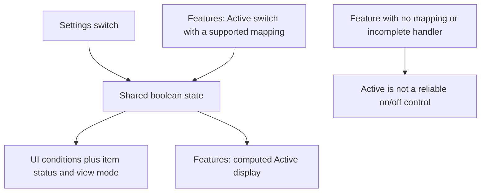

# Settings and feature toggles

[Documentation home](README.md) · [Personas](personas.md) · [User flows](user-flows.md)

Reviewed against `b6be833`. Values below are **code initializers**, not a reading of a live user's selected configuration. All [flows](user-flows.md) select [E1: all exposed capability settings ON](feature-list.md#e1--canonical-all-features-enabled-configuration). This reference separately records actual initial values and alternative OFF behavior for accuracy.

## Where controls live

| Control surface | How to find it | What it changes |
| --- | --- | --- |
| **Settings** | Gear in the bottom footer; expand the relevant section | Feature visibility and selected workflow behavior |
| **Internal View** | Footer switch | `isInternalTeamView`; internal review controls and detail visibility |
| **IA Layout** | Footer dropdown | Navigation arrangement: Current Layout, Version 1, Version 2, Version 3 |
| **Features / Active** | Footer **Product Requirements** → **Features** → table **Active** column | Usually the same boolean as Settings; not an independent flag |
| **Feature groups** | Settings → Quick Toggles → **Select Feature Groups...** | Sets a particular group of booleans together |
| **View filters** | Inside a page, e.g. **Pivot by Status** in Jobs | Local presentation state, not a product feature flag |

Enable **Show deactivated** in Product Requirements when searching for a feature whose setting is OFF. If Active or Associated Toggle columns are hidden, enable them with the column selector. Feature IDs below refer to the seeded `INITIAL_FEATURES`; authenticated Firestore feature records can differ.

## How Settings and Features relate

There is generally **one shared boolean**, exposed through two controls. Selecting Support Tickets ON in Settings also makes F25/F38/F53 appear active. Changing a supported Active switch writes that same boolean. You do not need to enable two independent flags.

[Open rendered SVG](diagrams/settings-and-features.svg).

Text equivalent: supported Settings and Features controls share state. UI availability additionally depends on the selected view and the item's state. Some feature rows cannot be switched effectively; use Settings and the exceptions below.

**Feature notation:** `F25/F38/F53` means those rows share the same state. **None** means there is no associated seeded feature row, not that a second flag must be created. A feature with `toggle: null` is reported active by `getToggleStatus` and its Active click does nothing.

## View configuration

| Exact control / state | Initial value | Selection and dependency |
| --- | --- | --- |
| **Internal View** / `isInternalTeamView` | OFF | ON for internal review actions and registry access; OFF for author draft actions and final publication. Associated feature **F36**. This is UI state, not an authorization check. |
| **IA Layout** / `iaLayout` | Current Layout (`current`) | All documented flows select Current Layout to make navigation reproducible. Other layouts move or split Data & Artifacts. |
| `isReviewerView` | `false` | Separate from Internal View. Changes navigation to Artifacts / Support Requests, hides catalog and registry tabs, and permits the dashboard when enabled. No direct toggle is rendered in the inspected app; only its initializer and saved-configuration loader set it. Do not instruct users to find a “Reviewer View” Settings switch. |
| **Reviewer Dashboard** / `showReviewerDashboard` | ON | Settings → Support & Integration. Dashboard requires BOTH this boolean and `isReviewerView=true`. No associated seeded feature row. |

## Support & Integration

These switches are in **Settings → Support & Integration**. “Auto-save” means included in the authenticated `settings/global` read/write handlers, not a guarantee that a write succeeds.

| Exact label | State key | Initial | Associated feature rows | Actual effect / dependency | Auto-save |
| --- | --- | --- | --- | --- | --- |
| Support Tickets | `showSupportTickets` | ON | F25 Human Support; F38 Support Tickets Toggle; F53 Support Requests | Ticket tabs and related escalation/retry actions; some actions also depend on job status or Internal View | No |
| Support Performance | `showSupportPerformance` | ON | F39 Support Performance Toggle; F54 Support Performance | Performance navigation/metrics; placement depends on IA Layout | No |
| Jira Integration | `showJiraIntegration` | ON | F40 Jira Integration Toggle; F55 Jira Integration | Internal Jira links and sync UI; does not make the simulated connector real | No |
| Automated Change Log | `showAutomatedChangeLog` | ON | F41 Automated Change Log Toggle | Additional change-log content; History is still a separate tab | No |
| Reviewer Dashboard | `showReviewerDashboard` | ON | None | Requires `isReviewerView=true`; Internal View ON alone is insufficient | Yes |
| Readiness Analysis & Score | `showReadinessAnalysis` | ON | F57 Readiness Gate; F58 Guided Solutions AI Chat | Analysis step and readiness entry for unbuilt user-generated, non-approved pipelines. OFF selects a direct build-confirmation route instead; build confirmation remains required for submission | Yes |

### Readiness sub-settings

Shown beneath **Readiness Analysis & Score** when it is ON. None has a separate seeded feature-row toggle, and none is included in automatic global settings persistence or named configuration save/load.

| Exact label | State key | Initial | Verified scope and limitations |
| --- | --- | --- | --- |
| Documentation Links | `showDocLinks` | ON | Wizard shows Learn More only when the issue has `doc_link`. Not passed into the details resolution component. |
| Code Snippet Suggestions | `showCodeSnippets` | ON | Wizard checks `issue.code_fix`, but mock analysis supplies `suggested_fix`; ON does not guarantee a visible suggested-fix button. Not passed into the details component. |
| Acknowledge & Override | `showOverride` | ON | Setter exists, but there is no read of this flag gating the override UI. Details component handles acknowledgment independently. OFF is not an enforced disable. |
| Resource Profiling | `showResourceProfiling` | OFF | Shows the mock resource profile in the wizard when data exists. |
| Compatibility Matrix | `showCompatibilityMatrix` | OFF | Shows the wizard matrix when corresponding data exists. |
| Positive Reinforcement | `showPassedChecks` | ON | Lists wizard passed checks when provided. |
| Quality Gates | `useQualityGates` | OFF | At wizard analysis → next: ON blocks unacknowledged critical issues, score below 50, or unanswered blocking inputs. OFF warns and permits progress. Does not govern the details resolution component. |

## Infrastructure & Registry

Located in **Settings → Infrastructure & Registry**.

| Exact label | State key | Initial | Associated feature rows | Actual effect / dependency | Auto-save |
| --- | --- | --- | --- | --- | --- |
| Container-based Pipelines | `showContainerPipelines` | ON | F44 Container-based Pipelines Toggle | Container fields in creation. This Settings switch also sets Container Registry to the same value; the Features Active handler changes only this flag | No |
| Container Registry | `showContainerRegistry` | ON | F31 Image Inventory; F34 Tag Comparison Tool; F35 Image Details Modal; F45 Container Registry Toggle | Registry tab requires **Internal View ON** AND `isReviewerView=false` | No |
| Vulnerability Heatmap | `showVulnerabilityHeatmap` | ON | F32 Vulnerability Heatmap | Summary indicators in the registry; requires registry access | No |
| Vulnerability Scan | `showVulnerabilityScan` | OFF | F48 Vulnerability Scan Toggle | Detailed image scan display; no live scanning service verified | No |
| Orphaned Image Detection | `showOrphanedDetection` | ON | F33 Orphaned Image Detection | Flags images without a pipeline association; does not delete them | No |
| Error Clustering | `showErrorClustering` | ON | F22 Error Clustering; F49 Error Clustering Toggle | Cluster indicators; banner also requires an infrastructure-wide cluster and an undismissed banner | Yes |

## Architecture & Visualization

Located in **Settings → Architecture & Visualization**.

| Exact label | State key | Initial | Associated feature rows | Actual effect / dependency | Auto-save |
| --- | --- | --- | --- | --- | --- |
| Architecture Diff Tool | `showArchitectureDiff` | ON | F46 Architecture Diff Tool Toggle | Architecture tab requires a built container, a non-user-generated pipeline, or Approved status | No |
| Advanced Architecture | `showAdvancedArchitecture` | OFF | F47 Advanced Architecture Toggle | Richer architecture/lineage view where available; does not perform real dependency discovery | No |

## Pipeline Workflow

Located in **Settings → Pipeline Workflow**.

| Exact label | State key | Initial | Associated feature rows | Actual effect / dependency | Auto-save |
| --- | --- | --- | --- | --- | --- |
| Pipeline Sidebar Details | `showPipelineSidebarDetails` | ON | F42 Pipeline Sidebar Details Toggle | Input/output sections and optional wizard step. Details sections also require a built container, non-user-generated pipeline, or Approved status | Yes |
| Pipeline Type Dropdown | `showPipelineTypeDropdown` | ON | F43 Pipeline Type Dropdown Toggle | Type selector in creation wizard; use Settings because the Features click handler omits this key | Yes |
| Draft Status for Updates | `showDraftUpdates` | ON | F50 Draft Status for Updates Toggle | Draft-saving controls plus external draft Edit / Submit for Review actions; use Settings because the Features handler omits this key | Yes |
| Dry Run Simulations | `showDryRunUpdates` | ON | F51 Dry Run Simulations Toggle | External Draft testing; built-container condition and build-in-progress disabling also apply | Yes |
| Dry Run Log Feature | `isFeatureDryRunLogEnabled` | ON | F52 Dry Run Log Feature Toggle; F56 Dry Run Log | Dry-run history display; logs also require a run | No |

## Feature groups: exact selection semantics

These are multi-select checkbox groups, not exclusive, complete environment presets. A group appears checked only when all its members are ON. Checking or unchecking it sets only its listed members; unrelated state is left unchanged.

| Group checkbox | Members set together |
| --- | --- |
| Baseline | Support Tickets; Support Performance; Jira Integration; Automated Change Log |
| Container | Container-based Pipelines; Container Registry; Vulnerability Heatmap; Orphaned Image Detection; Vulnerability Scan; Advanced Architecture; Architecture Diff Tool |
| Dry-run | Draft Status for Updates; Dry Run Simulations; Dry Run Log Feature |
| Pipeline Creation | Pipeline Sidebar Details; Pipeline Type Dropdown |

**No group selects Internal View, `isReviewerView`, Readiness Analysis & Score, Quality Gates, readiness sub-settings, or Error Clustering.** Choose these explicitly. The Container group is initially unchecked because Vulnerability Scan and Advanced Architecture start OFF, even though most other members start ON.

**All ON / All OFF are partial shortcuts.** All ON changes the listed main feature settings but does not enable Vulnerability Scan, Error Clustering, Internal View, reviewer mode, or readiness sub-settings. All OFF also disables Error Clustering, but leaves Vulnerability Scan, view modes, and readiness sub-settings untouched. Always check the flow's required values after using a shortcut.

## Exceptions and behavior to check

1. **F57/F58 Active is misleading.** Both associate with `showReadinessAnalysis`, but `getToggleStatus` and the Features Active handler omit that key. The rows can appear active even when Settings disables readiness, and clicking them does not fix it. Use **Settings → Readiness Analysis & Score**. **F59 Readiness Feature Toggle** has `toggle: null` and is descriptive only.
2. **F43 and F50 cannot be changed through Active.** Their status lookup exists, but the click handler omits their setters. Use Settings. Other rows with no associated toggle also cannot disable their feature through Active.
3. **Settings and Active can have different side effects.** The Container-based Pipelines Settings switch also sets Container Registry; F44 Active does not. Error Clustering's Settings ON resets the dismissed-banner state; its Active switch does not.
4. **Readiness has different rules in two views.** Wizard Quality Gates can block progress at score <50 or with unresolved critical issues/inputs. The details component labels BLOCKED when active critical issues or blocking decisions remain, but shows **Build Image** when score ≥70 **OR** state is READY. A high score can therefore expose Build Image while BLOCKED.
5. **Acknowledgment is not resolution.** In the details component it requires a comment and increases displayed score, but does not remove a critical issue from the blocking count. `showOverride` does not gate this component.
6. **Quality Gates ON can stall the seeded wizard.** Its mock analysis contains critical issues and blocking inputs, while decisions/actions/overrides are hidden in the wizard. Do not promise an in-wizard fix path or a successful strict-gate walkthrough.
7. **Build confirmation is a UI state change.** Confirm & Start Build immediately sets `isContainerBuilt=true`, returns to Draft, and adds a local container marked Building. It does not verify image creation. Dry-run is disabled while the matching container is Building; no completion worker is implemented in the inspected path.
8. **Reviewer mode has no direct switch.** `isReviewerView` defaults false; the saved configuration loader can restore it if a stored configuration already includes it. Internal View does not set it. Do not assume the dashboard is reachable merely by enabling its Settings flag.

Sources: [`getToggleStatus`](../src/App.tsx#L4462), [Features Active handler](../src/App.tsx#L11838), [Settings modal](../src/App.tsx#L19030), [wizard gate](../src/App.tsx#L18060), [details readiness rules](../src/components/ReadinessResolutionSystem.tsx#L300).

## Saved settings and configurations

Automatic authenticated `settings/global` synchronization includes visible table columns and these flags only: `showPipelineSidebarDetails`, `showPipelineTypeDropdown`, `showDraftUpdates`, `showDryRunUpdates`, `showReviewerDashboard`, `showReadinessAnalysis`, `showErrorClustering`.

Named **Save / Load Configuration** stores feature effort/need scores and many main toggles, including Internal View and `isReviewerView`. It **omits** `showReadinessAnalysis`, all readiness sub-settings including Quality Gates, IA Layout, and local page filters such as Pivot by Status. Loading a named configuration does not fully reproduce a flow. Recheck the omitted settings explicitly. The documents' selected configurations are instructions, not saved database records.

Sources: [save/load handlers](../src/App.tsx#L2319), [global settings listener](../src/App.tsx#L4246), [global settings writer](../src/App.tsx#L4312).
