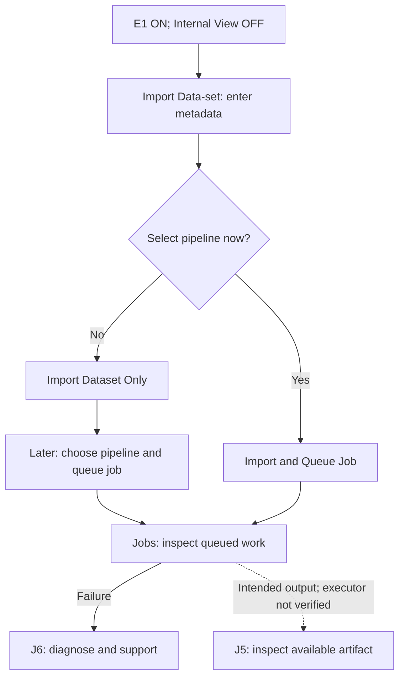
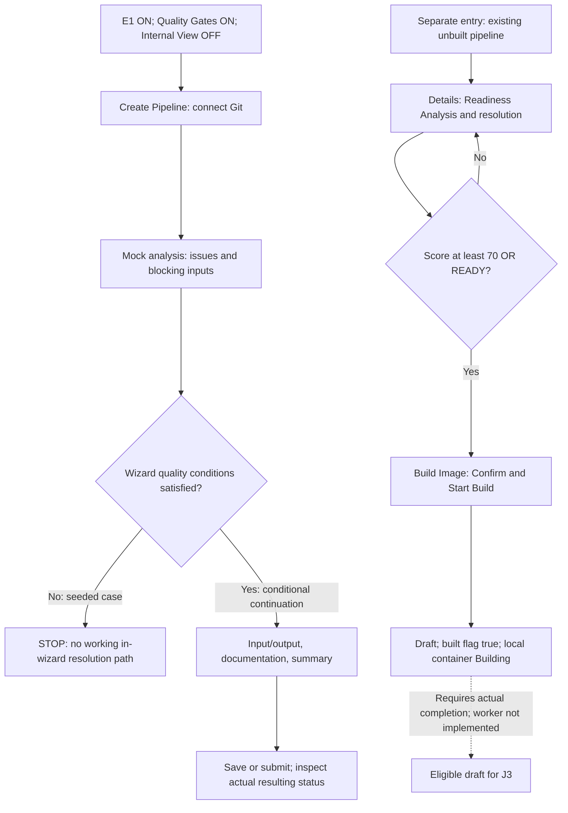
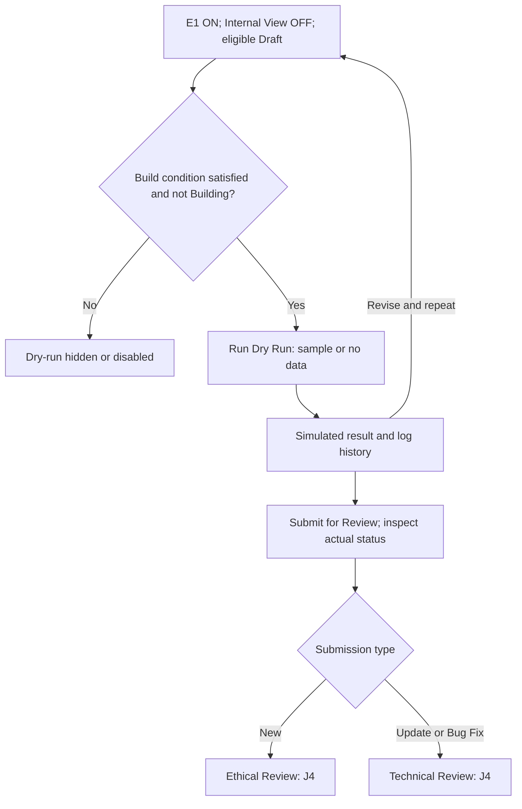
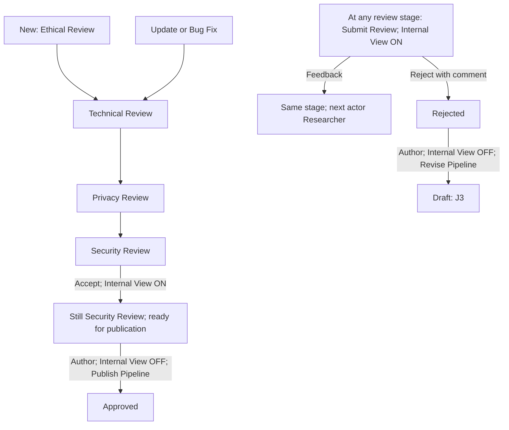
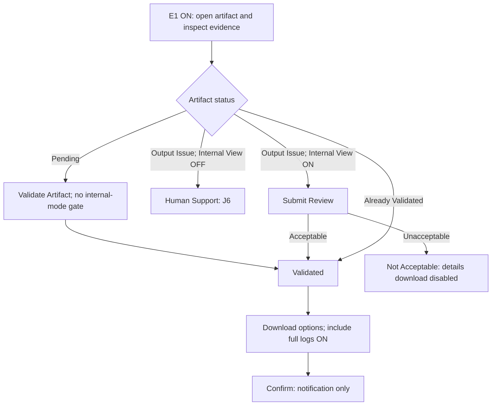
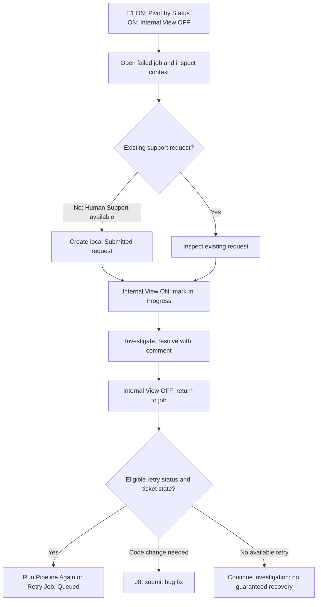
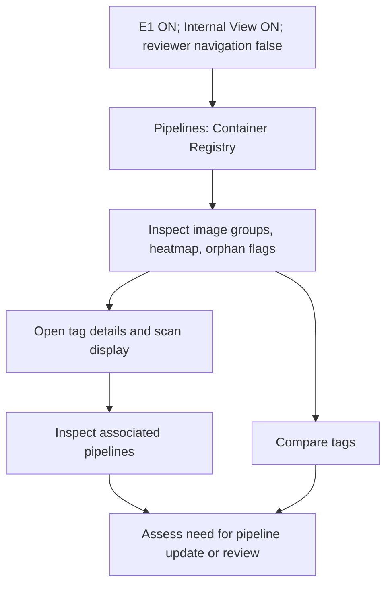
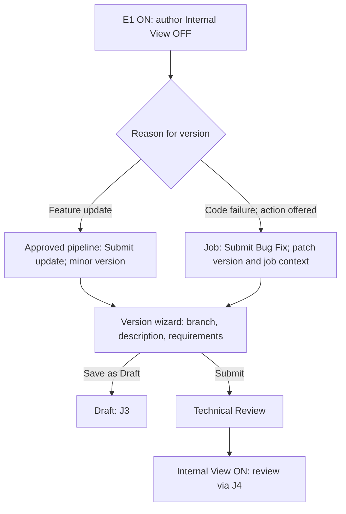

# User flows and diagrams — all features enabled

[Documentation home](README.md) · [Personas](personas.md) · [All-features list and E1 configuration](feature-list.md) · [Settings reference](settings-and-feature-toggles.md)

Every flow uses **E1: all exposed capability settings ON**, including Quality Gates, vulnerability detail, advanced architecture, and all readiness sub-settings. Core features with no toggle remain available. We do not switch features OFF to make a flow appear successful. **Internal View changes with the actor**, because author and reviewer controls are mutually conditional UI modes. All walkthroughs use **IA Layout = Current Layout** and `isReviewerView=false`; this state has no direct UI toggle.

These are source-derived workflows. Solid arrows describe implemented UI transitions or decisions. Dotted arrows identify intended outcomes that are not supplied by a verified execution backend. Each diagram has a text equivalent in its numbered steps. Journey IDs **J1–J8** are separate from the repository's feature IDs **F1–F59**.

## Flow index and selected configuration

| Journey | Primary personas | Capability settings / feature selection | Actor view and additional condition |
| --- | --- | --- | --- |
| J1 Import and queue | P1 | E1; core dataset/import/job features F6–F9/F20/F23 have no toggle | Internal View OFF; approved pipeline exists |
| J2 Custom pipeline/readiness | P2/P7 | E1; F14/F15 plus F42–F44/F50/F57/F58, Quality Gates ON | Internal View OFF; strict wizard currently stops at mock findings |
| J3 Dry-run and submit | P2 | E1; F50/F51/F52/F56 ON | Internal View OFF; Draft; built or otherwise eligible; no matching Building container |
| J4 Review and publish | P2/P3/P4/P5/P7 | E1; F19 always available; F36 available; F41/F42/F46/F47 ON | Internal View ON for reviewer, OFF for author |
| J5 Artifact review/export | P1/P4 | E1; F26–F30 always available; F25/F38/F53 ON for escalation | Internal View ON for output-issue review, OFF for requester |
| J6 Failure and support | P1/P2/P6 | E1; F22/F25/F38–F40/F49/F53–F55 ON | Internal View OFF for requester, ON for triage; Pivot by Status selected ON |
| J7 Container inspection | P5 | E1; F31–F35/F44/F45/F48 ON | Internal View ON; reviewer navigation false |
| J8 Update/bug fix | P2/P3 | E1; F18/F19 always available; F41/F42/F46/F47/F50–F52 ON | Internal View OFF for author, ON for reviewer |

**Before starting:** open the footer Settings gear, apply [E1](feature-list.md#e1--canonical-all-features-enabled-configuration), then verify the actor view. The Features Active column mirrors only supported settings; it cannot reliably set F43, F50, F57, or F58. Use Settings for those. These selections describe the docs; no running app or saved database configuration was modified.

## J1 Import data and queue an approved pipeline

**Objective / pain / gain:** P1 wants to start processing without creating a pipeline. The flow addresses dependence on specialists and unclear progress, aiming for self-service and traceable job context.

**Selected settings:** E1, Internal View **OFF**, IA Layout **Current Layout**, `isReviewerView=false`. Import/run core features have no extra feature switch. The import form’s **Secure Vault** choice is an item/form choice, not a global capability flag.

1. Open **Data & Artifacts → Source Data-sets** and choose **Import Data-set**.
2. Enter the available dataset metadata, including name/type and the secure-vault choice. The import handler registers metadata; it is not a verified file-ingestion service.
3. Optionally select a pipeline in the wizard. Choose **Import Dataset Only** or **Import & Queue Job**, according to that selection.
4. For an existing dataset, use its run action to select an approved pipeline. Alternatively open **Pipelines → Approved Catalog → pipeline details → Configure Run**, select dataset(s), and start the run.
5. Inspect the resulting job in **Jobs → All Jobs**. Open its details for pipeline, dataset, version, and execution context.
6. Use J6 on failure; use J5 to inspect available artifacts. A real executor generating a new artifact from this job is not established by this repo.

[Open rendered SVG](diagrams/j1.svg).

**Observed boundaries:** import metadata uses placeholder size; the dataset-run path queues a record. The pipeline-details run path simulates Queued → Running → Completed with timers. Those are different implementations; neither proves actual processing or new artifact creation. Source: [`handleImportSubmit`](../src/App.tsx#L5786), [`submitPipelineJob`](../src/App.tsx#L5760), [`submitPipelineRunJobs`](../src/App.tsx#L5594).

## J2 Create a custom pipeline and confirm a build

**Objective / pain / gain:** P2 wants a custom algorithm to become usable; P7 wants blockers and exceptions explained. Earlier feedback is intended to reduce environment-related rework.

**Selected settings:** E1, **Quality Gates ON**, Internal View **OFF**. Readiness, type selector, container fields, input/output step, draft actions, documentation, snippets, override, resource profile, matrix, and passed checks are all selected ON. See the [feature list](feature-list.md) for F14/F15/F42–F44/F50/F57/F58. “Enabled” does not repair missing wiring.

1. Open **Pipelines → Create Pipeline**. Enter repository URL and branch/tag; select the available type/base image/entrypoint fields.
2. Continue to **Readiness Analysis**. The code returns a fixed mock assessment, not a scan of the supplied repository.
3. Inspect issues, passed checks, resource estimates, and compatibility data where supplied. Snippet display checks a different field name from the supplied mock fix, so it may not appear despite being enabled.
4. Select Next. **With E1's Quality Gates ON, the seeded mock's critical issues/blocking inputs prevent progression.** The wizard hides the decisions/actions/override controls required to clear those findings. This is the current stopping point; the all-enabled new-pipeline wizard is not a complete successful walkthrough.
5. Intended continuation after a working resolution path: define input/output requirements, documentation, and summary; save a draft or submit. The creation handler's status formula can still yield Draft (e.g. analysis score ≥70), so a “Submit” notification is not proof of entry into review.
6. A **separate, existing unbuilt user-generated pipeline** can be opened from **New Pipelines → details → Readiness Analysis**. The details resolution system provides Issues, Decisions, Actions, architecture editing, acknowledgment with a mandatory justification, and Guided Solutions preview chat.
7. In that details view, **Build Image** appears when displayed score ≥70 **OR** state is READY, even if critical issues still make the state BLOCKED. It opens build confirmation; **Confirm & Start Build** immediately marks the pipeline built in UI state, sets Draft, and adds a local container marked Building.
8. Return to J3 only when an eligible Draft with a non-Building container exists. There is no verified build worker completing that local Building state.

[Open rendered SVG](diagrams/j2.svg).

**Important differences:** acknowledging a critical issue increases displayed score but does not clear BLOCKED in the details component. Quality Gates does not govern that component. Readiness sub-settings are not passed to it; Acknowledge & Override OFF would not hide its override UI. Guided chat explicitly uses a preview response. Source: [mock analysis](../src/App.tsx#L4988), [wizard gate](../src/App.tsx#L18060), [creation status](../src/App.tsx#L5455), [details rules](../src/components/ReadinessResolutionSystem.tsx#L300), [build confirmation](../src/App.tsx#L16534).

## J3 Dry-run and submit a draft

**Objective / pain / gain:** P2 wants feedback before formal review, aiming to reduce failed submissions and make test history inspectable.

**Selected settings:** E1; **Draft Status for Updates ON**, **Dry Run Simulations ON**, **Dry Run Log Feature ON** (F50/F51/F52/F56). Internal View **OFF**. Quality Gates remains ON; it is not a dry-run execution gate.

**Precondition:** use an existing Draft whose build condition is satisfied and whose matching container is not Building. Merely confirming a new build in J2 is insufficient for a runnable dry-run demonstration.

1. Open the Draft from **Pipelines → New Pipelines** or **Updates**.
2. Use **Edit Draft** if changes are needed. Select **Run Dry Run**, choose the offered sample or no-data option, and run.
3. Inspect the displayed progress and result. Open dry-run history/results where available; revise and repeat if necessary.
4. Select **Submit for Review**. User-generated, non-approved pipelines without the built flag are rejected by the submit handler.
5. A New submission enters **Ethical Review**; an Update/Bug Fix enters **Technical Review**. Continue with J4.

[Open rendered SVG](diagrams/j3.svg).

**Observed boundaries:** dry-run stages are timers with a random failure branch; they do not clone code or execute it. A successful dry run is not checked by `handleSubmitPipeline`; do not portray it as a mandatory enforced prerequisite. Source: [`handleDryRun`](../src/App.tsx#L5179), [`handleSubmitPipeline`](../src/App.tsx#L5322), [draft footer conditions](../src/App.tsx#L17348).

## J4 Review, revise, and publish a pipeline

**Objective / pain / gain:** P3/P4/P5 assess suitability, while P2/P7 need clear next actions. The intended gain is a predictable review handoff rather than opaque waiting.

**Selected settings:** E1. Internal View **ON** for internal reviewers; **OFF** for author revision and publication. Automated Change Log, input/output details, architecture diff, and advanced architecture remain ON. Reviewer Dashboard remains ON, but no dashboard is assumed reachable while `isReviewerView=false`.

1. Reviewer: open **Pipelines → New Pipelines** or **Updates**; inspect the submission's actual status and available details. New submissions can include Ethical Review; updates normally begin at Technical Review.
2. With Internal View ON, select **Submit Review** and choose acceptance, feedback, or rejection. Rejection requires comments in the modal.
3. Acceptance advances **Ethical → Technical → Privacy → Security Review**. Accepting Security Review does **not** set Approved: status remains Security Review, progress says ready for final publication, and the next actor becomes Researcher.
4. Feedback keeps the current review stage and sets the next actor to Researcher. It is not rejection. The current UI records this handoff but does not implement a complete, separate author-response protocol.
5. Rejection sets Rejected. Author switches Internal View OFF, reads feedback, selects **Revise Pipeline**, and returns the pipeline to Draft. Use J3 to resubmit when eligible.
6. After Security Review acceptance, author switches Internal View OFF and selects **Publish Pipeline**. This sets Approved in local UI state. Configure Run is then available from its details.

[Open rendered SVG](diagrams/j4.svg).

The acceptance arrows assume an internal acceptance at each stage with E1 enabled. The feedback branch deliberately does not invent a resubmission transition. These are UI workflow roles, not independently enforced reviewer permissions. Many review/publication handlers update local state only. Source: [`handleReviewSubmit`](../src/App.tsx#L5394), [publish/review controls](../src/App.tsx#L17324).

## J5 Inspect, validate, or review an artifact

**Objective / pain / gain:** P1/P4 need to judge output usability, not assume completion means acceptance. The intended gain is clearer quality/privacy decisions before export.

**Selected settings:** E1. Artifact inventory/preview/PHI highlighting/export (F26–F30) have no independent flag. Support Tickets and Jira remain ON. Requester uses Internal View **OFF**; reviewer uses **ON** for an Output Issue.

1. Open **Data & Artifacts → Derived Artifacts**, filter as needed, and open an artifact. Inspect supplied metrics, preview, and PHI warning where present.
2. If Pending, **Validate Artifact** sets Validated. This action currently has no Internal View requirement; do not describe it as reviewer-only.
3. If Output Issue: the external user sees **Human Support**. An internal user sees **Submit Review** and can select an acceptable or unacceptable outcome.
4. Acceptable sets Validated; unacceptable sets Not Acceptable. The current handler clears the comments input without saving those review comments on the artifact.
5. Download is disabled in details for Pending, Output Issue, and Not Acceptable. When eligible, choose **Download**, select format and **Include full process logs** (selected **ON** for this walkthrough), then confirm.

[Open rendered SVG](diagrams/j5.svg).

**Observed boundaries:** PHI metrics and previews are supplied data, not proof of a running PHI detector. Confirmation does not download a generated file. “Use in Experiment” is a visible placeholder without an action handler in the inspected path. Source: [artifact handlers](../src/App.tsx#L5682), [artifact footer](../src/App.tsx#L18302), [`confirmDownload`](../src/App.tsx#L5583).

## J6 Diagnose a failure and coordinate support

**Objective / pain / gain:** P1/P2 need a next step after failure; P6 needs actionable context. The flow aims to reduce duplicate investigations and make resolution visible.

**Selected settings:** E1: Support Tickets, Support Performance, Jira Integration, and Error Clustering all **ON** (F22/F25/F38–F40/F49/F53–F55). Local **Pivot by Status ON** for the requester; it is a view control, not another capability switch. Internal View **OFF → ON → OFF** across requester, operator, and retry steps.

1. Requester opens **Jobs → All Jobs**, filters to the failure, and opens details. Inspect code/data/system categorization and any clustering indication. A cluster banner appears only when matching infrastructure-wide failures exist and it has not been dismissed.
2. Use **Human Support** when offered. A new local request is categorized and marked Submitted; requesting again for the same item opens the existing-ticket path instead of creating another request.
3. Operator switches Internal View ON and opens **Jobs → Support Requests**. Mark a Submitted request **In Progress**, investigate, and use **Mark as Resolved** with a resolution comment. The latter action is not itself gated by Internal View in the row rendering.
4. With Internal View ON, Jira links/sync are visible where supplied. Their creation and synchronization are simulations, not messages sent to a verified Jira service.
5. Requester returns to job details. Retry availability depends on status and ticket state: **Run Pipeline Again** appears for Failed/Code Error/Data Error with a resolved request; **Retry Job** appears for Failed/Data Error without a resolved request. System Error is not included in these footer retry conditions. Use J8 for a code fix when appropriate.
6. Retry sets the job back to Queued in local state; verify real recovery separately when an executor exists.

[Open rendered SVG](diagrams/j6.svg).

**Observed boundaries:** support requests and many status transitions are local state. Jira sync randomly resolves selected open tickets after a delay. Support Performance does not establish measured production support outcomes. Source: [support request handler](../src/App.tsx#L4773), [resolution handler](../src/App.tsx#L5350), [support row actions](../src/App.tsx#L13008), [retry conditions](../src/App.tsx#L18826).

## J7 Inspect container risk and usage

**Objective / pain / gain:** P5 wants to identify a concerning image/version and the pipelines associated with it. The intended gain is faster prioritization with usage context.

**Selected settings:** E1; Container-based Pipelines, Container Registry, Vulnerability Heatmap, Vulnerability Scan, and Orphaned Image Detection **ON** (F31–F35/F44/F45/F48). Internal View **ON**, IA Layout **Current Layout**, `isReviewerView=false`.

1. Open **Pipelines → Container Registry**. If absent, check the exact view conditions: registry flag ON, Internal View ON, reviewer navigation false. Enabling Reviewer Dashboard does not expose it.
2. Inspect image groups, displayed vulnerability severities, and orphan badges.
3. Open an image/tag for metadata, layers, and detailed scan display; inspect **Associated Pipelines** for usage context.
4. Use tag comparison to inspect differences in displayed metadata/security counts. Follow associated pipelines into review/update work where needed.
5. Treat orphan detection as an investigation signal. No automated deletion or verified remediation is implied by this flow.

[Open rendered SVG](diagrams/j7.svg).

**Observed boundaries:** registry contents are `mockContainers`. Turning Vulnerability Scan ON reveals supplied detail; it does not start a real scan, establish freshness, or enforce remediation. Source: [registry access condition](../src/App.tsx#L13131), [container seed state](../src/App.tsx#L1373).

## J8 Submit an update or bug fix

**Objective / pain / gain:** P2/P3 want traceable iteration without losing the context of the approved pipeline or failed job.

**Selected settings:** E1; versioning and feedback core capabilities F18/F19 are available, draft/dry-run/log and review-detail features remain ON. Internal View **OFF** for author steps; **ON** for review. Quality Gates stays ON, but the version-submission handler does not apply the new-pipeline wizard's Quality Gates.

1. For an update, open an approved user-generated pipeline and choose **Submit update**; the internal equivalent is **Upload New Version**. For a code failure, use the job's **Submit Bug Fix** when offered by its state-dependent UI.
2. Inspect the suggested version, description, Git branch/tag, documentation, and available input/output fields. Update suggests a minor bump; bug fix suggests a patch bump and carries job context when supplied.
3. **Save as Draft** creates/updates a Draft; use J3 for testing and later submission. Direct **Submit** creates/updates the submission in Technical Review.
4. Find it in **Pipelines → Updates**, inspect grouped versions and change context, and continue with J4. Updates/Bug Fixes begin at Technical Review, not Ethical Review.

[Open rendered SVG](diagrams/j8.svg).

**Observed boundaries:** new version objects inherit fields from the selected pipeline. Handler updates are local; a version entry is not proof of a Git commit, image rebuild, or persisted review submission. Source: [`handleSubmitNewVersion`](../src/App.tsx#L5104), [author update entry](../src/App.tsx#L16988), [internal update entry](../src/App.tsx#L17174).

## Walkthrough checks

For each journey, check that E1's capability switches remain ON, the current actor view matches the instructions, and the item has the required status/data. Record the resulting status rather than trusting a success notification. Use the J2 stop and J3 build precondition as documented implementation limits, not as reasons to silently disable a feature. Verify backend effects separately before using these flows as production acceptance criteria.
